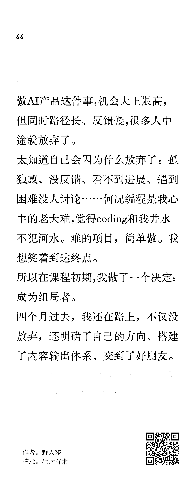

# 越会召集人的人，越容易先成长起来

> 原文：[`www.yuque.com/for_lazy/zhoubao/ny8r2w12nzfaoiw2`](https://www.yuque.com/for_lazy/zhoubao/ny8r2w12nzfaoiw2)

## 越会召集人的人，越容易先成长起来

作者：木木@生财有术

日期：2025-10-11

大家好，我是子安，现负责线下活动方面的运营工作。

刚刚过去的国庆，各地圈子里的朋友自发办了五十多场线下见面，热闹程度超乎想象。观察下来，有个规律挺明显：进步最迅速的，往往都是那个牵头把局搭起来的人。正像有位同学在复盘时说的那样：

“我很清楚，搞 AI 产品周期长、反馈慢，单打独斗很容易坚持不下去。所以我选择自己当召集人，给自己造一个必须坚持的环境。”

想让到场的人不白来，牵头的人就得提前大量做功课、去研究。这一来一回，思考的深度和投入的程度自然就超过了旁观者，甚至成了全场收获最多的人。而且还能带来一个意想不到的转变：

听完这些，有没有一点被点燃，又有点打退堂鼓？完全能理解，从念头到行动之间，总是隔着几层顾虑：自己经验不够会不会翻车、现场会不会冷场、流程会不会乱。

这些心结我们都懂，所以专门建了一个「聚会答疑群」，就是为了把你第一次组局的门槛降到最低。进群后你会得到：

1/ 海量的主题灵感和可复制的组局思路
2/ 场地对接支持，以及组局过程中遇到的各种卡点的一对一解答
3/ 海报宣发协助，帮助你把活动信息触达更多感兴趣的人

另外，如果你能在 10 月 15 日前成功落地一场自己的聚会，就有资格参与会员日活动，领取术值并瓜分龙珠。详情可见：别再只当听众了，试着当一次组织者吧，我们群里等你。 [`scys.com/articleDetail/xq_topic/8854548512822252`](https://scys.com/articleDetail/xq_topic/8854548512822252)[`scys.com/meeting`](https://scys.com/meeting)[`t.zsxq.com/dqZUE`](https://t.zsxq.com/dqZUE)

* * *

评论区：

北 : 莎莎的组局超级棒～

bravo : 生财真的是面面俱到，我刚进生财一个多月，期待我的项目能尽快跑通 MVP，然后接着组局

野人莎 : 嘿嘿 明儿继续！

野人莎 : 谢谢子安的推荐！ 说是组局，其实也是喊大家来一起陪我学习。 做项目、学习新事物注定不是轻松的事儿，广结善缘，有一帮朋友共同成长会走得更远。 也推荐给大家！