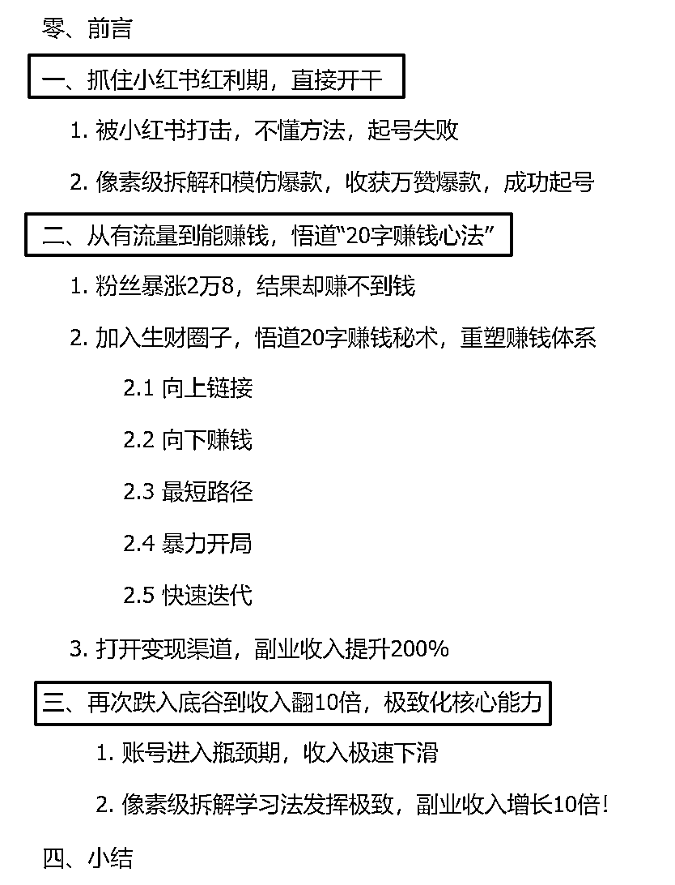
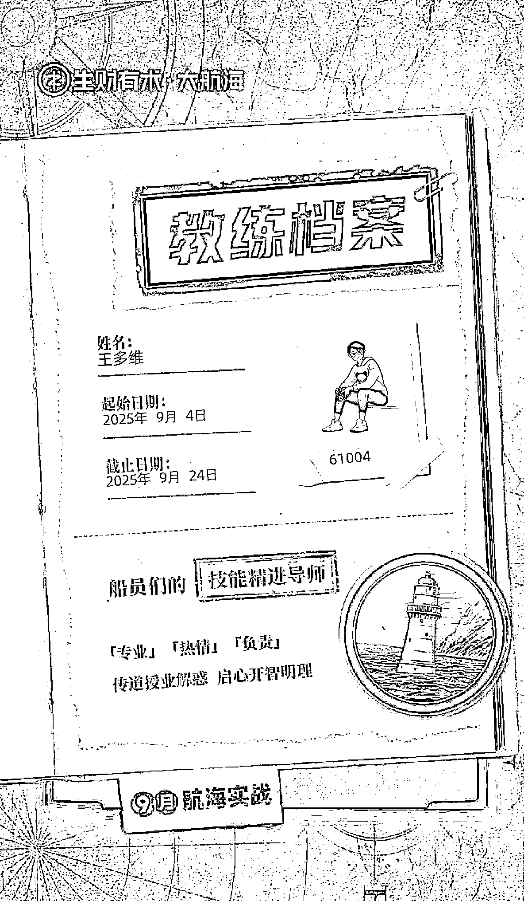
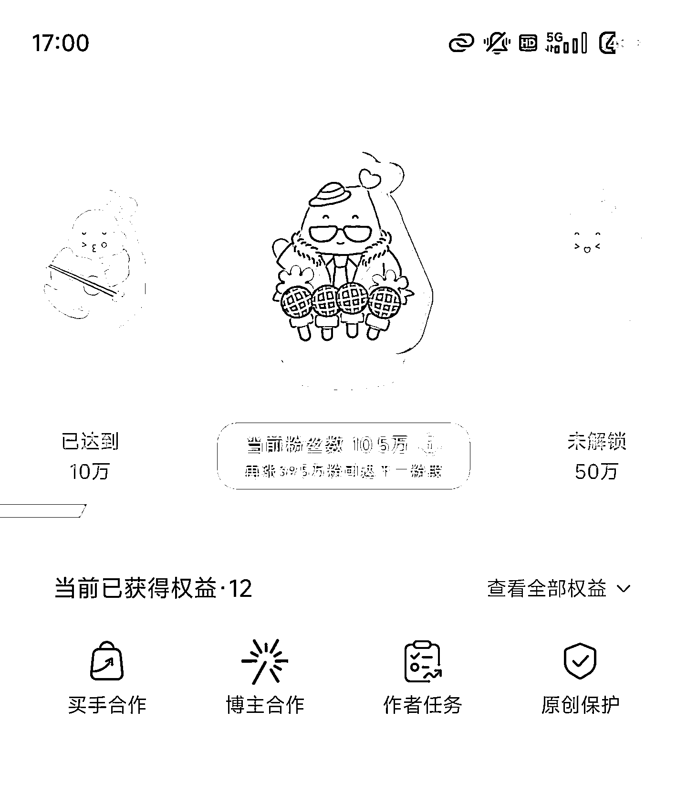
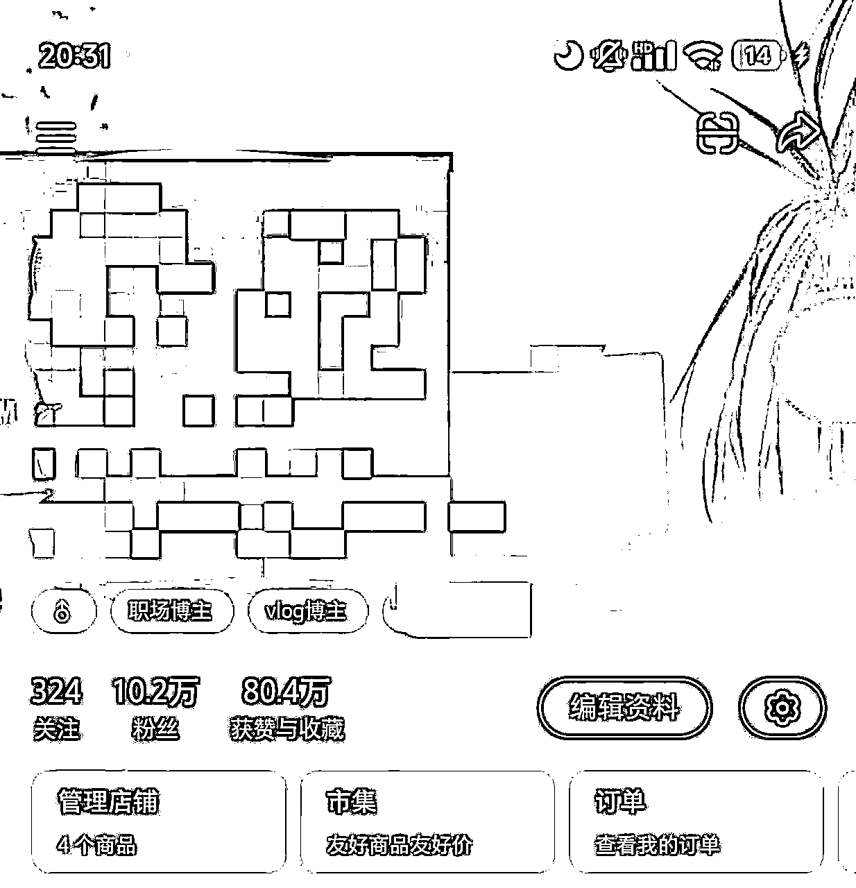
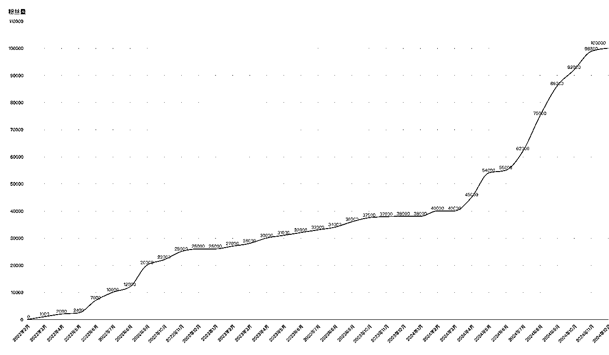
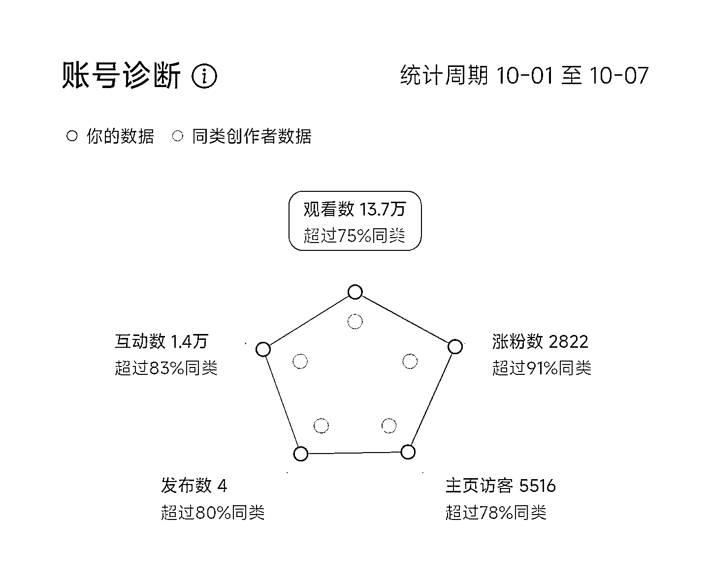

# 一个普通上班族与小红的四年：从零基础做到10万粉，副业终于跑赢主业

在龙哥盟的圈子里，我是龙哥，一名国企的基层员工，同时也是一个专注📕运营与教学的副业者。今年，是我白天上班、晚上做副业的第五个年头，也是我专注深耕📕的第四个年头。如今，副业带来的收入已经渐渐超过了主业，我也终于体会到了“靠热爱吃饭”的感觉。

回想起来，我和📕之间，有过甜蜜，也有过痛苦，说是“爱恨交织”也毫不夸张。今天，借着这个机会，想把自己这些年摸爬滚打出来的经验，完完整整地分享给还在路上的朋友们。

4年时间，从素人账号做到10万粉丝，没有团队，没有资源，靠的就是死磕和复盘。很多圈友问我，普通人到底能不能在📕上赚到钱？我的答案是：能，但前提是你得愿意把时间拉长，把动作做扎实。

---

评论区也收到了不少朋友的鼓励和支持。借此机会，也想感谢那些在赚钱路上给过我帮助的人，比如拱卒、子白、七小、梨云，还有内容组各位老师们的宝贵建议，你们都是我成长路上的贵人。希望我们都能在赚钱这条路上，继续相伴走下去。

有圈友在评论区说，最受触动的是我面对卡点时的解决方式——花钱去找有结果的人付费咨询。这一点我真的非常认同。很多时候困住我们的不是能力，而是信息差。适当借助外力，反而能让你走得更快。博主这条路，拼到最后拼的其实就是坚持，只要你一直留在牌桌上，就永远有机会。