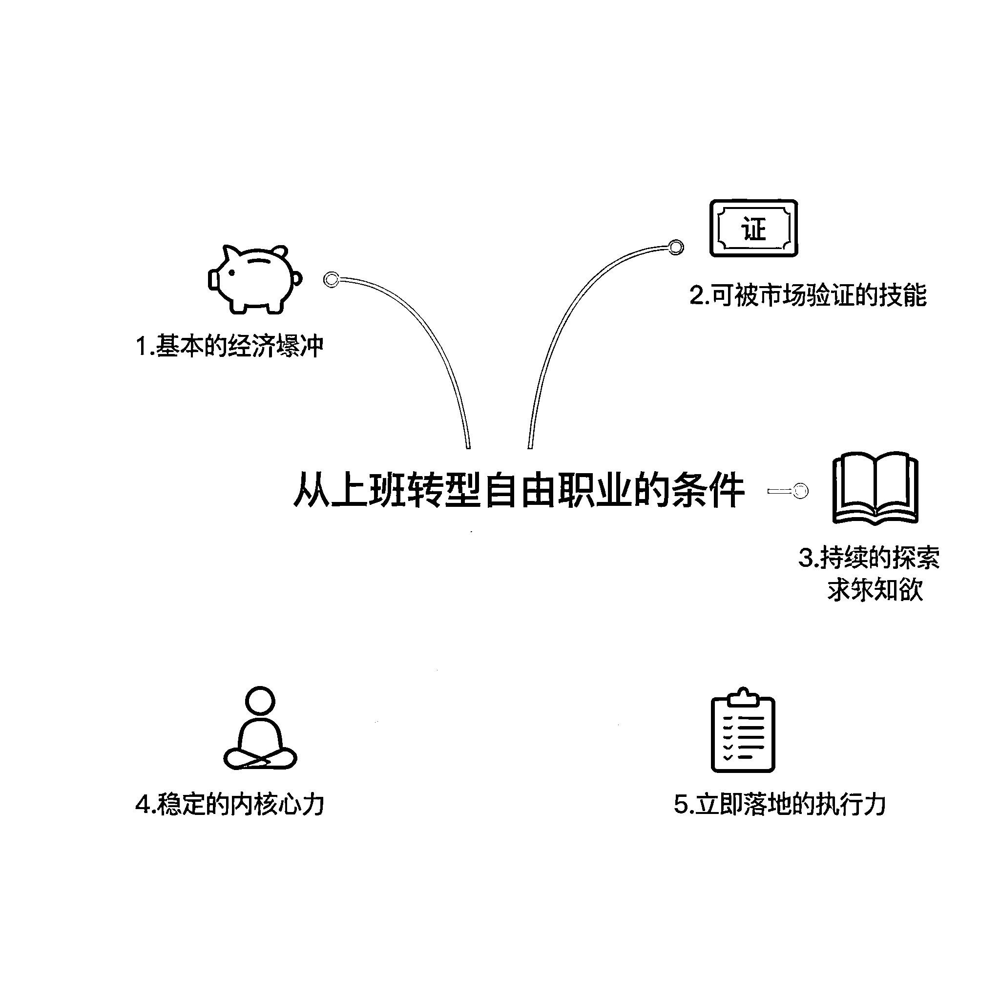
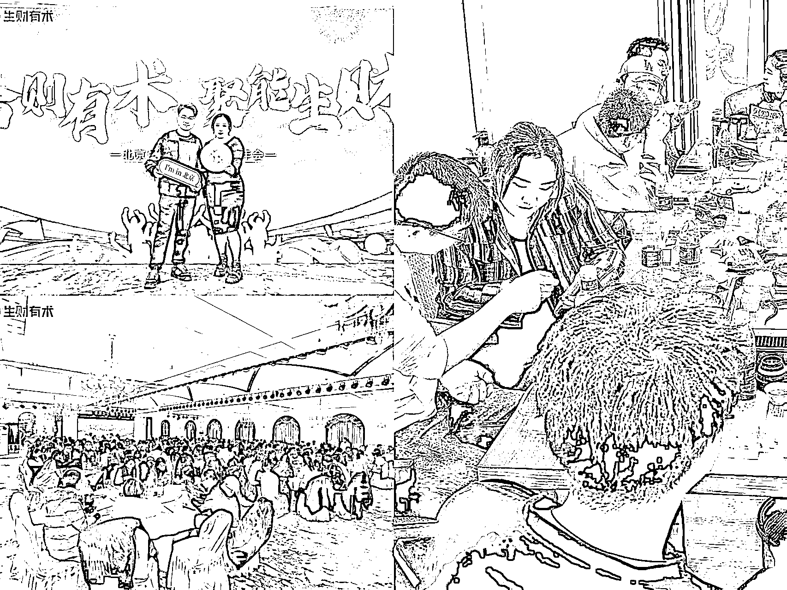

# 离开固定工位安稳过上自由工作生活，这五件事先想清楚

## 离开固定工位安稳过上自由工作生活，这五件事先想清楚

作者： 荷包蛋糕哦哦

日期：2025-10-18

嗨，各位朋友，我是龙哥。一个00后，做文字已经六年了，走自由职业路线三年，现在正在慢慢搭建我自己的“人生躺赢系统”。

是不是你也在繁忙的班次里，偶尔会脑补一把不用打卡、不用看脸色、时间完全由自己说了算的理想状态？

可是一旦真的想放手，内心马上就会冒出不安的声音——“我能做得来吗，会不会搞砸？”

我三年前也卡在同样的纠结里，后来因为赚钱的指引，才完成了从打工人到自由职业者的跨越，收入也实现了十倍的跃升。

* * *

评论区：

吴泽承 : 荷包蛋老师优秀[强][强][强]

泽泽｜李泽楠 : 优秀

小宋 : 太优秀了，00 后

荷包蛋糕哦哦 : 感谢宝子的投喂❤️

L!N/林林/小林 : 哈哈哈 周末被截掉了吗

刘智行 : 向荷包蛋老师学习。

荷包蛋糕哦哦 : 好滴宝 加油哦

刘飞 : 很有感觉[强]