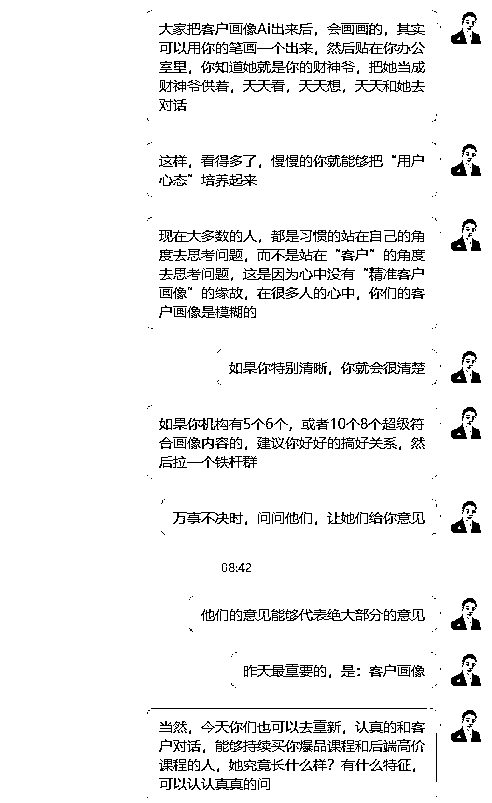
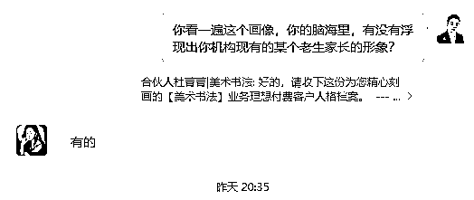
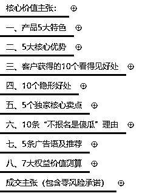
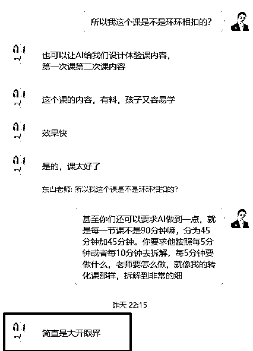

# (精华帖)(195 赞)一人公司想年赚百万，把 5 个 1 挂墙上

> 原文：[`www.yuque.com/for_lazy/zhoubao/imyhpbqpmw5bdtbx`](https://www.yuque.com/for_lazy/zhoubao/imyhpbqpmw5bdtbx)

## (精华帖)(195 赞)一人公司想年赚百万，把 5 个 1 挂墙上

作者： 东山老师

日期：2025-09-28

今天这篇内容，如果你一年已经到了一千多万甚至上亿的体量，可以直接退出了，这篇不适合你；毕竟篇幅很长，约一万六千字左右，读完要花点精力。你一年赚那么多，时间成本高，没必要在这儿耗。

但如果你跟我一样，夫妻两个人一年挣个一百多万就觉得够用，踏实过日子就行，那请认真看完。

另外，还想先把定义对齐一下：

**我讲的一人公司是指：真正靠 1-2 个人，最多再带 1-2 个助手就能把活儿干完的微型团队。**

不是那种背后有三五十人甚至上百人，却把“一后端”当噱头去卖的公司。

那种公司，我现在认知里很难说服我自己，我也不想争论，你觉得对就是对。

**01**

**我转向微型团队背后的经历**

讲之前，先说说我现在的生活节奏，你就知道这种模式有多寡淡了。

我一般早上八点左右自然醒，有时能赖到九点。我由衷佩服那些五六点就起床开工的老板，我真做不到。

吃完早饭，大约八点四十五到工位。我家客厅走到办公室茶桌，实测过：四分五十秒。

到办公室后，我先洗杯子烧水泡茶，我太太喂鱼浇花。茶好了，聊聊今天的安排，九点半左右各干各的。

十二点，家里长辈会在群里喊吃饭，十二点半吃完，我回房间刷短视频或看微信读书。我每天保证大概一小时阅读，都是午休前和睡前凑的。

下午一点十五左右准点犯困，手机一扔就睡，睡到一点五十分醒，有时睡到两点半，再回办公室。

下午两点左右回办公室先泡茶，也跟太太聊聊天，两点半左右开工。

下午四点左右，长辈会把孩子接来办公室写作业，我们各自忙。也会跟孩子互动，玩得高兴还会买点下午茶一起吃。

每周三天打匹克球，周二周五下午三点到六点，我去球场，孩子那段时间上围棋。

傍晚六点，长辈做好饭我们回家，吃完休息，晚上七点左右全家一起练一小时匹克球到八点。

八点后各自由。很多时候我去办公室喝茶看书约球，太太和她妈妈追剧，她们俩是资深剧迷。

偶尔有交付要赶，就用晚上八点到十点做。太太有时也用这段时间直播。

晚上十点半左右，我看会儿书，她刷视频，十一点半准时睡。

周末是周六天气好全家爬山或逛公园，周日上午打球，下午看电影或找好吃的。

近两年，每周都是这个循环。没朋友，没聚会，没出差，生活圈就方圆一公里，两点一线，单调到有点无聊。

总的来说，我性格比较散漫有些懒。散漫懒惰的代价是：

**我们没办法像生财圈那些大咖一样，一年赚个上亿甚至十亿，我们只能仰望。**

但我也明白很难兼得，所以这两年我们接受了自己赚不到大钱的现实。朋友劝我做这个项目那个项目，我基本都拒绝：我没那命。

**当然我们不是一开始就这样的：**

我2003年创业，到2022年前20年一直带团队。最多时三百多人，最少也有二十人左右。

真正彻底转向微型团队，是2022年5月初，我和太太在合肥被隔离七天。

那七天像是给我们高速运转的生活按了暂停键，也改写了人生轨迹。关起门聊了很多，反思了很多，对未来也做了很多推演。

这些年我们忙忙碌碌，承受巨大压力，每天提心吊胆带着十几个招生教练到处给机构做招生。钱赚了一些，牺牲也很大：

**1：孩子被老人带坏了。**
孩子当时五岁多，做事磨蹭，脾气大，一言不合就地上打滚。好习惯没有，坏习惯一堆，看着头疼。

**2：老人家总抱怨。**
说我们不要家了，把孩子扔给她们自己到处玩。还常骂我太太，其实是借她骂我。

那种境地下，我们除了多给钱，还得陪笑。

**3：身体扛不住了。**
长期奔波，三餐不规律，常年胃痛，半夜在酒店疼得睡不着，白天困得不行，我一度怀疑大病了。

**4：夫妻感情也很差。**
有段时间见面就吵，分开就冷战，甚至动了手，我吓得落荒而逃。

到2022年，必须改变了，再不动，后果严重。

七天深聊让我们明白：人要负责任，尤其是对家庭和对自己。

**1：家庭责任**
成年人不能只给钱。要把老人照顾好，让家庭和睦；要维护夫妻关系，日子才有幸福感；要持续陪伴孩子，孩子会长大但不一定成长，童年缺父母深度陪伴，多少钱都补不回来。

**2：对自己的责任**
我是70后，有牺牲精神，可以为家庭拼健康，一天到晚搞钱。

我太太是90后，认知不同，她觉得人生就一次，要对自己好些。她想要旅行、爱好、吃喝玩乐，想要持续学习、读书上课、拜访大咖、接触AI等新技能，想要好身体、多精力、运动放松。

我以前笑她既要还要，愿望清单太长。

现在我觉得她说得对，凭什么不能都要？

我们以前也知道要尽责，但做不到。因为尽责需要两点：

**1：钱**
这年头，没钱万万不能。我以前拼命赚钱，一年100万没安全感，想300万、500万、1000万……创业很容易上瘾，永远觉得不够。

现在想通了，一年50-100万够了，省着花花不完。我们没车贷没房贷，孩子上公立，办公室月租不到4000，老人伙食费5000也花不完。真实成本不高，是我想要太多。

**2：时间**
尽家庭责任也好，对自己负责也好，都需要大量时间。好孩子是陪出来的，好身体是练出来的。

钱没了能再挣，时间没了回不来。赚十个亿，一天也没25小时。

为了争取更多时间，2022年5月隔离后回广州，我们解散了团队，开始实践微型团队模式，当时也不知道这叫一人公司。

当时所有人都觉得我傻，好生意说扔就扔？尤其连续几个月零收入时，我们也怀疑自己是不是太蠢。

到今天践行三年半，踩了无数坑，反复折腾，才摸清了微型团队的经营路数。

现在靠夫妻俩一年赚点小钱，过小日子没问题。

更重要的是收获：

1：孩子在三年多陪伴下，变得懂事自律，自驱力强，基本不用盯。
2：我身体好很多，近期连续打五小时匹克球也不累。
3：我和太太磨合后，感情越来越好，甚至有点回到谈恋爱的感觉。

这两年是幸福感最强的时期，虽然钱比以前少了。

以上是我选择微型团队的故事，不知道是否给你启发？

如果有启发，我问你：**对微型团队来说，最稀缺的资源是什么？**

我问过很多老板，答案很多，最多人说是钱。

其实微型团队最缺的不是钱，而是：**极度有限的时间和注意力。**

真正做微型团队就会发现：扣掉家庭和自我成长的时间，留给创业的时间非常少。

这个世界太碎片化了，信息轰炸，很容易迷失。我们自律性并不强。表面上看起来忙，其实没人监督时，东看西看，刷一会聊一会，一天下来有效工时很少。

**钱花了还能赚，时间和注意力浪费了就永远回不来。**

在这么紧张的时间注意力下，微型团队怎么年入百万还能留时间过日子？

我从2022年5月到现在三年半的实践，总结出微型团队年入百万的“5个一”。

如果你能死守这5个一，甚至做成亚克力板贴墙上时刻提醒，自己注意力就能收回来，锁定在高价值事项上，年入百万的小目标就能实现。

**02**

**第一个一：定一个极高价位，并坚决执行，绝不降价**

我评估过20多种模式，在个人可支配时间很少的情况下想多赚钱，只有一条路：做超高价、超高利润的生意。

对微型团队来说，**2-5万元**这个区间比较合适。

低于两万，要年入百万，客户数就得上去，忙不过来；高于五万，客户数虽少，但交付难度和工作量会大幅增加，也不划算。

我用小学数学算过：客单2-5万，年入百万，服务30-60个客户就够了。

算出来后我松了口气，感觉没那么难。

因为流量焦虑瞬间降低了。如果人群够精准，从一千几个私域客户里转化出几十个客户也可行。

所以我有一阵子把近8000个私域客户删到只剩2000左右。

最近西贝贾老板和罗永浩的事件把华与华华杉也推出来了。不讨论对错，从经营角度看，他很聪明。

他客单600万/年，还要续费。一年服务50个客户就是3亿营收，团队不到200人，人效很高。

他为什么敢定这么高？除了赚钱，高价能筛选出更容易成功的客户，案例反馈更好。

一年能轻松付600万的老板，营收至少十亿八亿，已经有口碑和预算，华与华为他们做超级符号和洗脑歌曲，再加重投放，一个漂亮案例就出来了。

我们做不到收600万，但收个2-5万是可行的。

可我发现很多微型团队喜欢定几百块甚至一两千，想着低价好成交，多卖几单实现年入百万。

我觉得是误区。微型团队最怕迷恋“薄利多销”。你只有一个人，可用时间有限，**薄利可以，多销很难。**

而且低价不一定好卖。低价和高价客户决策流程差不多，甚至低价客户更难决策，因为预算紧。

更致命的是：低价客户付完款，服务要求一点不低，反而更挑剔、更爱闹心。

所以想做微型团队，只能走超高价路线。

超高价不仅赚得多，更能自动筛掉事多预算少消耗注意力的“低质客户”，留下尊重专业、回报高的优质客户。

**高价带来自由，低价带来崩溃。**

我现在判断一个微型团队能不能年入百万，只看一点：有没有能力成交并交付好一个2-5万的产品。

本质上就是一年服务30-60个客户实现年入百万。

道理很简单，所以执行的人不多，因为多数人偏爱复杂一点的，觉得复杂才靠谱。

**03**

**第二个一：聚焦一个极度精准的人群**

常有人说：我也想定2-5万，但客户不买单怎么办？

光定高价不够，还必须聚焦一个配得上这个价位的精准人群。

只有聚焦，你才能深入研究他们的痛点，打磨出独一无二的产品和价值，才能支撑高价。

否则产品不行硬收高价，客户只会骂。

所以人群和价格是互相成就的。

怎么选？有个窍门：**从交付本质反推人群。**

比如我们之前的招生服务，交付本质是同城获客，用私域裂变流程帮门店批量卖前端引流品。

基于这个认知，我理论上可以服务全国所有需要前端引流的实体门店，美业、大健康、口腔、健身房等都可以。但不能这么做。

看清交付本质后，你有多个选项，然后挑一个你能搞定、喜欢、有能力打磨成产品的去深耕就够了。

我综合判断后选了“少儿培训机构老板”这个垂直方向，为了一棵树放弃整片林。

给你两个选择标准：

**1：有钱**
这是硬指标。我常说：赚有钱人的零花钱，别赚穷人的生活费。

穷人生活艰难，虎口夺食不道德。2-5万对真正有钱人就是小钱，像普通人花三五百一样。

我一般要求客户年收入至少30万以上，刚起步亏损的我基本不接。

同样是2-5万，有人要凑钱、借贷才交得起，压力巨大，我们收得也难受。

这两年被亏钱的“穷客户”搞怕了，他们提出的问题常让人无语。

想做好微型团队，就尽量选有钱的人群。**我们不是菩萨，救不了所有人。**

**2：人群越垂直越好**
微型团队一年只需要30-60个客户，最多100个就够了。

中国再细分也能找到100个客户，所以越垂直越好。

我现在做的是“少儿培训机构老板”。放大看是实体门店老板，有些同行服务全部实体，我只做少儿培训。

在少儿培训里，我聚焦少儿艺术培训——画画、口才、舞蹈这类。体育、科学类少做，K12基本不碰。

我们目前只服务现有学员300人以上、一二三线城市、单校区单科目的机构老板，目标是帮他们一年突破500人、赚到100万。

刚起步、学员一百来个、还在亏的，我们基本婉拒。

这些年我见过很多人第一步就错了，总想产品谁都能用，不断扩大人群。

扩人群背后是恐惧——怕客户不够活不下来。

真相是：你想服务所有人，最后谁也服务不好。不同人群需求、痛点、支付能力都不同，最后做出四不像的产品，痛点不痛。

销售时文案话术像对群人喊话，谁都打动不了。有效的文案应该像给情人写情书。

**人群越细分，内容越有力。**
越细分越懂他们，能说行话，戳具体痛点。获客成本降，信任度升。

你就从“又一个卖课的”变成“该领域的专家”，自然能撑起高价。

所以拿张纸写下这句话：**我专门帮助【地区】【行业】【遇到什么问题】的人，解决他们【某个具体】的难题。**

写不出来，就别往下走。

把方向想清楚之后，就要把火力集中在目标客群身上去设计所有环节：产品怎么做、内容怎么出、话术怎么讲、服务环节怎么安排……哪怕是发一条朋友圈，也要当成对方正看着你。

在刚结束的 21 天【AI 单干创富实战营】课程进入后半程的首日，我安排学员用 AI 生成用户轮廓，再根据轮廓中的问题与需要，去找合适的“鱼塘”，设计引流物和转化触点。

以前谈起客群定位，多半靠拍脑袋，甚至把身边关系好的熟客当成标准客户，其实完全跑偏了。借助 AI 与大数据，只要你把需求描述得足够具体，它就能帮你把目标客群的真面目推算出来。

如果你正打算开始或优化个人生意，不妨现在就写一下：我最想服务的到底是哪类人？尽量写详细：年纪、职业、烦恼、愿望。

**选客群，是单干创业里的第一个关键决策！**

客群没选对，后面的事全都会错。

**04**

**第 3 件事：锁定最合适的客群，抓住核心痛点，设计订阅产品**

我们认真分析过：要实现年入百万，大概率得走高单价路线，同时也要把高价位匹配给特定的客户群体。

一旦把目光收窄到某个高度垂直的细分客群，你会发现他们的需求和麻烦特别多。

比如那些经营面向少儿的机构的老板，他们要解决招生、带团队、搭课程架构、扩大规模、提升心力……一大堆。

但需求再多，我必须想清楚：哪个问题是我能切实帮他们解决的？并且这个问题能让他们愿意拿出 2-5 万元？

这点上，我一直在改进：

1：2022 年刚转型时，我们只管解决招生问题，手上有一套打磨过上百遍的社交裂变流程，照着执行基本就有结果。

2：2023 年底，我们渐渐意识到：很多客户在招生上非常吃力，拉新成本高，根源在于团队、认知和商业模式。于是我们决定主推一种做法——帮客户打造年利润百万的精致机构。当时脑子一热，做了一个 10 年期的【精致机构校长共创计划】，定价 14900 元。招募半年、收了 50 多人后，我察觉到问题严重，就停止了招募。创业 23 年，我干过不少蠢事，但这件最后悔。这 50 多人里，经过两年多的跟随和辅导，有 10 多个老板从濒临倒闭做到了年入百万。20% 的成材率虽然不够好，但至少证明了方法可行。

3：2024 年底 AI 爆发，我就想用 AI 帮更多客户实现单个校区、单个科目年入百万。今年花了 6 个月打磨新产品：【AI 年度百万方案】。把之前那个让我后悔的长约产品改成按年订阅，落地难度更低，价格还比原来高一倍。

我讲这些，是想让你理解：**客群可以长期深耕，但客群需求会随时代变化，产品也必须一起进化，没有永远不变的做法。**

还有一段惨痛经历：做单干创业这几年，我最大的问题是“滥好人式的心态”，总想拯救客户。这个想法让我内耗严重、赚钱艰难，甚至一度想放弃这个客群。

最开始很简单，我们从“帮客户招生”变成“教客户招生”，授人以渔嘛。可后来慢慢跑偏了：一件招生的事，最后变成私域运营、集中获客、集中成交、建立信任全都要做。每个环节我都做了线下内容、线上内容，还写书、开特训班、做陪跑……到 2023 年，我甚至带着客户做地推、经营社交动态、拍竖屏视频、运营粉丝群拉新、开直播、写订阅号……

一个人运营的生意，硬是做成了一个庞大的产品集合。结果呢，不但没改变谁的命运，反而差点把自己压垮：产品一多，配套资料就多，宣传任务也多，有几天甚至一天要发 6 条社交动态，自己都搞不清该主推哪一项。客户一来，我直接丢给他一整套产品，活像在路边小吃店抬头看一整墙菜单，密密麻麻让人挑花眼。

精力被摊薄后，每个产品都做不精，交付苦不堪言，盈利也不行。后来统计发现，90% 的客户只想要高质量的招生服务，那些复杂但对业绩没直接帮助的东西，他们根本不想学。于是我们回到最初：只解决招生问题，不再管别的，状态立刻好了。

你的高收费产品，靠什么撑起价格？

因为你能解决那个让人坐立难安的麻烦。

很多产品卖不上价，因为它是可有可无的装饰品；真正卖得上价的是急人之困，是刚需，是有快速反馈，是直接给结果，而不是等学员慢慢消化。

因此，要把客户最痛的难题写得像钉子一样扎人。比如：

不说“助你身材变好”，而是说“产后半年，帮你减掉肚腩，重新穿上怀孕前的裤子”。

不说“提升品牌形象”，而是说“未来三个月，从种草平台为你带来 500 条精准咨询线索”。

不说“帮你做个人品牌”，而是说“用 AI 帮你搞定公域曝光、私域转化，一年做到 100 万营业额”。

每个客群各有各的麻烦，只有那个最迫切、最折磨人的点，才会让他们痛快付钱。

关于优秀产品，我有 4 条判断标准：

**标准 1：高价值**

我会按“至少提供 10 倍价值，再定 1 倍价格”来设计。收 2 万，就要保证能给对方创造 20 万的价值。无风险保证也是以此为基础。现在我不太追求获客数量，在成交上甚至有点“作”：不硬推销，有时候客户想买我还要筛选，因为被某些差劲客户折腾怕了。这种底气来自两点：一是产品自身的价值足够大，我有无风险保证托底；二是我特别擅长价值呈现，这是我和别人最大的区别。

所谓价值呈现，就是把：**产品特色、优势、显性利益、隐形利益、独特卖点、十几条购买原因、成交条件、差异化理由、品牌定位、价值理念、宣传口号**等打包成一套彼此咬合的物料。

每次梳理产品方案或帮客户做产品规划时，我都会在这上面投入大量时间。

**标准 2：能规模化交付**

优质产品最好能同时服务多人；就算需要单独服务某个客户，也顶多一次。否则，自己单独做两年就会累垮。哪怕单干生意一年只服务三五十个客户，每个都亲自深度辅导，时间也会被彻底烧光。再碰上几个难缠的人，总来追问、问完不行动，最后还来骂你甚至投诉你，遇到三五个，心态直接崩。

所以专门服务某位客户也不是不行，只要收费高到 50 万，一年服务两三位就够了。但如果定价在 2-5 万，就必须做成能标准化服务一群人的产品，否则很难持续。

**标准 3：能续费，续费比例越高越好**

自己运营的产品特别需要注重续费，续费比例越高越好。有些业务天生很难续费，比如高考志愿规划、房屋中介、海外留学申请，基本都是一锤子买卖，只能拼命让老客户推荐。我不太喜欢做一锤子生意，因为那意味着一年到头都得不停拓新客，一停就断粮，太累了。

如果产品能持续续订，情况就完全不同：第一年服务 60 位客户，第二年有 60% 继续付费，那第二年只需再找 30 多位新用户，压力小很多。加上个人品牌和内容持续累积，客户逐年增加，到第三、第四年会更轻松。只要续订比例高、老客户推荐多，流量和成交都不用太操心，专心做好服务就行。

这样的生意，才会越做越省力。

**标准 4：产品有生命力，续订年限越长越好**

我不希望客户只续一年，更希望他们能一直跟着产品走。所以要盯住客户的长线需要。对做儿童机构的老板来说，招生和赚钱就是长线需要。生财社群也一样，大家核心需求是赚钱，所以它做了 9 年，很多人连续续费超过 5 年，运营者也才能坦然看待新增和升单。

如果只是卖课，很难长久：同一套课听一次，第二次免费也不愿意来。我最大的贡献是帮助客户重构课程和服务架构，把他们的用户付费年限从平均 2.5 年拉到 5 年左右。那个 10 年长约产品让我后悔，是因为一次收费后，未来十年都得靠承诺硬扛，几乎没有了续费空间，太考验人性。

满足以上 4 点，即使只是单兵作战，年入百万也不难。但还有两个前提要记住：

**1：要有长期经营的打算，而不是打一枪换一个地方**

再小的生意也要长期主义。盯住一个方向不断迭代，直到做到最好。不要看见风口就换方向，看见热点就掉头。就算要蹭热点，也请围绕同一个客群去蹭。

**2：优先做会员订阅模式，而不是卖单品**

订阅模式更有黏性，可以把多项权益放在一起，天然能持续产生收入。而且订阅制可以一直做下去，只要不断更新权益就好。单干模式对流量其实没那么大渴求，因为单价高，更需要信任和轻松的成交路径。

**所以，锁定一类客群，做好一款拳头产品，解决一个关键难题，把它打到极致、做出口碑、再定出高价，** 一年服务三五十位用户，年入百万完全可期。

**05**

**第 4 件事：跑通一套简单的转化闭环**

我们已经确定了细分客群、较高的价位、围绕核心痛点并可续费的产品……下一步自然是把产品推出去，赶紧招到那三五十位用户。毕竟，产品做得再好，没有用户也是零。那该怎么办呢？需要跑通一套可持续循环、轻量运营的转化闭环。转化闭环是什么？就是用户先在公域平台刷到你，再关注你，购买你设计的低价入口品，最后买下高价位服务。

说到获客，我很反感“矩阵”这两个字。互联网人喜欢把账号、流量、产品、AI 都套进“矩阵”概念里，听起来很努力，实际效果不佳。

我经常看到有人订阅号、竖屏视频、直播、社交动态、粉丝群、种草平台、短视频平台全都做，甚至每个渠道开几十个号，还要上内容流水线和 AI 工具……表面高效，背后却累得不行。

很多人走久了，就忘了当初出发的原因。天天埋头生产内容、追逐爆款，却忘了忙这么多，只是为了找到属于你的那几十位用户。

所以，除非背后有团队，有人专门做内容，有人专门管私域和谈单，否则千万别全网铺开。单枪匹马去做的话，所有主流平台都开号、各个平台再养几个号，还要管理一堆账号，根本顾不过来。你拉个表算算每天要做多少事？很快就会被内容生产拖垮，精力也会被耗干。

我发现身边做得好的单干者，通常只有一条简单可复制、近乎自动运转的小路径。举个例子：

1：每天写订阅号文章，把读者导进私域池，先完成基础成交，再慢慢升级。

2：不断泡在各种社群，添加好友、聊天，用小额产品成交，再逐步升单。

3：做分销，和其他人合作开发产品，按比例分享收益。

4：定期开直播，用低价课吸引用户，交付后再转化高价位服务。

5：只拍竖屏视频，把用户导入私域，再提供线下培训或陪跑。

6：每年出版一两本书，通过发售把读者引入社群和私域，慢慢升单。

7：只做社交动态和客户推荐，把推荐机制做到极致。

以上任何一种路径，都有人靠它做到年入百万甚至几百万。如果有位自认为很聪明的人说：我把 1-7 全试一遍，再铺上矩阵、加上 AI，不是要起飞吗？别信。能做好其中一两个就已经很厉害了；全做，你会累死。你是凡人，精力顾不过来。你说可以招人？那和单干不是一回事。

结合多数单干创业者或实体店主的实际，如果要找一种既适合现在、又能越做越省力的获客方法，我认为核心只需三步。

**第一步：用内容把自己塑造成行业专家形象，把目标用户养在私域里。**

为什么要从内容开始？因为现在的客户大多从线上获取信息，他们在哪里，你就要去哪里。不断用内容出现在他们面前，他们才会认识你、信任你，进而咨询你或购买你的低价产品。所以，要以高价位服务为目标，设计一个前置的低价诱饵品。这样可以省去大量咨询，客户想链接就买，不买就算了。

**第二步：设计低价前置产品。**

有了内容和信任，你需要一个产品来承接粉丝，把信任变成低价学员。小型训练班、付费社群、知识圈子都可以，定价从几元到 365 元，决策成本很低。

这里有两条关键：

**1：策划它的目的，是为了后续转化 2-5 万元的高价位服务。** 所以低价诱饵品一定要和高价位服务紧密挂钩。并且在交付过程中，主动创造 2-5 次让客户购买高价位服务的机会。我们虽然不硬推，但会把机会递到客户面前。

**2：它要让人觉得超值，同时能轻松复制给很多人。**

当然，如果你特别厉害，不需要前端，客户一上来就直接买贵价服务，那也很好。

**第三步：让低价用户升级为贵价用户。**

服务低价会员时，持续促成高价位服务成交。尽量用集中成交的方式，而不是逐个单独谈。逐个单独谈既花时间，又容易造成待遇不一致，后期维护会很麻烦。

其实第二和第三本是同一件事。常见打法有两种：细水长流式，或者集中引爆式。

细水长流：通过直播、竖屏视频、订阅号和社交动态，每天积累五到十位基础用户；每月集中交付一两次，再统一转化。

集中引爆：一年做一两次大活动，用发售模式调动所有资源，一次招募成百上千位基础用户，再统一交付、统一转化。

我认为，一两个人想年入百万，最有效的路径是：**高价位服务 → AI 内容获客 → 优化转化环节，把成交率拉到最高。**

这个模式做得好，一年赚 300 万、500 万甚至千万也不是不可能。比如我的贵价产品现在定价 29999 元，采用标准化交付后，服务 50 人与服务 500 人差别不大，想象空间一下就打开了。

最近我在重点打磨直播引流：付费投流配合循环直播，反复优化脚本，一场直播大概能招 50 位基础用户，再集中转化。这个闭环非常简单。

你想：先锁定一类精准用户，抓住他们最痛的难题，设计出独特且有高价值的订阅制产品；一年做两三场集中发售，每场能进几百或上千位基础用户，按 5-10% 的比例转化；平时用直播或视频持续收集有意向的线索，每月统一交付并跟进成交。一年赚 100 万，难吗？不难。

这套方法我已经验证过了。下一步准备把儿童教育项目交给我太太，我协助她。等她彻底独立，我每天花 1-2 小时做单干项目，说不定我们两口子各干各的，更自由。

但在跑转化的过程中，最大的考验不是获客，也不是成交，而是“失焦”。因为总有人不断暗示你：某个方向突然火了、某平台有红利，错过就亏了。听多了心里就会痒，一旦真信了，那才是真的亏。

所以，想做轻松点的单干生意，一定要有定力。守住你已经跑通且验证过的系统，除非发生重大变化，否则别轻易换方向。

**能拒绝诱惑，往往比追逐新机会更关键——记牢！**

**06**

**第 5 件事：搭好标准化的服务交付系统**

当我们持续跑通内容传播、获客、成交这条链路，积累起一批客户之后，更重要的就是：建立标准化的交付机制和产品升级机制。

这些年我观察下来，最深的一个体会是：把产品打磨到能稳定交付的状态，远比天天琢磨拉新和逼单更值钱。我自己经营小生意，绝大多数时间也都砸在这两件事上。我始终觉得，产品和交付才是地基，引流和成交只是把客人引进门；地基不牢，来再多流量，最后也是一场空。

关于交付，我给自己定了一条铁律：先把标准流程搭出来，能复制、能批量，就别轻易搞那种贴身式单独服务。除非客单价已经高到五十万往上的级别，那另当别论。

产品上承诺了多少，就给多少。偶尔多送一点点，算是惊喜，没问题；但别把“多给”当成本能。原因有两点：一次交付，烧掉的是你的时间和精力；你今天塞得越多，对方明天就越会开口要更多。这两条坑，我全都亲自掉进去过。

哪怕只是最基础的普通交付，市面上能做到位的人也少得可怜。这些年我买过不少价格五位数的知识课，真正让我觉得“值”的，没几个。我不会去闹退费，但从那以后，我对他们的信任已经清零。

很多人就是一锤子买卖：把你哄进来，收完钱就再也不管你后不后悔，也不指望你再来。说白了，就是收割。

我为什么死磕交付？因为把服务做好，能带出一连串好的化学反应：

**第一，服务的过程，就是攒证据的过程。**
你在持续跟进客户的时候，会发现大约有两成的人，行动力强、悟性也好。你把注意力稍微往这些人身上偏一点，帮他们真的把结果做出来，再请他们出来讲讲自己的经历，这些真实故事就变成了你最好的活招牌。

**第二，活招牌自己会带新人。**
当这样的故事攒得越来越多，而且故事主角的背景、处境跟你的准客户高度相似，后来的客户往往会自己找上门。咨询、报名、成交，都不再需要你费力吆喝，业务会自己滚动起来。

**第三，正向反馈会让续费变成习惯。**
持续跟进，让客户觉得自己用一份钱换回了十倍收获。这种“我赚到了”的感觉越强烈，他们就越愿意留下。样本多了，口碑热了，续费的人也会从一年续到三年、五年。续费和转介绍，是整个生意里最省力、利润也最可观的一环。

**第四，口碑会自动裂变。**
当一个被标准流程打磨出来的样本愿意替你说话，他身边相似的人自然就听说了你。转介绍一旦形成循环，你根本不需要再为获客花什么钱。

所以这一整套服务机制，真不能糊弄。拿不出持续的真实样本，独立生意注定做不长。

反过来，如果一个生意得靠天天拉新才能活，每个月都为流量发愁，我也劝你趁早放手。那种一停手就断粮的日子，太熬人了。

**07：**
**小团队，怎么少干活、多挣钱**

复盘到这儿，如果你也想一个人或者夫妻搭档做一份小而美的生意，年入百万，还能腾出时间陪老人孩子、锻炼身体、过点自己的日子，那可以把下面这五件事串起来：

**一，把价格定得足够高。**
**二，只服务一类高度同频的人。**
**三，围绕客户最疼的那个需求，做一个会员制产品。**
**四，把引流、成交、复购整个路径打通。**
**五，把服务流程标准化。**

这五件事环环相扣，核心不是让你越干越多，而是让你干得少，却干得漂亮。哪怕只有一两个人，也有机会撬动一百万、三百万，甚至更高的数字。

说实话，我刚开始转型那阵子，还没听过“一人公司”这说法，这个名词是2023年以后才慢慢流行开的。那时候，想靠单枪匹马赚到钱，还得保持悠闲，听起来真有点像白日做梦。

好在，AI来了。

AI能把独立创业最核心的那个小循环——产品打磨、内容引流、成交转化——整体提上一个台阶。比如在我那个21天训练营的第二天，我会现场拿学员的真实行业，带大家用AI生成引流品的点子。每一步都拆开讲，为什么要这么问、背后什么逻辑、跟AI对话的关键在哪，全部做成截图。大家跟着操作一遍，下课时手里已经多了一堆马上能用的引流方案和内容框架。连定价策略、销转链路、海报怎么写，AI都能替你安排得明明白白。

那会儿大家基本都是一个反应：原来还能这么玩？

有AI帮忙，一个人就能把独立生意的全套流程跑通，服务几十上百个稳定的客户，年入百万不再是幻想，而是已经落地的事实。

如果你现在想做点自己的事，或者手里有家实体小店，干得灰头土脸还赚不到钱，那问题多半出在这三处：

**第一个问题：东西跟别人太像了。**

你得认清楚一件事：生意场上绝大多数难题，说到底都是产品和服务的同质化。一旦你卖的跟同行卖的一模一样，话语权就跑到买家那边去了。你只会被嫌弃、被比价、被压价，逼着自己花费更多力气去揽客、去谈判，最后只能打折、送东西，再打折。利润全没了，生意也就没了。

拿少儿教培举例，满大街都是9.9元体验课、1680元二十次课，本质上是卖时间、卖课时。按时间收费，就是最严重的同质化。因为家长眼里根本不在乎你的成本，只看每节课划下来多少钱。

实体店卖货也一样，比到最后全在比装修、比赠品、比谁家服务更周到。

知识付费呢？大家一窝蜂去卖9.9元录播课，再用各种招数追着客户加购，背后花掉的人力和开销，没人比你自己更清楚。

**第二个问题：流量太杂，或者时有时无。**

我身边有不少挂着“一人公司”名头的人，实际上干的是流量生意、追风口生意。他们并不是在经营一门长期事业，更像是在做副业，什么热扑什么。这种做法，自然会走向“大流量”的怪圈：标题怎么抓人就怎么起，热点怎么蹭就怎么蹭，封面怎么吸睛就怎么放。

可独立创业者最缺的，就是时间、精力还有资金。你根本服务不了那么多人，也不需要。攒下一千个真正信任你的老铁，就足以让你吃得很好了。一年沉淀下来一千个付费用户，再慢慢养、慢慢转，基本就够撑起整盘生意。

我做这份生意这些年，几乎没被流量绑架过。不但不焦虑，还经常反向操作：删人、冷淡、不通过好友申请。前两年圈子里不少人加我微信，我基本都不通过。今年被一位老大哥说了一顿，才通过了一些，但加了也很少聊。我心里清楚，他们不是我的客户，来找我只是来分走我的时间和注意力。我要把这两样东西，留给真正对的人。

所以我很少主动加别人，都是等别人来找我，然后我还要筛一遍。听起来有点端着，但当你真的把这个模式跑通，就明白为什么要这么做。

**第三个问题：成交太费劲，或者价格太低，抬不起价。**

独立创业要做到年入百万，我觉得有三条铁律：

**第一条，赚有钱人的零花钱，别碰穷人的生活费。**
我太太的经验是：第一眼让你心里犯嘀咕的人，后面大概率还真就有问题。所以，只跟那些思维在线、愿意为好产品买单、付款也爽快的人打交道。千万别收靠花呗、信用卡甚至救命钱凑出来的学费，那既不道德，后患也无穷。

**第二条，价格尽量往上够，最终要能收到五位数。**
我认识不少博主、实体店老板，尤其是教培机构的人，产品并不差，就是价格太低，常年在几十块、两三百块里打转。价格上不去，人累死也攒不下钱。一没钱就心慌，一心慌就乱来：开一堆新项目，搞一堆合作，卖别人的产品赚点佣金，最后被拖垮。

**第三条，一定要想方设法让客户持续续费、持续升单。**
如果你手里有三五十个铁杆客户，你卖啥他们都买单，还能一年、两年、三五年地一直跟着你，那你过得比很多大老板都滋润。

这三条要落地，关键在把整个销转体系设计好。很多人一说到成交，脑子里就只有话术、催单那套，那就把这事儿想窄了。

我很庆幸活在这个时代，也很有信心：借助AI，我们夫妻俩在2026年有机会突破现在的收入线，不止是百万级，再翻十倍都有可能，而且能比现在更轻松。

独立创业的终极追求本来就该是：用更短的工作时间，换来更自由的生活、更高的收入，对自己和家人有个交代。

一起往前走吧！