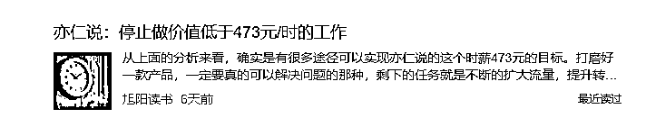

# 别再用拼命来掩饰分心：一人公司真正的壁垒，是对“注意力税”的逃税能力
作者：龙哥

作者： 东山老师

日期：2025-10-02

我这些年接触的个体创业者，结局呈现出极端的两极：有人就一两个人的小团队，年营收轻易突破千万；更多人却忙到半夜，恨不得把二十四小时掏空，赚到的钱也只是勉强比打工多一点。

差距从何而来？

### 看似是钱的差距，本质是注意力的分配战。

这几年我反复对身边人说：不必把每个风口都通吃，也没必要把所有赛道都学一遍，更不是每个看似不错的机会都要去试。

对于一人公司来说，钱和时间都可以再赚，再找，真正用不完的只有一点：高度稀缺且不可再生的注意力。

### 01 真到了财务自由的阶段，就一定能安稳吗？

很多人从职场跳出来，脑子里只有一个画面：我要财务自由，自由之后就可以为所欲为。

那种画面感给了他们穿越黑暗的动力：熬夜、奔波、持续输出。

可我们真的想清楚财务自由意味着什么吗？

简单来说，财务自由就是被动现金流足以覆盖当下生活，开源自足后可以把时间留给自己真正在乎的事。

那自由之后呢？会不会一直自由下去？

我一个老乡在2010年左右抓住了无缝壁画的红利，和兄弟一起上机器加班加点印。几年的时间里，东莞有了房和车，老家盖起了六层楼。那段时间确实风光。

后来全村的人都挤进来，价格被打下来。2017年左右，市场价格跌了十倍。有人转做水晶框、集成墙板，他们却在2018年把机器卖掉，东莞的房子也出手，回老家准备搞奇楠和乌龟养殖。

去年春节回去，看到他们整天和留守妇女打牌，或者沉迷游戏，养殖项目也因为看到各种不利消息不敢下手。

初步实现财务自由的人，很容易掉进空闲的陷阱：有钱有闲，不知道怎么把时间填满，最终浑浑噩噩。

他们的问题在于，致富的逻辑是靠运气和时代红利，而不是靠能力。靠运气赚来的钱，最终会用实力亏回去。

**财富是认知变现，模式撑不起自由，自由就撑不住。**

经历过十年的创业周期就能明白：很多人赚到几百万上千万，几年后人财两空，甚至背上债务。他们当年能赚，靠的是红利加运气；等红利散去，主业不赚钱，瞎投的副业也不赚钱，掉下来就快。

核心问题是：从来没有把注意力钉在主业上。

### 02 注意力，比资本更稀缺

从2003年开始创业，我见过真正的自由者。

对多数人而言，能有数亿资产、几栋收租楼，年租金过千万，就是财务自由。

但这些自由的人，会怎么用省下来的时间？

我认识的好几个大佬，都在做一件事：搭建自己的商学院体系，经营人脉网络，用资本去投资更多创业者占股，从多个维度持续加深护城河。

我们总说创业缺的不是钱，是时间。再往下想，**时间本身不值钱，有价值的只有停留在工作上的注意力。**

所以创业者必须极度聚焦，才能拉开差距，赚到超额利润，获得更久的自由。

自由后省下的时间，不是用来瞎逛、睡大觉，而是用来复盘模型、优化体系。

这就形成了一个正向循环：专注带来结果，结果带来自由，自由带来更多专注。

对一人公司来说，值钱的终究是注意力。全部集中在主业上，复利才跑得起来。那些零散的琐事，都是在收你的注意力税。

我曾在中山小榄认识一个亿万富翁。饭点他必去“饭堂”，说是饭堂，其实是家很贵的私房菜，菜单每天由主厨定，几个人吃一顿就要近千。他从不计较，每次吃完就走，月底统一结账。

他说过一句话我印象很深：“看起来贵，其实一点都不贵。”

不是因为他有钱，而是他用一点钱，换来的是高质量、不操心、零分心的体验。

拥有者像龙哥说的逻辑：当你一小时能赚四五百，花几十分钟去纠结几十块的事情，就是对自己注意力的不尊重。

他把选吃什么这件事彻底外包了。而且那家店环境极好，80%的客户都在那里谈成。

对他而言，省心就是省钱，因为他的专注力定价更高。

他开丰田塞纳，用苹果手机，天天穿同一件灰色T恤，说设备稳定比时髦重要。

跟他相处两年，我学到的核心思维就是：**注意力，才是创业第一资源。**

我当年开厂、招人，发现大部分员工，最大的问题是注意力失控。时间像野草一样乱长，关注雨天、火灾、明星生日，休息时间不是学习，而是打牌、刷手机、吹水。他们被低价的即时快感绑架，意志力被慢慢消耗，最后连思考阶层跃迁的精力都没有。

优秀的创业者和普通人的区别，不在努力时长，而在对时间的利用精度。年入千万和年入二十万的差距，本质都是善用时间，善用注意力。

### 03 注意力不平等，比财富不平等更致命

时间对所有人都是公平的，每天都24小时。

可注意力是不公平的。同样活到八十岁，有钱人和普通人的注意力密度完全不在一个维度。

有钱人极少亲力亲为处理家务，买服务、请家政，把琐事外包。省下的注意力用来社交、深度阅读、深度思考。

我们父辈那种普通农民，一辈子都在为多挣几十块奔波，根本没有余力去思考怎么跳出困境循环。所以穷人要靠几代人才能跳层，不是没努力，是注意力被生活榨干了。

我观察过工厂流水线上的操作工，他们没有意识到业余时间可以用来改变自己。注意力被无意义的事耗尽，意志力崩溃后，只能靠甜食、短视频、啤酒短暂麻痹。即便加班多赚几百，也舍不得买书报课，反而去买新手机追星。

我去年带的助理，大学毕业一年，天天花钱追星，演唱会请假坐飞机去。不是她有劣根性，是生活的消耗让她失去了未来感。

大多数人的人生就是循环：白天累死，晚上靠短剧和啤酒安慰自己。

我丈母娘小学毕业，在广州住几年，每天除了一日三餐就是刷短剧。我偶尔带她看《饺子皇后》，她眼里闪过一丝光，几天后又回到刷视频的日常。

视频剪辑的实习生也一样，不肯看行业精华帖，叫了好几次也不看。她不是不想改变，是改变的成本太高，需要在已经很累的生活上，再挤出注意力去开辟新路，对绝大多数人来说太难了。

### 04 一人公司的核心是注意力开源节流

一人公司一天能高度投入的时间非常有限。任何分散注意力的杂事，都是致命消耗。

一人公司的优势是灵活、专注不用管团队；劣势是资源少、自由度高，完全靠自觉。

所以注意力管理就是生死线。

我把办公室设在家里五分钟步行范围内，避免通勤消耗。每天在家吃三餐，一年四季拖鞋大裤衩，衣服不用想。车都放回老家了，出行滴滴地铁，省下来的时间全用来看书。广州开车停车太费神，纯粹是注意力税。

我和老婆几乎没有社交，没有聚会，把省下的精力全部砸在工作上。几年下来积累了近800万字的工作沉淀，60多万字出版，1000多页PPT，四个系统课程。我成了这个细分领域的专家。

这几年我读了大量大部头，也把孩子培养成了爱阅读的人。

把注意力集中在核心工作上，把会消耗注意力的事外包，是一个人运营一人公司的必备心智。

### 05 警惕真正的注意力绑架

很多人觉得刷短视频、逛新闻、看主播是最大的注意力杀手，其实那只是浅层的。

创业者想放下就能放下。真正危险的“杀手”是大家都在鼓吹的ALL IN。

我有个60岁的匹克球球友，不上班只炒股。广州四套房，清远一套，惠州一套。上个月他几天赚的钱，是别人一辈子赚不到的。

他说过一句话让我震撼：再好的机会，也不值得押上全部身家。All in的只是暴发户，不是老钱。

观察下来确实如此。创业和股市都一样，一旦把所有子弹打光，你会患得患失，吃饭睡觉都盯着它，心态变形，动作走样。

他自己长期定投苹果、腾讯这类科技股，用的是复利逻辑，而不是赌博。腾讯在不同高点买入的长期回报，以及苹果近年的增长，都证明了长期持有的力量。

道理人人都懂，难的是坚持十年。因为你押上的是全部身家，别人押的只是十分之一。

即便身家过亿，把全部投入进去后，每周的波动都会让你寝食难安。只投入十分之一，你可以淡定看待波动，最后才能理性赚钱。

所以任何事业都要给自己留余地。中年人上有老下有小，创业要留底牌，让决策不走形。预备队不是浪费，是心安的保障。

创业也要有B计划。我和老婆现在做少儿艺术培训陪跑，但我依然在社群里分享一人公司的思考，混脸熟。目前还没赚钱，但哪天需要转身，就有资本和底气。

### 06 才干，才是被低估的胜负手

你了解自己的天赋吗？

格拉德威尔提出的“一万小时定律”很流行，认为刻意练习一万小时就能成大师，盖茨编程七年超一万小时是佐证。

但关键不在于时长，而在于练习的质量和专注度。有的人练两万小时摊煎饼，也成不了御厨。

我有个球友暑假每天打墙一两小时，到处找人单打，就是为了赢我。他很轴，但打不过我。

我不喜欢打墙，也不爱比赛。我的练习是看Ben神和王康杰的比赛视频，把自己代入，揣摩细节。买发球机练发球练了1000次，单反直拉也练了1000次。时间没他多，但每个环节刻意突破，所以他打不过我。

刻意练习有三点：突破舒适圈拆解动作，有教练指路，有效管理时间。

有人会说，有教练就能成功？未必。我就算请Ben神来陪练，也不可能打赢王康杰。我在这个小圈子里有点能耐，出广州可能就没了。

在这个内卷的世界，为什么成功者如此稀少？因为要尊重天赋。

越到高段位，越看重天赋和才干。NBA的饮水机管理员在CBA能成大腿。龙哥一句话能解决的问题，有些人想一个月都想不明白。某些才干，你不服不行。

### 07 成就背后，都有能量输入

一个人能把一件事做到极致，一定有源源不断的能量在支撑。前面是消耗，后面一定有输入。

你有没有这种感受：做成一件了不起的事后，会特别自信，觉得类似的事都手到擒来。

“你知道洛杉矶凌晨四点的样子吗？”

这句话曾经像电流一样击中无数人。科比的故事传开后，多少人把“死磕到底”当成人生信条，也这样教育孩子：只要够狠、够拼，就算坐十年冷板凳，也一定能出头。

但真相真的这么简单吗？

说句扎心的话：这种只强调“不怕苦不怕死”的口号，多半是骗人的。

因为它压根不具备可持续性。乔丹和科比之所以能日复一日泡在球馆，不是因为“意志力超人”，而是因为他们从一开始就在篮球里尝到了甜头。天赋让他们轻轻松松就能在场上碾压对手、赢得欢呼，这种掌控全场的快感，换谁都会上瘾。为了延续这种“爽”，他们才愿意一遍遍打磨技术，去迎接一场又一场比赛。

换句话说，他们努力，是因为努力本身能带来巨大的回报。

篮球世界从来不缺这种例子：托马斯靠着高阶数据为自己争取顶薪，西蒙斯拿着场均接近20分的表现，在重建球队里找机会，库明加也会在社媒上点赞“职场PUA”来向管理层施压。他们每一次拼杀，都能转化为商业价值；每一滴汗水，都能换来真金白银和身份认同。这种“成功孕育成功”的循环，才是他们停不下来的真正引擎。

可现实里，太多人只学到了表面那一层“狠劲”。

自己明明不擅长写文章，听说垂直号有流量，就硬写了半年，阅读量还是没过百；明明不喜欢出镜，却逼着自己对镜头念稿，拍了几十条，播放量依然可怜；看到别人直播带货一天上百单，自己也冲进去，播了30天，在线人数个位数，最后靠朋友捧场才卖出一两单。

努力当然重要，但“拼命努力”从来不是成功的关键。真正关键的是：你有没有找到那件你天生就顺手、越做越有劲的事。

我自己就是最好的例子。

当年我读的是模具设计，那可是1995年最吃香的专业之一。但我偏科偏得离谱：语文、历史，哪怕十天不听课，考试照样拿高分；可物理、电工、机械制图、CAD这些，我死活开不了窍。期末考抄同学的图纸，人家画一横我画一横，人家画一竖我画一竖，最后还是画错。毕业找工作，老板拧开一个矿泉水瓶盖丢给我：“你用CAD画出来就录取你。”我盯了半天，只能说不会。老板还把毕业证翻来覆去看了半天，问我是不是伪造的。

后来我实在走投无路，去电子厂流水线拧螺丝，一个月拿两三百块。直到看到厂里招业务员，底薪250，加2%提成，我二话不说就去了。

第一年，我11个业务员里业绩第一，一个人订的货，比后面十个人加起来还多一倍。2003年左右，深圳布吉、龙华房价一平还不到两千五，我一个月就能赚两三万，再多能到五六万。后来自己开厂，几年时间把一个细分产品做成了国内隐形冠军，大品牌都来找我下单。

这时候我才彻底明白：跑业务、见客户、谈生意，才是我的天赋。我做这些事不费力，一天见四五个人也不累，反而越干越兴奋。

同样的道理，在学校里，大家比的是既定规则下的有限博弈，压抑又痛苦；但进了社会，是无限博弈，越符合人性，走得越轻松。

那怎么判断一件事适不适合自己呢？就两点：

第一，有没有天赋。所谓天赋，就是你做这件事上手极快，稍微花点精力就能做出成果，用最少的投入换最大的成就感。

第二，能不能走通“正反馈循环”。

2015年，我刚经历一场大失败，亏了几百万，整个人灰头土脸。但那一年我花了2.8万元，加入《秦王会》。当时里面的人聊的概念，我全听不太懂。可有一句话我听懂了，就这一句，我觉得值回票价：王通说的，“做得累的，都不对。”

那时我正是什么都做，什么都累：🛰️群讲课、微商、线下培训、做餐饮、去企业当教练……像无头苍蝇一样乱撞，越做越泄气。直到2016年5月，一个美术机构的老板找我帮忙招生，我在佛山南海，用社群和朋友圈做了两天半，招了近200个学员。

那天晚上回到酒店，我哭了。

不是因为累，是因为我终于找到了正反馈——这件事做起来太顺了。后来我帮一家又一家艺术机构招生，2016到2019那几年，真是“时来天地皆同力”，跟捡钱似的。后来疫情来了，我又一次转型，折腾了三年多，甚至几个月没有收入，直到我深入使用AI，把机构的每个环节迭代了一遍，那种“畅快感”才重新回来了。

所以，判断一件事值不值得做，别听人吹，就问自己：做这件事，你的状态是压抑还是满足？有没有每天越来越好的感觉？写一篇文章有没有人加你咨询？开一场直播有没有人当场下单？发条朋友圈有没有人响应？

这些点点滴滴的正反馈，会给你精神满足、社会认同，还有钱。

《新约》里有句话：“凡有的，还要加给他，叫他多余；没有的，连他所有的也要夺过来。”这就是马太效应。

人生在世，总有顺风逆风。有的人天生适合做网红，非要去搞实体，就成了“冥灯”；有的人天生适合搞关系，非逼自己死磕技术，就是自讨苦吃。只要短板不致命，就别天天补短板。去把优势发挥到极致，一枝独秀，才是正路。

别老在同一个坑里跌倒。当年把你绊倒的那块石头，以后大概率还会绊倒你。重复那些让你赢的、让你顺的选择，才是最大的智慧。

这几年，人人都在讲“一人公司”“超级个体”，好像进了某个圈子、上了几节课，就能轻松年入百万。说实话，我创业二十年，也算努力上进，但我觉得一人公司想赚到钱，真的没那么容易。定位、人群、产品、定价、获客、IP、转化、交付、维护……每个环节都得你一个人扛。所以我从来不敢拿这个概念去割韭菜，最多在熟悉的朋友里聊聊。

可很多人却跑来跟我说，听了某某大咖的课，进了某某社群，不仅没赚到钱，还被PUA，说“你不成功是因为不够狠”。我听完只想骂一句：这叫自欺欺人。

真正可持续的成功，需要三个来源。

第一，自我实现的精神满足。这得靠持续的正反馈撑着。就像我写文章，发一篇拿一个精华，我就有动力继续写；如果发三十篇都没反应，我可能连会员都不想续了。所以无论产品、交付还是流量，你要找到那个能持续给你“爽感”的反馈源。

第二，外部认可带来的社会地位。说白了就是“面子”，但面子是自己挣来的。你可以给自己贴标签，也可以持续打造案例。这些年，我们帮一些校长转变思路，有人本来要离婚，后来日子过好了，换了大机构；有人想把学校转让，听了劝再干一年，生源翻倍，一年赚了上百万。逢年过节，他们寄来家里的老母鸡、土特产、鲜水果，我们嘴上推辞，心里比赚钱还高兴。

第三，安身立命的物质来源。创业当然要赚钱。数据显示，大学生创业平均成功率只有3%，但创业三次以上，成功率会明显提高。创业是一件长期的事，不是一锤子买卖。赚多赚少不要紧，关键是每个月都有进账，能给老婆孩子一个不焦虑的家。所以，要做出有价值的产品，别坑人；还要天天卖，大胆卖。出来混，本质就是价值交换，只有输出价值，才能获得回报。

别再相信那些“只要够狠就能赢”的鬼话了。

真正的成功，是在有天赋的赛道上，不断获得正反馈，让能量越滚越大。找到那件事，然后乐此不疲地干下去。正反馈来了，钱会来，尊重也会来，能量就会像滚雪球一样，源源不断地把你推向更远的地方。

**一个人开公司，最怕的不是没客户，而是把自己活成了一支疲惫的杂牌军。**

很多独立创业者，白天谈业务，晚上做交付，凌晨回消息，忙得像陀螺，账上却没攒下几个钱。这不是能力问题，是方向从一开始就跑偏了。

判断一件事到底值不值得继续死磕，其实有个特别简单的标准——就看它能给你回馈几样东西。

第一，能不能让你有成就感，觉得越干越有意思？第二，能不能让你赚到钱，养活自己和项目？第三，能不能让你保持好状态，越忙越有劲而不是越忙越垮？

三样全占，那没什么好犹豫的，集中火力干到极致。占两样也稳住，慢慢优化。就算只剩赚钱这一条，那也先握着现金流再谈理想。可要是三样全搭进去了——人累得不行、说出来脸上也没光、账户还一毛没涨，那真的别硬扛了，及时收手不是丢人，是止损。

聊到这，作为一名长期单打独斗的创业者，我自己也复盘了很多次。总结些方法论之外，更底层的几条铁律，分享给你。

### 01 你的时间就那么多，别用堆时长来假装努力

一个人开公司，最稀缺的资源就是时间。一天就24小时，你想靠多熬几个小时来换规模，这条路径基本是死的。

真正要琢磨的，是**怎么把每个小时卖出更高的价**，而不是怎么挤更多的苦力时间出来。用杠杆、用工具、用更聪明的方法，比无脑埋头苦干有价值得多。

### 02 真正值钱的，不是你的时间，而是你的注意力

你说你忙了一天，到底干了啥？大概率是回了一堆无关紧要的消息、刷了一会热搜、处理了些鸡毛蒜皮的杂事。注意力的损耗，比时间的流逝更隐形、更致命。

判断一件事该不该碰，就问你一句：它是不是在偷走你的专注？如果是，外包掉、砍掉、直接拒绝掉。请个助手处理行政、用自动化工具省掉日常杂活，学会对无效请求说“不”——千万别心疼拒绝别人，你是在保护自己最值钱的资产。

### 03 别硬学别人干，要找自己天生就擅长的事

一个人公司的天花板，取决于你能不能找到那个“天生擅长、一干就来劲”的领域。这不是说技能匹配，更重要的是能量匹配。那种越干越困、越做越泄气的事，就算别人说前景再好，也别碰。你做起来觉得在充电、越做越high的事，那才是你的“本命赛道”。

### 04 最大的坑不是没机会，是太贪心

一个人公司倒掉，很少是因为做得太少，多半是做得太多。今天看见AI火就追AI，明天看见📕火又冲📕，最后什么都做了，什么都没成。真正能立住的一人公司，都是极其克制的，**只在极少数几件事上做到最好**。别试图满足所有客户的所有需求，你又不是钞能力供应商。

### 05 别为了搞钱，把自己搞丢了

这是我最想提醒的一件事。很多单干的朋友，走着走着就变身成了“赚钱机器”，早忘了自己当初为什么选这条路。开始搭团队、做矩阵、拼规模，忙得昏天暗地，比上班还惨。

说实话，直到我45岁才真正彻底想通——**创业是手段，生活才是目的**。家庭的温度、亲子的互动、亲密关系带来的柔软，这些东西带来的幸福感，反而是创业能长久走下去的燃料。当你每天的状态稳了、心定了，你会发现事业上的决策也变得干净利落不少。

### 06 你要有耐心，等复利慢慢滚起来

一家公司要长大，急不来。一个人公司更是如此。你能不能在别人狂躁的时候稳住心态，继续做那些当下收益不明显、但长期必然复利的事？关键在于，你得给自己设计一套“正反馈系统”，让即便在最难的日子里，也有小的成就感托着你往前走。

---

**走完这一圈你会发现，成功的定义早就该被更新了。**

自己当老板，靠的不该是每天耗尽自己，而是靠清醒的取舍。拼的不是谁加班更多，拼的是谁把注意力和精力用得更准。

**财务自由不是终点，只是起点**——它真正给你的是“重新分配注意力”的自由。那些真正走出来的人，从来不是最忙的，而是最清醒的。他们非常清楚自己擅长什么、该抓什么，也早就建好了那套持续给自己供能的运转机制。

在这个随便刷两下就被热搜钩走魂的时代，真正顶级的东西根本不是钱，而是——**屏蔽干扰、守住专注的能力**。

那个能让你安静沉浸、物我两忘的领域，才是你该深耕的地方。

最后的答案，其实说出来特别朴素：做你天分里带着的事，做能给你充电的事，护好你的注意力，然后，一直在牌桌上待着。

听上去简单，但能做到的，已经跑赢了99%的选手。这也是为什么同样起跑的人，有人忙到飞起却颗粒无收，有人云淡风轻却盆满钵满。

希望你能是后者。

*评论区聊一下：你现在做的事，占了几条？*