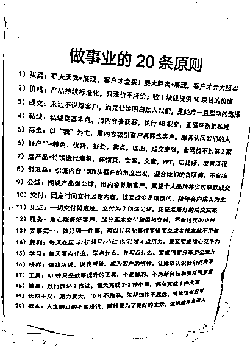

# 一人公司两年踩坑总结：这 20 条“反常规”原则，反而让我赚得更稳了

**别急着快，先把根扎深。**

我右手边的墙上，贴着一张皱巴巴的纸。上面没有华丽的管理学理论，只有我过去二十多年在商场摸爬滚打换来的几条心得。每一条都是用实打实的亏损、无数个失眠的深夜和反复推翻自己的痛苦换来的。

这些原则，单看每一条都朴素得不像话，甚至和主流商业观点背道而驰。

但就是靠它们，我这间只有几个人的小公司，从谷底一步步爬了出来，熬过了好几轮行业洗牌，在吵闹的市场里找到了自己的呼吸节奏。

今天把这份压箱底的东西翻出来，连同每一条背后的想法，一次说清楚。它不只是执行清单，更像是我对“怎么做一门踏实生意”的完整思考。

**01｜赚钱不是终点，好好生活才是**

我们奋斗，不是为了账户里多几个零。赚钱只是手段，最终是为了活得更好——身体健康，时间自由，能陪在重要的人身边。

我出身普通，学历不高，刚开始创业想法很单纯：多赚点钱，让家里日子好过些。那阵子，我把营业额当成唯一的成绩单，哪天没进账就心慌到不行。

直到胃溃疡发作，一个人蜷缩在酒店床上疼得满身冷汗；直到发现孩子没有长成我期待的模样；直到和太太争吵到婚姻濒临破裂。

我才猛然惊醒——我为了所谓的“成功”拼命往前冲，却把最重要的东西全落在了身后。

现在我做任何决定前都会先问自己：这件事是让我离“更好的生活”更近了，还是更远了？每天坚持锻炼，尽量和家人一起吃饭聊天。因为身边人的笑脸，才是我奋斗的源头和归宿。

**02｜定力比速度重要，认准了就深耕十年**

正因为追求的是长久的生活品质，而不是一把梭哈的暴富，我反而敢把目光放得很远。

不再眼红任何风口，看着别人起飞也不着急；好朋友反复劝我换个赛道，我也不为所动；同行搞出什么新动作，我也能安然睡觉。

我坚信，只要在一个足够细分的领域里做到极致，就能成为那个低调却不可或缺的角色。这份内心的确定感，就是压舱石，让我在任何风浪里都不慌。

**03｜大目标拆小，每天完成两三件正事**

再大的愿景，也得靠一天天的微小进步来铺路。我的方法是“循环工作法”——年度、月度、周度、日度层层拆解。

每年只推动一个大里程碑；每月落实一项固定安排；每周抓牢两件重点；每天完成两三件小事，偶尔集中攻坚一件大事。

我们现在的日常很规律：上午专心创作内容，下午打磨产品、处理交付，晚上太太直播带货体验营，我打辅助。一天的核心任务完成，心里就踏实了。

每周固定和一部分客户做复盘，也算交付的一环；周末雷打不动带家人爬山或逛公园。每个月开两期小型训练营，用低价体验去带动高阶转化。每年双十一前后，集中迭代一次产品并做大型发售，这一波往往能撑起接下来一年的营收。

生意，就是在这些看似不起眼的小事里，一天天长起来的。

**04｜好产品是一个完整的价值包**

我始终觉得，一人公司想年入百万，核心要押在产品上，而不是盲目打造个人IP。

这里说的“好”，不是你自以为的好，而是客户无法拒绝的好。它得包含六个维度：

- **特色**：产品是什么？有什么独特属性？
- **优势**：凭什么比别人强？根源在哪？
- **好处**：客户能获得什么实际利益或情绪价值？
- **卖点**：一句话说清为什么非你不可。
- **购买理由**：有什么证据、案例能支撑上述claim。
- **成交主张**：怎么买？交易条件能否打消顾虑？

把这六块组合好，让目标客户一看就惊呼“这就是我要的”，自然就占据了“只此一家”的心智位置。

**05｜打磨是永无止境的**

产品做完就一劳永逸？不存在的。海报、详情页、文案、PPT、短视频、发售脚本……这些都是产品的一部分，都在向客户传递价值。

市面上太多同类产品只是“卖时间”，比如“XX元XX节课”。我坚持让大家转向“卖解决方案”——围绕客户的真实问题，把整个呈现体系当成艺术品反复打磨。

产品是1，营销是后面的0。1不行，后面加再多0也只是零。

**06｜高价本身就是筛子**

这条最反直觉：**定价要高，只涨不降，但必须给足超值交付和零风险承诺。**

价格是价值的信号。低价招来的往往是价格敏感型客户，她们在意的是“便宜”而非“值”，后续服务又累又难满意。高定价天然过滤掉这批人，留下的都是同频、认可价值的优质客户。

只涨价不降价，是对老客户的尊重——她们早买早享受，还享受了更低价。降价反而会伤了她们的心，也会把品牌拖入无休止的价格战。

但高价必须站得住：要么提供远超价格的价值，要么用“无效退款”这类零风险承诺来兜底。这不仅是给客户吃定心丸，更是自己底气的证明。

**07｜交付要有节奏，改变需要时间**

交付不是即兴表演，要标准化——固定时间、固定内容，像课程一样有规律。客户知道接下来会发生什么，焦虑感自然降低，我们也轻松许多。

更关键的是保持谦卑：我们能给的只是工具、方法和陪伴，真正做出改变的永远是客户自己。我们陪她走一程，但不能替她走。

**08｜服务要用心，但别失去边界**

服务分两层：

- **基础交付**：合同里承诺的，必须做到100分，这是本分。
- **偏袒式关怀**：在底线之上，偶尔给点小惊喜——一条用心的回访、一份小礼物、一次超时的咨询，让客户感到被特别对待。

但注意，不要被客户牵着走，无底线地加码。过度付出不但会掏空我们，还会把客户的胃口养大。清晰的边界，是为了保护这段关系能走得长久。

**09｜让付出被看见**

做了服务不留痕，等于白做八成。每次交付都要有意识地留下反馈、截图、案例、感谢信。

这些真实的“见证”，是下一单成交时最有力的临门一脚。因为客户不一定相信我们说的话，但她会相信那些和她处境相似的人的真实经历。

**10｜筛选，比讨好重要**

我不做所有人的生意。传统销售是“推”，我们是“吸”——先亮出我的理念和价值观，用内容吸引认同者前来，再用价格和原则过滤出真正匹配的付费客户。

文章、视频、朋友圈，都是同频共振的媒介。愿不愿意为你付费，是判断一段关系值不值得投入的重要标准。

**11｜每天输入、思考、输出**

看一点、学一点、把它想透、再写出来发出去，这必须成为肌肉记忆。持续学习和表达，不仅是自我精进，更是最稳定的流量来源。

你的见解，就是最吸引人的广告。

**12｜公域，一切围绕交易**

在公域（直播间、📕、视频号等），不要做无效的品牌宣传。一切动作都要指向“买卖”。

最有效的方式是：设计一个让人无法拒绝的引流产品，然后付费投流，直接验证和成交。以前我们直播老是只为爱发电，纯分享不卖货。现在改了——一半时间分享干货建立信任，一半时间直接推引流品。

**13｜引流品要懂人性**

所谓好的引流品，不是你觉得有趣，而是客户觉得“哇这太值了”。它必须：

- **超高价值**：看起来远超价格，解决一个具体到不行的大痛点；
- **超低单价**：决策成本极低，比如9.9元、19.9元，甚至5.2元；
- **迎合人性**：贪便宜、想速成、怕错过——直击这些本能，才能引发行动。

引流品的目的不是赚钱，而是用付费动作筛出意向客户，并引导她们进入私域池。

**14｜付费，是最大的认可**

私域是我们的基本盘，但只有花过钱的人，才算真正的私域客户——哪怕只付过1毛钱。没付过一毛钱，天天说爱你，那也不是真的。

付费是最真诚的信任投票。我的精力必须优先投入给那些用真金白银支持我的人。这份清醒，能省下我们大量精力。

**15｜天天卖，客户才会买**

不要怕被说“又在推销”。你的产品能帮人解决问题，就是值得反复分享的好东西。

训练营里正儿八经地卖一次；朋友圈、社群也要天天展现：产品介绍、客户反馈、专业思考……持续刷存在感，就是在教育市场、提醒客户：“我在这里，我能帮你。”

**16｜不说服，只启发**

说服和逼单，是低姿态的乞讨，能量场很弱。我选择高姿态的展示——用价值、案例和见证，让客户自己得出结论：“这就是最适合我的选择。”

把成交周期拉长到一年，你会发现根本不用焦虑。持续展示、不断见证别人的成长，那些真正有需求的人，迟早会想明白：她们其实没有更好的选择。

**17｜成为客户的榜样**

我分享的，必须是我在践行的；我要求客户做到的，自己先做到。

言行一致，才能赢得信任。让客户觉得认识你、和你共事是一种幸运——这是口碑的终极来源。

**18｜选一个点，死磕出复利**

直播、视频号、👸号、私域这4个渠道，不必样样精通。选一个你最适合的，每天投入，日拱一卒，直到它成为你最锋利的那把刀。

复利不是奇迹，是每天进步一点点，乘以足够长的时间。

**19｜工具是仆人，不是主人**

AI也好，新科技也罢，都只是提高效率的工具，不是目的。不用因为别人用了什么新玩法就心慌，更不必为了追新工具而焦虑。

先想清楚要解决什么问题，再看工具能不能帮上忙。工具为人服务，别本末倒置。

**20｜找到那个“只要做好它，其他事都变简单”的关键**

如果一天只能做一件事，选哪件？

找到那个一旦完成，其他事情就会变得容易、甚至根本不用做的关键任务，优先投入时间。比“忙完所有事”更重要的，是识别“哪件事最值得先做”。

---

以上，就是我在一人公司这条路上，用真金白银和时间换来的20条心得。它们帮我走过了最难的阶段，也陪我在市场中越走越稳。

如果这些文字对你有那么一点启发，或者让你觉得“原来还可以这样想”，那就不算白写。

我必须要活成客户心中那个理想的样子——比他们更从容、更丰盛、也更专业。

当客户从我们这里拿走的不仅是产品和服务，更是一份“原来人生还能这样活”的触动时，她就不再只是消费者，而是你最忠实的追随者。

这意味着，我得不断践行那套原则。比如第18条原则说得很清楚：每天在直播、视频号、👸号、私域这4个方向里，只挑一个去死磕，直到它成为你的护城河。

别想着什么都要抓，选一个最适合你的流量入口，把全部精力倾注进去，把它打磨到90分以上。这比在每个平台都只做到60分，要强出太多。

之前我也是多平台同步推进，现在彻底聚焦🛰️生态，特别是视频号和直播，其他的渐渐淡出了。

在这个过程中，第19条原则替我守住了清醒：AI这些新工具，只是效率放大器，不是目的本身，别为了追赶新科技而焦虑。让AI去写初稿、做脑暴、处理繁琐的重复工作，这没问题。

但真正核心的思考、人与人之间的真诚连接、以及属于你独有的创意，这些必须由你自己来。别被工具牵着走，更别因为一个新概念冒出来就慌。守住你的内核，工具只是帮它发光放大的。

我自己用AI，更多是当“决策参谋”和“心力陪练”。我发现，我越来越享受和AI进行深度的交流。

但所有这些，最终都要落到第20条原则——要事第一。那句灵魂拷问是：做好哪一件最重要的事，能让其他事都变得轻松，甚至根本不需要做？

这是我每天问自己最多的问题。它逼着我做终极思考，找到那个决定性的支点。

可能是把产品打磨得更极致，可能是深度服务一个核心客户让她主动帮你转介绍，也可能是打造一篇爆款内容。一旦锁定，我就全情投入。

关于这一点，我们做过测算：每天的直播，就是我们那件“要事”。只要每天能卖掉30-50个引流品，其他很多事就自动变得简单，甚至不需要做了。

所以，我们不断迭代直播的每一个细节。现在已经优化到第六个版本了，每天复盘、每天调整、每天投流，不达成目标绝不罢休。

总而言之，这是一场关于“创业自由”和“人生自由”的亲身实践。

回过头看这20条原则，并不是零散的感慨，而是一个环环相扣的系统。

从初心出发——要生活，要长期主义；然后打磨极致的产品；用内容筛选出同频的人；在私域里用“展现”代替“说服”去成交；再用超值的交付创造见证；最终这一切都在倒逼我持续修行，活成别人的榜样。

这套系统，追求的不只是赚多少钱，更是构建一种可控、健康、持续成长的事业状态，最终奔向那份最初的向往——更好的生活。

这，就是我理解的“一人公司”的终极胜利。

希望这20条原则，能给你带去一点不一样的启发。和所有追求“小而美”的一人公司伙伴共勉。

你被哪一条戳中了？评论区聊聊？

评论区：

东山出品，必属精品！
感觉不错，准备费曼学习一下
强
先收藏了，慢慢看
东山老师的这套方法论振聋发聩，其实细想和赚钱的理念也有许多相通之处
东山老师，非常真诚