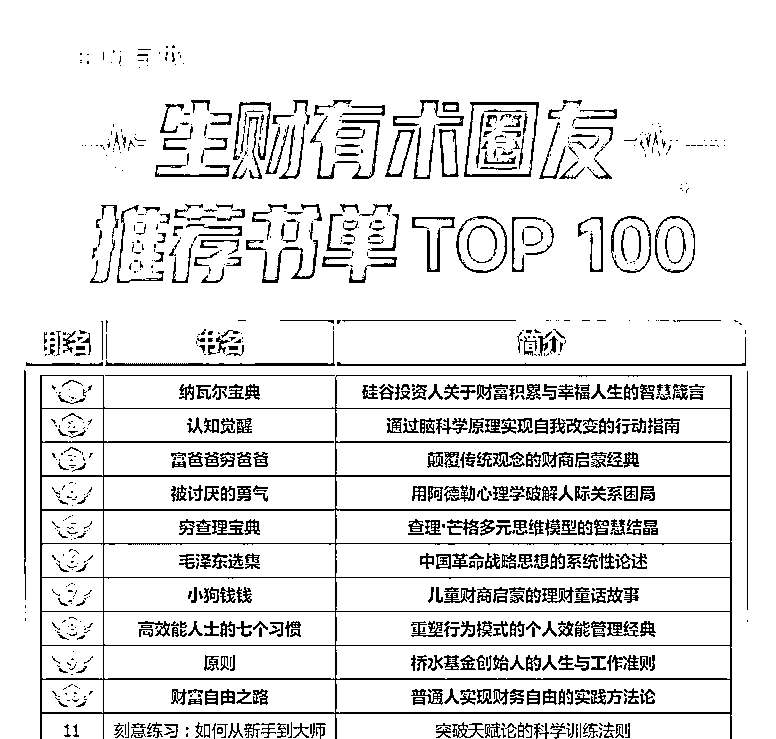
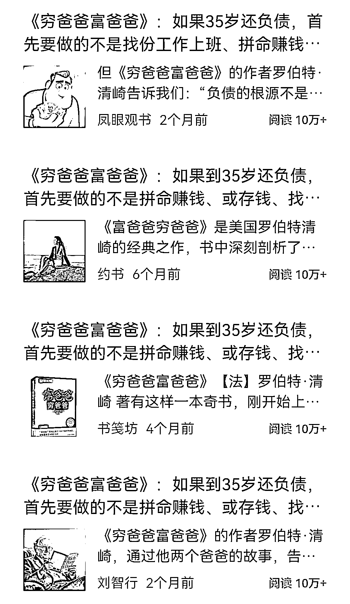
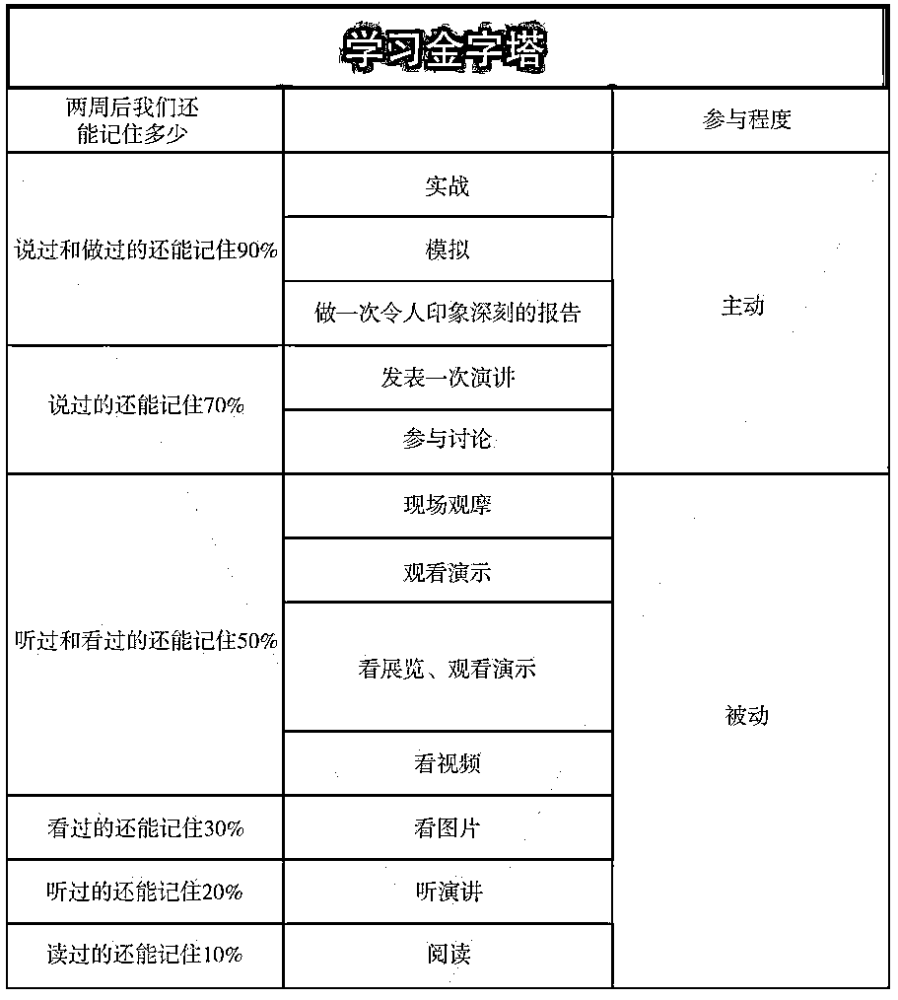
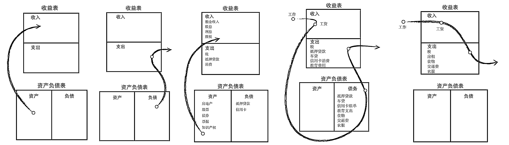
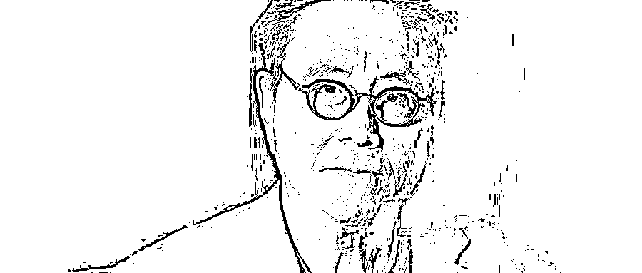
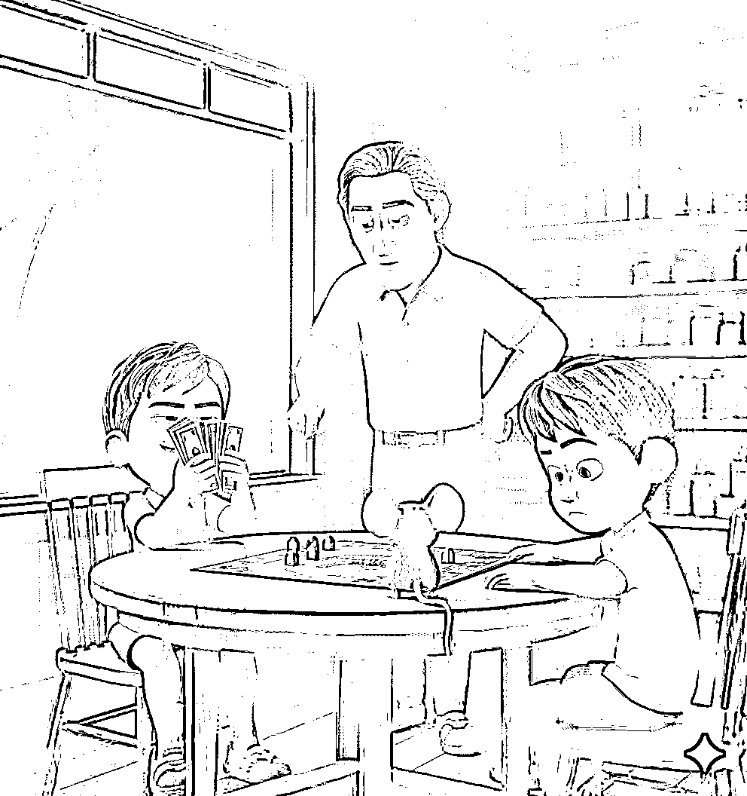
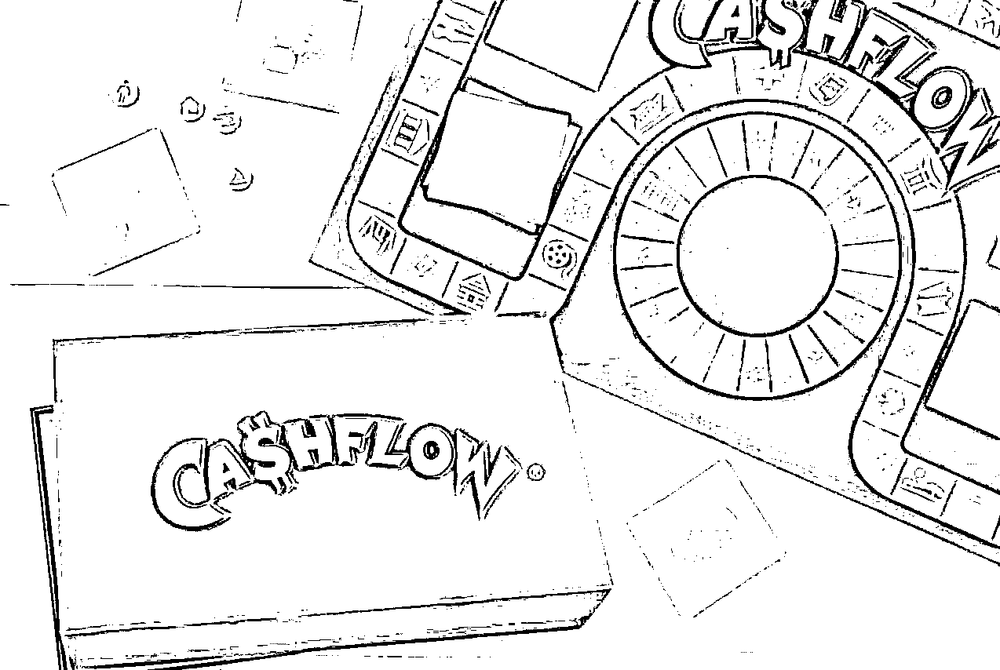
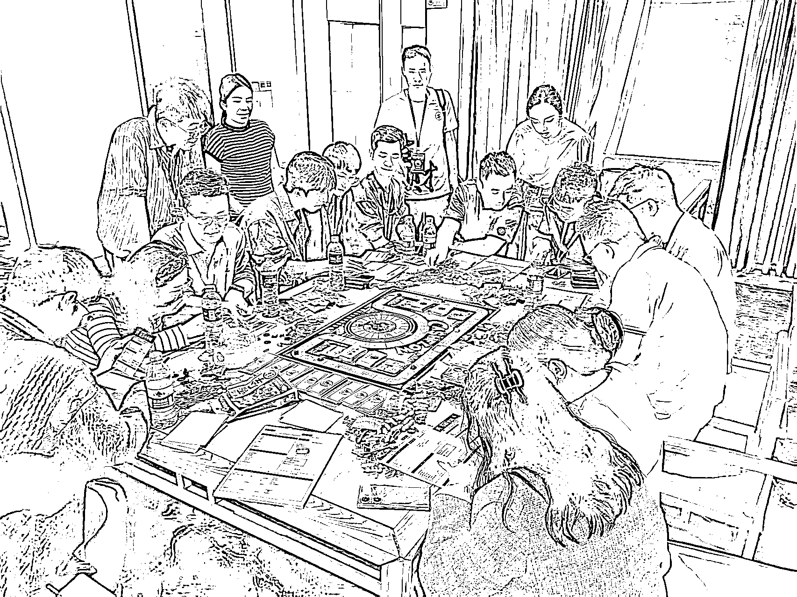

# 读了20遍《富爸爸穷爸爸》之后，我想通了一些事

龙哥盟的书单 Top100 出来那天，我扫了一眼，前三名果然又是那几本书——《纳瓦尔宝典》《认知觉醒》《富爸爸穷爸爸》。这三本，恰好也是我近几年翻得最勤、提得最多、用得最透的枕边书。圈友们的口味跟我如此一致，忍不住想点个赞。

说实话，以前看《富爸爸穷爸爸》也就是随便翻翻，真正读进去是在2019年。那会儿我已经上班好多年了，拿着央企月薪过万，日子不算差，但总觉得哪里不对劲。这本书读完，像被人往脑子里倒了一盆凉水。三年后，我辞了职。再后来，我老婆也告别了干了十年的电视台，我们开着房车从沈阳一路南下到海南，开始了自由职业者的生活。

到今天，这本书我读了不下20遍，还带过30期读书营，组织过200多场现金流游戏。这篇文章写了1.3万字，不指望你一口气看完。如果你只是好奇这本书讲什么，读第一部分就够了。但如果你也是这本书的粉丝，我建议你慢慢看，后面有不少会颠覆你认知的东西。

## 先说三个你必须知道的“秘密”

第一，这本书其实是“游戏说明书”。罗伯特·清崎真正捣鼓出来的，是一款叫“现金流”的财商教育游戏。书是他的合伙人莎伦·莱希特劝他写的，目的是给游戏做推广。

第二，富爸爸的原型是中国人。清崎自己透露过，富爸爸是早期移民到夏威夷的广东潮汕人。2012年他在上海开记者会时承认过，2025年在新加坡演讲时又提了一次。

第三，书名得叫“富爸爸穷爸爸”，千万别念反了。很多人图顺口说“穷爸爸富爸爸”，连一些大V和十万加爆文都这么干。但语言是有暗示力量的，就像富爸爸从来不许孩子说“我可付不起”，只准问“我怎样才能付得起？”

## 读这本书前，记住三句话

有些书，你读一遍就够了，但能改变你人生的书，一定值得一遍遍重读。说实话，人一辈子能反复读的书真不多，能把你掰向另一条人生轨道的，更是少之又少。《富爸爸穷爸爸》对我而言就是那一本。

第一次读完，我后背发凉：这不就是我的生活吗？起床，上班，付账，再起床，再上班，再付账——书里说的“老鼠赛跑”，我整整跑了十年。那一刻我意识到，人生其实不止一种活法。

给你三个建议：

**第一，别指望一遍读懂。** 这书第一遍要快速读，别停下来纠结。我读了20遍，每回还能读出新东西来。

**第二，从改变认知开始。** 把触动你的话划下来，别急着判断对错。第一遍读书，重点不是求甚解，而是攒情绪、找盲区。

**第三，读完别急着行动。** 至于为什么，文末再告诉你。

## 这本书到底讲了什么

很多人觉得它只是理财书，其实它是生活哲学。它教你用富人的方式去思考，用财务自由去换生活自由。

全书大致分三块：前言部分交代了背景，中间六章是富爸爸的六堂课，最后三章加结语讲财商怎么落地。

**前言里藏着很多预言。** 比如致中国读者的信是2007年写的，里面说中国经济要经历转型阵痛，“艰苦而漫长”——放在今天看，还真被说中了。还有几个颠覆常识的观点：富人不是不为钱工作，而是让钱为自己工作；储蓄很重要，但存钱存不出财富自由；你住的房子不是资产，是负债。

**第一课：富人不为钱工作。** 穷人拿时间换钱，富人拿钱买时间。你越怕付不起账单，就越想找份安稳工作，然后就越离不开那份工作——这就是恐惧在控制你。

**第二课：财务知识是地基。** 挣多少钱不重要，留得住多少钱才重要。分清资产和负债，是财务自由的第一步。书里有张只有五类的现金流图，我每期读书营都让学员亲手画一遍，画完的人都说，好像突然开窍了。

**第三课：关注自己的事业。** 富人盯着资产，普通人只盯收入。有一个很扎心的说法：穷人喜欢先买奢侈品，富人最后才买。那些大房子、好车，很多时候不是身份的象征，而是财富的漏口。

**第四课：税收和公司的力量。** 公司的税法和个税完全不是一回事。一句话总结就是：打工是挣钱—缴税—花钱，公司是挣钱—花钱—缴税。顺序不一样，剩下的钱天差地别。

**第五课：富人的投资。** 知道为什么有钱人越来越有钱吗？他们靠的不仅是胆量，更是财商。还有一点很多人误会了：清崎靠房地产实现了财务自由，但那是他真正热爱的事。别看完书就冲去买房，房子只是资产的一种，不是全部。

**第六课：学会不为钱工作。** 有些人专业技能很牛，但一辈子都在为钱发愁。学校里教的是“找份稳定工作”，但富爸爸教的是“不断学习”。尤其是销售能力——这个社会不缺有才华的穷人，缺的是敢谈钱的人。你都不爱钱，钱凭什么来找你？

## 财商怎么落地？这才是全书的重头戏

从第七章开始，书里逐渐落到实操层面。

**克服困难之前，先看见困难。** 有人因为恐惧不敢投资——可从来没亏过钱的人，通常也从来没赚过钱。有人因为怀疑始终观望——一个从不相信自己能变富的人，大概率也不会变富。还有一种懒惰，不是啥也不干，而是忙着学习、忙着收藏、忙着“准备”——就是不肯开始搞钱。

**行动的方法，书里也给了。** 停下来看看自己做的哪些有用、哪些没用；去书店找新思路；向好工作的人请教，最好的姿势是付费；敢于报价，不怕被拒绝；每个月到感兴趣的街区走走看看，观察机会。

最重要的一条：**行动的人总会击败不行动的人。** 知道不算懂得，记住不算掌握，讲出来才算改变，真正下场做了才叫知行合一。

普通人的路径应该是：**先知道，再记住，然后不断讲，最后开始行动。**

## 最后说几句掏心窝子的

结语里有一句让我盯了很久：“金钱是一种观念，如果你想要更多的钱，只需要改变你的思想。”

富人和穷人，差的不是账户余额，是思维方式。但改变思维很痛苦，所以大多数人宁愿继续困在原地。

书里还提到三种收入：劳动性收入、投资组合收入、被动收入。财务自由的关键，就是把你靠时间换来的劳动收入，慢慢转化成不需要你盯着也能进来的被动收入。现金流游戏的价值，就是让你在一个安全的环境里反复练习这件事，就像开车前先上驾校、先学交规一样。

读这本书时，我还顺手干了一件事：把书里提到的其他书也找出来读。比如《思考致富》，比如清崎的第二本书《富爸爸财务自由之路》——书里能找到书，这是我觉得最高效的读书法。

这篇文章写完，有人会问我，你能辞职、能改变，是靠这本书吗？我不确定。但我确定的是，如果不读它，我大概率还在原来的轨道上打转，连辞职的念头都不会冒出来。

方向对了，慢一点也没关系。

如果你也想摆脱“老鼠赛跑”的生活，不妨从这本书开始。但记住那句话：富人不折腾，依然是富人；穷人不折腾，这辈子大概也就这样了。

有粉丝私信问我：罗伯特·清崎的书我都看完了，那到底要怎么才算真正开始致富？

他的原话很干脆：先自己玩十次现金流，再教会十个人一起玩。

读完一本说明书，第一反应是什么？去试用。

**二、清崎口中的财务自由，真相是什么？**

先把一件事情说清楚，财务自由这个词，并不是清崎首创的。它的演变脉络很长，有空再单独聊。

清崎本人真正触碰到“财务自由”这个理念，是1985年和女友金、挚友拉里一起在加拿大雪山滑雪的时候。在那之前，富爸爸教他的更多是关于钱、投资和退休的话题。

（补充一下，拉里·克拉克是清崎在夏威夷西屋公司的同事，后来一起做了Rippers尼龙钱包生意。1991年清崎搬去凤凰城，两人成了邻居。）

**1、财务自由的起点在哪**

1985年新年，几个人窝在温哥华雪山的木屋里聊明年目标。拉里提议做一份详细的长期规划，早点把人生从工作里解绑。因为目标写在纸上，才会倒逼行动。

清崎却犹豫了。他脑子里全是尼龙钱包公司倒闭的阴影，还有刚带着全部积蓄从夏威夷搬到旧金山创业却不顺的经历。手头现金快见底，恐惧和自卑占据上风，他只想先活下去，嘀咕着：“没钱，谈什么提前退休。”

情绪一上来，他和普通人没什么区别，只盯着眼前的生存安全。

拉里还在讲，清崎基本没在听。忽然一句话点醒了他，想起了离开夏威夷前富爸爸对他说的话。

“除了你自己懒和怀疑自己，没有任何东西能拦住你。原地不动很容易，不改变很容易，大多数人一辈子都不会变。”

他振作起来，把恐惧压下去，决定真的去想、去计划“十年内退休”这件事。

每次讲到这里，都有读者追问：你具体怎么做到的？清崎的回答是：关键不是怎么做，而是为什么要做。没有一个坚定的为什么，怎么做都走不通。

很多时候，搞清楚要不要做，比搞清楚怎么做重要得多。

《创富法则》里汤小明老师反复强调的创富动机M，就是这个意思。道有了，术自然好找；没道，术再多也到头。

为什么要讲这个故事？因为这就是清崎通往财务自由的起点。很多人只记得1994年47岁时他实现了财务自由，却忘了他是怎么起步、为什么起步。

结果来自过程，过程来自开始。

**2、人生的至暗时刻**

下雪山后，清崎又迎来一段极其艰难的日子。他自己说，1985年是他最难熬的一年。

钱花光了，信用卡也刷爆了，他和金一度无家可归，只能挤在借来的一辆旧棕色丰田后座上睡觉。好在有个朋友把地下室腾出来让他们暂住。

亲友得知后都问同一个问题：你们为什么不去找份工作？清崎刚开始想解释，后来发现根本说不清。

如果你参加过《富爸爸穷爸爸》共读营，听过他完整的人生，应该能懂。

我常开玩笑，这才是真正的“宁可睡地板也要当老板”。

说个我自己的事共鸣一下。2022年我辞掉月薪过万的央企工作，家人非常焦虑，让我回老家，靠堂姐帮忙找个本地工作，每月几千块也算稳定。

你看，当别人不理解你为什么要去攀珠峰，就会觉得你每天晨跑十公里很无聊。爬个山而已，看看风景走走不行吗？

目标不一样，行为自然不一样。

富爸爸一直告诉他，想变富，就要有攀珠峰的心理准备，必须有强烈的渴望。

**3、摸索出自己的财务之路**

之后清崎和金一边打零工糊口，一边到处跑，去见各种老师找方向。

最后他把重心放回自己最擅长的领域——教育。

大家都知道他靠房地产实现了财务自由，但没人知道他真正的核心资产是教育。原本他和金的创业计划就是做一家商业教育公司，只不过“出师未捷”。

先问自己：如果要靠创业赚钱，第一件要学的是什么？

《富爸爸穷爸爸》里说：“很多人想致富，却总想在15厘米厚的混凝土上建帝国大厦。”

地基没打好，怎么盖楼？

这个地基就是财商知识。书里把财商分成四块，会计排第一。

我以前举过稻盛和夫的例子，财务报表就像飞机的仪表盘，机长看不懂，飞机就危险。

还有一个教训，清崎的尼龙钱包公司亏掉上百万，最致命的原因就是没重视财务报表，现金流一团乱。

正因如此，他才想用报表和游戏来教创业者财商。他说这种方法一天就能教完一年的会计课程。而游戏的灵感来自他9岁时富爸爸带他和迈克玩的大富翁。长大后他依然迷恋这个游戏，甚至在现实里玩大富翁，这后来就成了现金流游戏的原型。

他最终决定做“创业者商学院”和“投资者商学院”。开始研发课程、找伙伴、招学生。

路并不顺，有次飞到夏威夷开课，只来了2个学员，尴尬到极点。但他没停，坚持下来，到1990年，每场课都能坐满几百人。

**4、财务自由是如何一步步到来的**

1986年，富爸爸打电话给清崎，听说他正在创业，很欣慰。他说新税法要改，会带来很多机会，于是清崎又尝试做房地产，开始积累资产。

1989年，金也开始投资房产，买下第一套房。那年他们总共买了5套房，都是正向现金流，再次成为百万富翁。

等等，你不会以为财务自由就这么简单吧？

**下面说说他财务自由背后的真正秘密。**

** *第一*** ，他选房子，不只是因为房子好，更因为他喜欢房子和土地。

每种资产都有取舍，收益、风险、流动性不可能兼得。没有绝对的好坏。

清崎能靠房地产自由，很大程度上源于他从小在富爸爸身边培养出的兴趣。

就像比尔·盖茨妈妈在IBM当董事，初中就让他管家族基金会；巴菲特的爸能带他去认识华尔街的人。

12岁时，富爸爸带他看夏威夷海滩上4万平的土地，给他很大震撼。后来富爸爸把地连成一片，以8亿美元卖给凯悦。

26岁时，在富爸爸建议下，他花385美元学了三天房产课，用三个月完成作业，后来赚了好几百万。

39岁时，富爸爸提醒他新政策要变，他才集中精力做房地产。

他在书里说过：“我喜欢建筑和土地，我愿意整天看它们。即使有问题，也不会让我讨厌它们。但对那些本来就讨厌房产的人，投资它绝不是好主意。”

我自己的例子，我家有8套房，7套出租，主要是我太太在管。我虽然在地产公司待过，但对房子并没有热爱。所以我们的财务自由规划，并不以房产为核心。

** *第二*** ，作为专业房产投资人，他执行100:1的筛选法。看100套，买1套。

1989年在波特兰买5套，意味着一年要看500套，普通人根本做不到。

他还跨城市操作，1991年搬到凤凰城，并全面评估政策、城市发展、人口、劳动力、出租率等。

看房是体力活，别指望随便看看就能一直挑到优质资产。别拿自己的爱好去挑战别人的专业。知道得越多，才越敬畏市场。

** *最后*** ，他先靠教育培训赚到本金和稳定现金流，才去做房地产投资。

书里常举低买高卖的例子，好像很容易，实际上他是抓住了周期。

把房子做成正向现金流，逻辑不难，操作也不复杂。难的是持续不断地买入新房。加上不动产流动性差，对资金和现金流要求极高。

所以，清崎的财务自由是天时地利人和的综合结果，很难一板一眼复制。

对普通人来说，投入自己热爱的事业，持续学习，关注自己喜欢的资产，找到自己的路径，才更现实。

**5、财务自由不是终点**

“1994年，我们自由了。金37岁，我47岁。公式很简单：**每月被动收入大于每月支出。**

我们每月有1万美元现金流入，主要是出租房产，每月生活费只要3000美元。”

宣布自由时，他们手上有50多间出租公寓。

其中12单元的公寓每月净现金流1100美元，30单元的公寓每月超过5000美元，再加上其他资产，每月总收入过万。

之后他把公司股份卖给合伙人，想休假一年。朋友推荐斐济，结果天堂般的地方把他憋疯了，几天就受不了回国。

他搬到山里的小农场，重新审视人生，问自己：我真的想用生命做什么？

退休18个月后，他走出山里。电脑里存着关于富爸爸的手稿，公文包里放着现金流游戏的草图。他对自己说：“生活的另一段开始了，这次才是真正属于我自己的生活。”

**三、现金流游戏到底玩的是什么？**

富爸爸现金流游戏，也叫老鼠赛跑，是清崎1996年发明的财商教具。那年是中国鼠年，也算是巧合。

它不是普通桌游，在培训行业属于沙盘，体验式教学。通过游戏能映射出你的思维和行为模式。

我以前负责领导力培训，中高层专业强但缺全局观。我就请外部老师做经营沙盘，两天就要十万。

领导很忙，不会因为好玩就批钱。关键是游戏后的感受和背后的知识体系。

前面提到过戴尔学习金字塔，模拟仅次于实战。沙盘就是在模拟，现金流是在模拟人生，推演财务自由的路径。

清崎说过：“游戏想教会玩家去思考和创造新的财务选择。有人简单，有人纠结。有创造性财务思维的人，通常最先跳出老鼠圈。

游戏能教玩家把劳动收入变成被动收入和投资收入，还能学会计和财商基本素养。”

**1、该怎么玩才有效**

去年杭州航海家大会，我带圈友玩过现金流。老实说，对没投资经验、数字不敏感的人来说，挺难的。

要记账、掷骰子、读卡、做决策、更新报表，脑子很容易乱。

我带过220多场，线上线下都有。很多人玩过，但能坚持玩的很少。就像大家都喊搞钱，但真想财务自由的却不多。

财务自由是攀珠峰，多数人的目标只是财务安全，这也没错。富人毕竟是少数，要尊重现实。

如果你对现金流或沙盘感兴趣，几个小建议：

1）感受人生。游戏是推演人生，玩得越投入，感受越多。玩100次，相当于带100世记忆来玩这场游戏。

2）测试财商。先测试再训练。搞清楚你知道什么，不知道什么。你知道的塑造了现在的你，你不知道的决定未来的你。挑感兴趣的去学。

3）积累情绪。每一次游戏都在给你植入财务自由的思想钢印。懈怠迷茫时，体验一次老鼠赛跑，能立刻清醒。

4）明确终点和起点。游戏里会设梦想，先想清楚财务自由后想过的生活，这就是终点。起点就是你现在的财务报表。用游戏报表把自己梳理一遍。方向对了，努力才不白费。

**2、游戏进阶玩法**

*1.0版：原版卡片*
清崎编写，美国国情，房地产卡片多。适合新手入门。

*2.0版：国情卡*
北京读书人官方出品，贴近中国，金额更大，股票卡更多。适合熟悉规则的玩家。

*3.0版：三国杀玩法 & 金钱奴隶玩法*
我自己研发，基于前两版，增加博弈和合作。适合报表熟练的老玩家。

*4.0版：银行家*
做组织者，以上帝视角观察引导。适合热爱游戏或想引流的玩家。

**3、游戏的真正意义**

玩游戏是借假修真，重点是激发情绪，然后在现实行动。通过学习实践，提升财商，积累财富。

现实更复杂，游戏提供零成本试错场。终极目标是：**亏钱亏在游戏里，赚钱赚在现实中。**

如果你在有限的游戏里都不愿意花时间研究怎么跳出老鼠圈，在现实里又怎么可能完成这个任务？

*终极版：现实版卡片*
富爸爸官方的空白卡片。职业填自己的真实报表，梦想写真想做的事，卡片自己写房产、股票、基金、股权、创业项目……在游戏里推演要赚多少钱、投什么资产、几岁能过上想要的生活。你觉得这还是游戏吗？

期待遇到更多同频的朋友，有机会一起玩现实版现金流。

ps.现在线上也能玩，用腾讯会议加小程序记账，有兴趣可以联系我。

**写在最后**

啰嗦了这么多，如果你能看到这里，说明你是富爸爸的铁粉。

我写的时候也常怀疑，值得花这么多时间吗，会有人看吗？

其实没必要担心。写这件事本身让我愉悦。

祝大家国庆中秋快乐！

* * *

评论区：

礼新 : 认真的看完了，花了个 40 多分钟。感谢分享，确实好书值得重复读，不同时期拿来读，都会有不同的感悟，自己高中的时候读过，后来就再没看过了，这次跟着文章，发现很多不懂的现在好像懂了但是还是没有解决为什么的问题，还是恐惧战胜，可能现在的我确实对财务自由也只是嘴上说说，真正去落到实处的做，太少了。

小新 : [强]真富爸爸粉丝。想登上山顶，得先迈出第一步，而不是一直看着。要不从再读一遍书，或者玩游戏开始呢？

Stella@多多 : 请问这个游戏怎么玩？可以线上吗

小新 : 可以线上玩