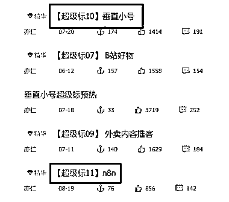
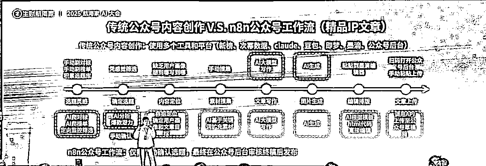

最近生财圈子里有两件大事特别火：一个是“垂直小号”项目，另一个是“N8N”自动化工具。不夸张地说，这两样东西已经在圈内掀起了不小的波澜。

就在上个月，亦仁大佬一口气放出了两个重磅“超级标”：先是7月20日推出的“垂直小号”，紧接着8月19日又公布了“N8N”。当时群里的反应可以说是炸开了锅。再到9月4日大航海正式启动时，报名数据直接说明了问题——“垂直小号”吸引了4165人，“N8N”也不甘示弱，有3778人报名，双双包揽了报名人数榜的前两名。

要知道，在这个汇集了众多高认知搞钱高手的社群里，大家的集体选择本身就是风向标。我之前在生财920 AI大会上，亲眼目睹了圈友kkk演示的N8N公众号工作流，那效果确实让人眼前一亮。当时我就在琢磨：要是把这两个热门玩法强强联手，会擦出什么新火花？

说干就干，我花了两天时间，真的把这套融合了垂直小号与N8N的自动创作工作流给跑通了。

今天这篇分享，就是要把我从零到一的完整搭建路径毫无保留地讲给你听。我会一步步带你走通整个链条：从灵感怎么捕捉，到选题怎么定，再到素材怎么搜集，然后是正文撰写、AI配图排版，最后文章直接躺在你公众号的草稿箱里，全程几乎不用你手动操心。

话不多说，咱们直接开始吧。详细的图文教程我放在了飞书文档里，链接如下：[`a0u2vshvubw.feishu.cn/docx/UnPHdrxF7oOs9AxSjuIc0rlRnKg?from=from_copylink`](https://a0u2vshvubw.feishu.cn/docx/UnPHdrxF7oOs9AxSjuIc0rlRnKg?from=from_copylink)

* * *

来看一下大家的反馈：

龙咖：说实话，在生财里翻了不少帖子，这算是把公众号N8N工作流讲得最明白的一篇了！等了好久终于看到中等级别的搭建教学，这种程度的工作流才是真正能拿出去变现的。

龙咖：其实还有优化空间，可以加个选择，让大家挑不同的排版风格，同时按字数需求分成短篇、中篇和长篇来生成。说白了就是在前端加点选项分支，这样会更实用。

Sunny：太优秀了，今晚就跟着教程试试。

千寻：你说的这些其实调整一下提示词就能实现啦。

千寻：感谢认可！

龙咖：不用动提示词，直接在节点上加选项就行。因为公众号发文有时候需要长篇，有时需要短篇，或者换个排版样式，如果每次都去改提示词太麻烦了。不如一步到位，做成全自动的。

千寻：哦，你这么一说确实有道理。

_Mizi：第二部分关于飞书的问题怎么解决呢？