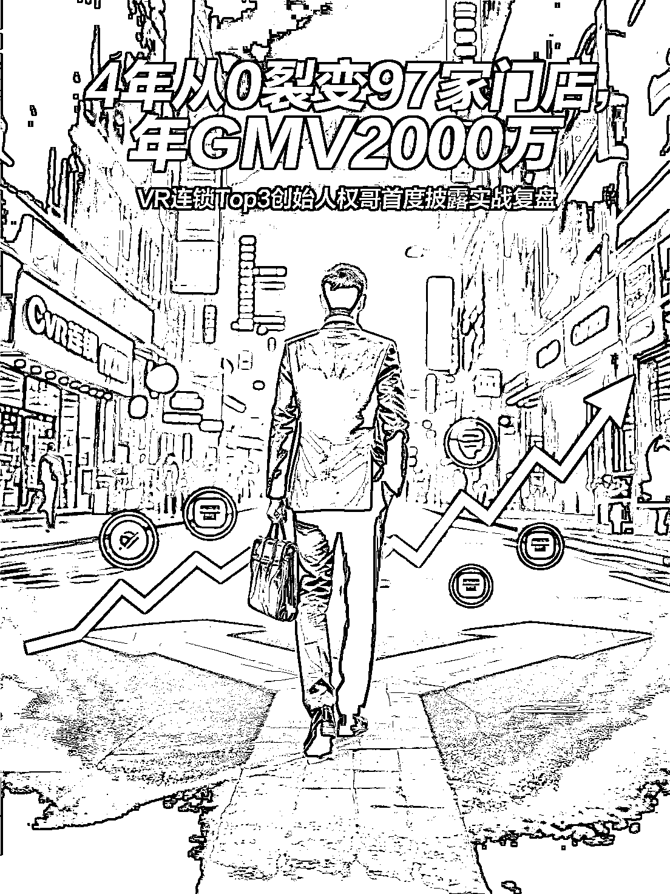
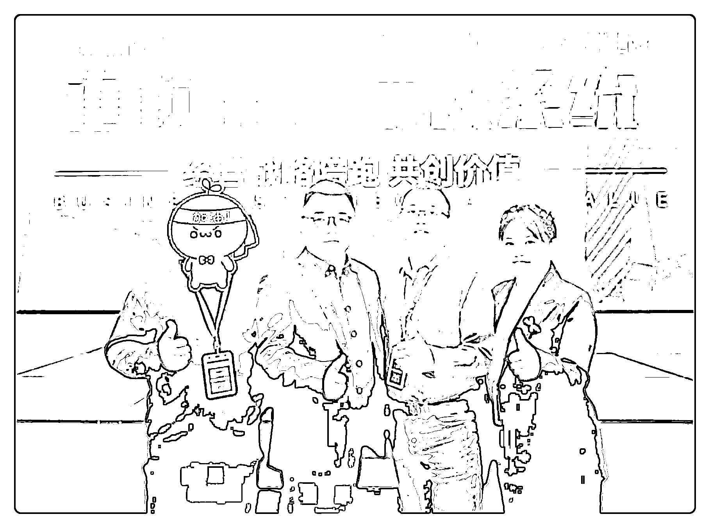
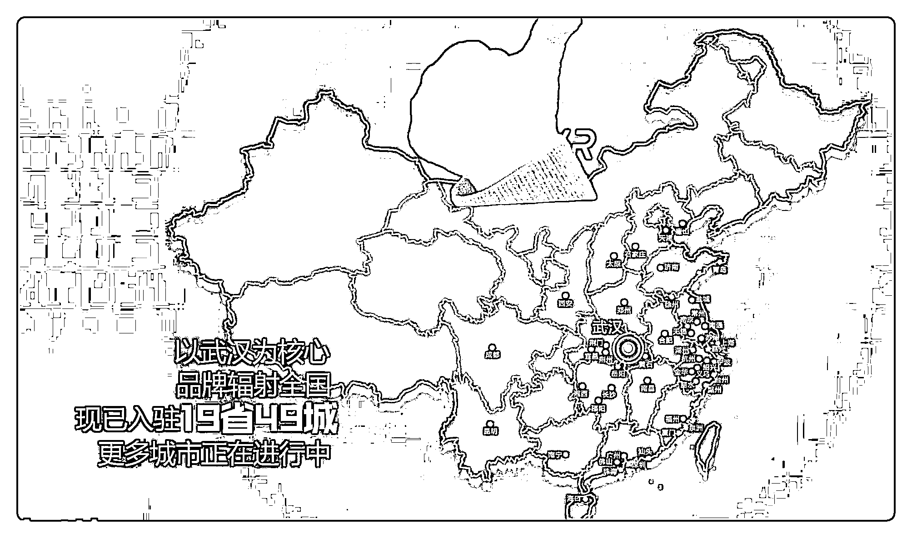

# (精华帖)(42 赞)四年跑出97家门店、年成交破两千万，VR连锁头部玩家亲述起落与重启

> 原文：[`www.yuque.com/for_lazy/zhoubao/kgg4upv8q6f0w4wr`](https://www.yuque.com/for_lazy/zhoub4...)

## (精华帖)(42 赞)4 年从 0 到 97 家店、年 GMV2000 万，VR 连锁创业复盘与再出发

作者：Ai 权哥（传奇）

日期：2025-09-28

用了四年时间把一个零起步的项目做成97家门店、年GMV达两千万元，跻身全国VR连锁前三的实战者权哥，这一次把自己的完整经历摊开来谈。

我亲历过把VR连锁打造成全国TOP3规模的阶段，也亲手在高光时刻把整个盘子归零重启。本文是一篇上万字的实战总结，里面没有空洞的框架和概念，只有我花了上千万才悟透的两个核心要素：流量与人。

从白手起家到97家店，再到归零出发的全部脉络，我都在这篇复盘里讲清楚了。如果你现在正感到方向不清、卡在瓶颈，这份经验或许能给你一个参照。

完整内容请查看飞书文档：[`ymcncqsd4u.feishu.cn/docx/CdhXduiFloo4fux5gpzcL5wonUh`](https://ymcncqsd4u.feishu.cn/docx/CdhXduiFloo4fux5gpzcL5wonUh)

* * *

评论区：

Ai 权哥（传奇） : [抱拳]