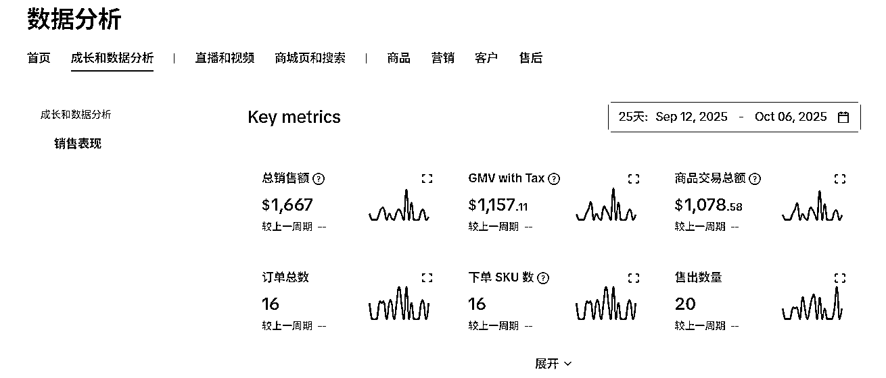
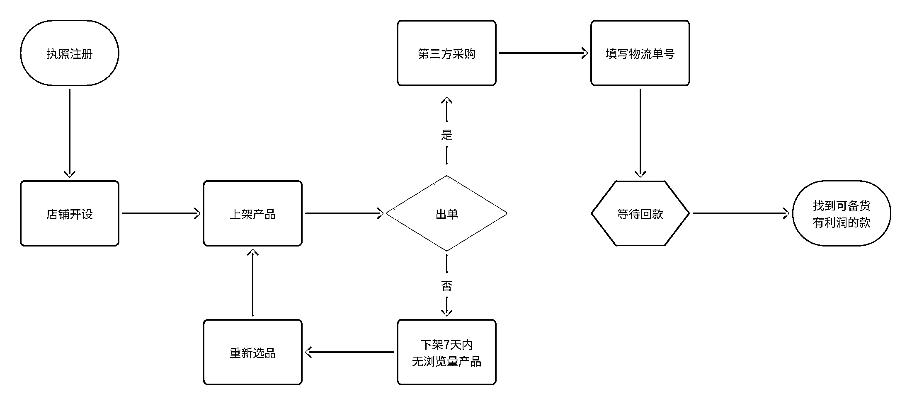

# (精华帖)(54 赞)零基础玩转 TikTok Shop 跨境，30 天目标 500 美金实操笔记

> 原文：[`www.yuque.com/for_lazy/zhoubao/fpa1yqour4q4uq61`](https://www.yuque.com/for_lazy/zhoubao/fpa1yqour4q4uq61)

## (精华帖)(54 赞)新手做 TIKTOKSHOP 跨境电商 30 天赚 500 美金教程

作者： 西沙

日期：2025-10-10

我的思考：为什么美区会是新手跨境的起点？

小红书无货源、抖音小店无货源，本质玩法都一样：从 B 端平台找货放到 A 端平台卖，客人下单后我们去 B 端下单采购，发货单号回传 A 端完成履约，赚的就是中间差价。TikTok 美区无货源，和这个思路完全同源，只是把战场搬到了更大的海外市场。

把模式拆开来看就很清晰：
A 端就是我们要经营的 TikTok 美区店铺，B 端则是能满足美国发货时效且物流单号可识别的本地货源渠道，比如美国亚马逊站、美国 SHEIN 站、速卖通美国站。只要能做到下单后快速收货、物流信息能同步到 TikTok 后台、时效达标，基本都能放进我们的供应池。

先说一说定价思路，我在用一个比较稳的计算方式：先把 B 端商品原价乘以 2.5 上架，再统一打 4 折券，实际成交价大概在原价 1.5 倍左右。

为什么我最终锁定美区，而不是东南亚、欧洲、日本、墨西哥这些常被提及的市场？我总结了三点：

第一，投入门槛低，赚头更实在。
我一开始也开过东南亚五国的店铺，客单偏低，利润被压得很薄，基本不出单，纯粹在消耗热情。后来和朋友合伙花 2800 块接了个英国个人本土店，还没来得及上架就 4 天被封了，到现在原因也没搞清楚。最后还是自己办执照做美区。实操下来，美区在出单后对操作的容错率明显高于其他站点。

第二，商家少，卷度低。
东南亚已经被卷到价格战，欧洲日本开店成本又高、审核严。TikTok 美区目前入局的玩家相对稀少，竞争压力小很多。

第三，天花板高，现在上车不晚。
国内电商已经是红海，而全球跨境的增量很明显在 TikTok 上。平台自带短视频种草、直播带货的闭环，还可以和独立站结合做私域沉淀。对比国内平台流量成本越来越高、规则越来越紧，美区现在更像增量市场：不要求你和几百万商家抢同一波流量，会选品、会基础履约，就能吃到第一波红利。

后面的内容我会带着大家从零搭建 TikTok 美区无货源店铺：B 端选品的判断逻辑、TikTok 上架的细节技巧、履约避坑经验、利润优化方法，每一步都是我亲自跑通的落地做法。这篇先把我踩过的坑和现在的成绩坦白讲清楚，主要是帮大家建立信心——这个赛道不需要百万启动资金，也不需要多年的跨境背景，跟着逻辑走，在全球最大跨境赛道里分一杯羹是完全可行的。

TIKTOK 跨境电商 TIKTOKSHOP

大家移步飞书观看：[`vqjz0ej9x2.feishu.cn/wiki/R1S8wfVAhiiSYlkJ3Nvcn15Onpe?from=from_copylink`](https://vqjz0ej9x2.feishu.cn/wiki/R1S8wfVAhiiSYlkJ3Nvcn15Onpe?from=from_copylink)

* * *

评论区：

青枝 : 感谢西沙真诚分享

悟空悟空空 : 很详细

沐飞 : 如果只是做 tk 短视频博主，里面提到的网址工具是不是同样适用

西沙 : 一部分，回款工具和数据分析是我做视频会用的

未央 : 老师，请问是选中国大陆还是美国？

西沙 : 中国大陆

98.  : tk 跨境店能本土发货吗？

西沙 : 要求本地发货；不然不会衍生出虚拟仓玩法