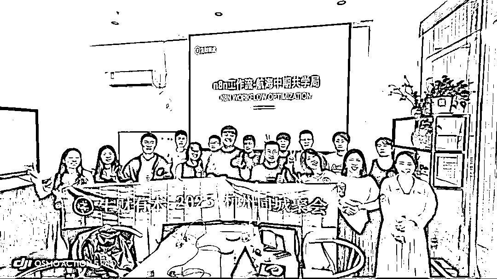
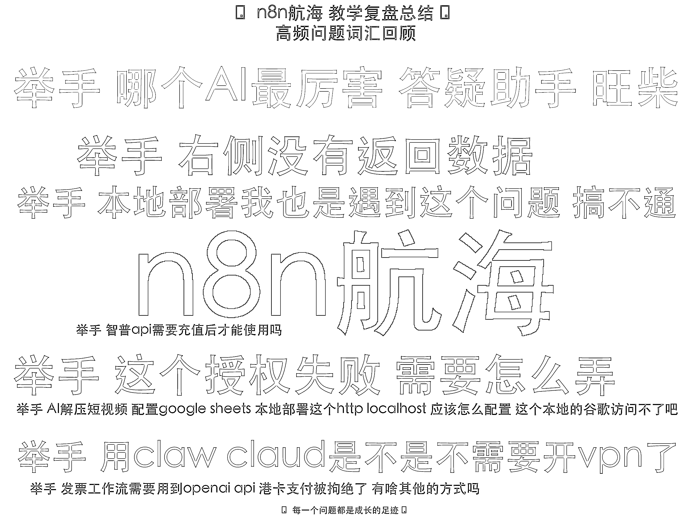
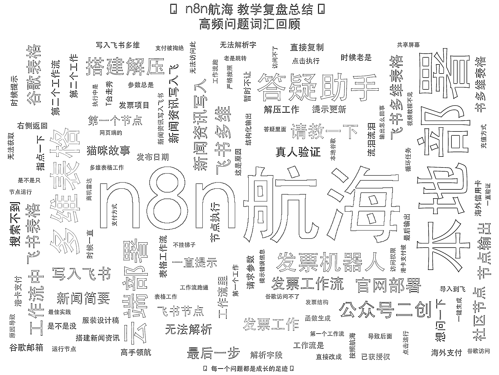

# 精华分享 | 9 月 n8n 航海收官复盘：3700+ 人同航，🛰️答疑机器人实战拆解

**9 月 n8n 航海教练复盘：🛰️答疑机器人的一次新探索 + 数据复盘 + 线下 n8n 精华分享**

作者： Cyrus-赛探长  
发布： 2025-09-28

9 月份的 n8n 航海训练营正式画上句号，超 3700 名船员全程参与。作为本期航海的教练，我把整个过程的思考脉络、这次重点尝试的🛰️答疑机器人方案，以及相关的技术实现与数据洞察，都整理成了一份完整复盘。

由于篇幅比较长，已整理到飞书文档，欢迎移步查看详细内容：[`lag410zsdtc.feishu.cn/wiki/Gz3mwr7R3iGTUKk76xBcwXVdn7b?from=from_copylink`](https://lag410zsdtc.feishu.cn/wiki/Gz3mwr7R3iGTUKk76xBcwXVdn7b?from=from_copylink)

* * *

**精选留言**

龙咖：现在赚钱里也在聊 wxauto 框架，这个工具我用很久了，确实好用。

邓瑜：只看了开头部分，就能感受到 n8n 教练的不易了[玫瑰][玫瑰][玫瑰]

铿然：我最近也在研究🛰️群的智能助手，之前担心封号问题比较严重，🛰️这条路不好走的话，我都想转钉钉了。