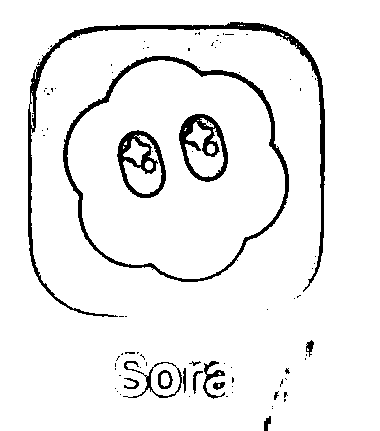
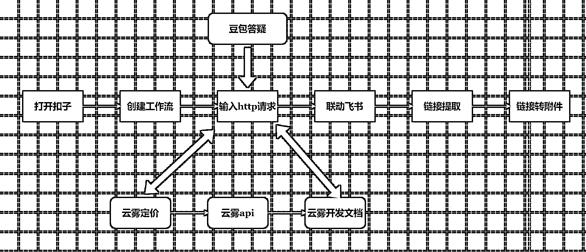

# 10分钟上手：用 Coze 把 Sora 接进飞书多维表格，批量出片不再卡壳
作者：龙哥

## 用 Coze 做桥梁，让 Sora 和飞书多维表格真正打通

作者：刘同学

日期：2025-10-05

安卓设备用不了 Sora？国内环境访问不畅？这些痛点都能绕过去。思路很简单：用 Coze 搭建自动化流程，和飞书多维表格联动，让创作效率直接拉满。

* * *

读者反馈：

吴泽承 : 国庆假期就该这样冲，学到了[呲牙]

晨 : 真的太感谢了，按着教程一步步搭完工作流，跑起来很顺畅

晨 : 另外提醒一下，测试前最好确认下云雾里有余额，不然跑不通容易误以为是配置问题[呲牙]

刘同学 : 对的，受益点赞

小宋 : 厉害了，这个思路太棒了

李朵拉 dollna : 之前一直不敢碰 Coze 和多维表格，这篇直接给我上车了，马上开始试