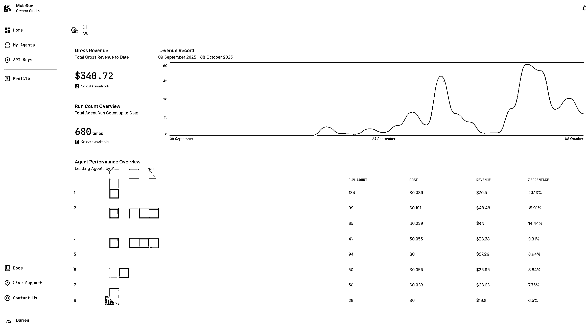
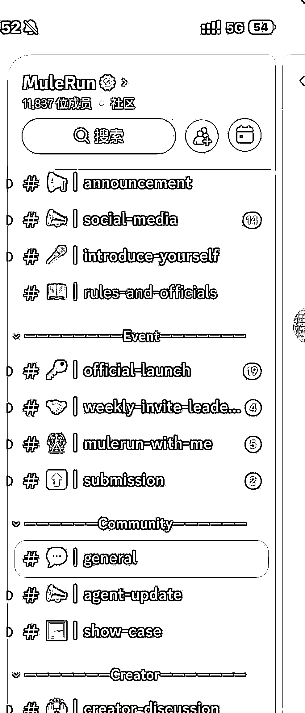

# (23 赞)MuleRun 中标之后关注的小机会，二周躺赚 340 美金

关于MuleRun的风向标中标后，我顺藤摸瓜，两周躺赚340美金

大家好，我是龙哥。今年4·18加入赚钱，很荣幸被邀请担任n8n航海教练。本职程序员，金融背景出身，之前也做过出海创业，接下来还想在这条路上继续匍匐前行。

这事要从一次线下n8n组局说起。那天认识了圈友小查，他给我安利了MuleRun。回来我立刻去X和Discord逛了一圈，发现活跃用户不少，平台也处在很早期的阶段，背后还有阿里投资。他们要做的是“AI界淘宝”，上线才10天，用户就冲到21万。用投资的眼光看，这就是一只还没price in的股票，得趁早上车。

听完一节他们的基础课，我搞清了上架要点和SOP，马上注册成了Creator。紧接着在圈里发了一条风向标，很幸运中标了。这里真心感谢龙哥老大，也谢谢圈友们的指点和帮助。

最终成绩？两周时间，躺着赚了340美金，有截图有真相。整个过程我按“小成绩、背景、过程、思考、资料”五个模块整理成了飞书文档，想上车的朋友可以直接移步。

回头想想，这件事最值钱的不是那340美金，而是验证了一个朴素道理：很多人其实看到了风向标，甚至看到了中标，但只有肯“把手弄脏”的人真的赚到了钱。所谓信息差，正在不断收窄，真正拉开差距的是执行。再大的风口，只要不动手，永远只是别人眼里的风景。

希望对你有启发，一起加油。