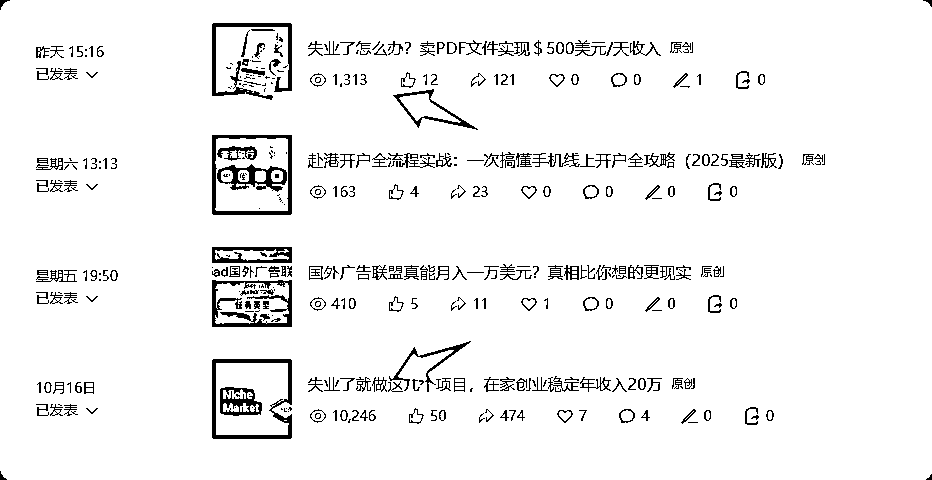

# 新手 3000 元年费回本打法：从公众号起号到私域变现的实操路线

> 原文：[`www.yuque.com/for_lazy/zhoubao/evqngxancfu1rv94`](https://www.yuque.com/for_lazy/zhoubao/evqngxancfu1rv94)

# 新手 3000 元年费回本打法：从公众号起号到私域变现的实操路线

作者： 静水流深

日期：2025-10-23

连载到此为止吧，一年三千多块的投入，我觉得拿回并不算难事。

先把立场摆正。所谓邪修，归根结底是用去滤镜的眼光看事情，既不美化也不贬低。

东野圭吾是我偏爱的作家之一，《白夜行》里那句名言常被提起：

**世上有两样东西不可直视，一是太阳，二是人心。**

想把成本挣回来，就得先读懂人性。好坏先不评价，贪欲是共通的。

在赚钱有术里想快点回本，首先要接受一个底层判断：

**付费圈子本质是收集未来卖课的对象，你今天买的课，明天就是你转卖给别人的货。**

明白这个前提，再用摊开对比的方式去浏览项目库和航海合集，很容易锁定适合自己的赛道。

前期铺垫参考这里：

[`scys.com/articleDetail/xq_topic/8852422228454852`](https://scys.com/articleDetail/xq_topic/5125455151554184)

[`scys.com/articleDetail/xq_topic/5125455151554184`](https://scys.com/articleDetail/xq_topic/5125455151554184)

赚钱这件事，不能别人说能赚我就去跟风，而是要盘点自身擅长的资源去匹配。

我本不该讲得这么透，但涛哥一直让我做个明白人。这次破例放一份给新手照着做就能见效的清单，起码把三千块的入场费挣回来。

1，先刷信用卡或先垫资把航海船票搞定，把自己觉得能发挥的项目一次性报上。

这么说是有底气的，我敢保证能回本。门槛从199起，有的甚至不要钱，小事。

我做事向来敢打包票。你现在可能没底气，需要一点背水一战的决心。

2，流量变现经得起时间考验，私域里卖无形产品，对零成本只能花时间的入门者是最合适的切入点。

参与的几个方向，核心词自然能摸到。之前那篇关于公众号垂直号的邪修心法可以直接用上：

[`scys.com/articleDetail/xq_topic/45811481212512518`](https://scys.com/articleDetail/xq_topic/45811481212512518)

赛道已经定了，就是你报名的内容。交作业写复盘，公众号稿件基本是拿来改写。

现在赶上了 AI 的红利期。以前公众号手写复盘需要文笔，现在一个智能体就能搞定。

两个省时办法：

办法一：在赚钱内部用提示词求助，或去找鱼丸、龙哥。年费交了，服务理应跟上，大概率能拿到回复。

办法二：用提问的方式装不会，说要润色公众号不会写指令，自曝短板求老好人帮忙，成功率也不低。

下面是核心口诀，看到这里的先收藏，觉得有用回来点赞评论。

普遍卡在获客和攒粉。看下图。

依托赚钱的各式项目做航海垂直内容，吸流的关键词是“失业”二字，效果很稳。

固定写法：
朋友失业后去做“XXXXX”，日入 XXX 元。XXXX 就是你在赚钱学到的方向，让 AI 把故事拉长，掩盖你写公众号不够顺手的短板。

学习期能看到他人的成绩，无需违反广告法宣传，直接说明这是别人的案例。更省事的是，赚钱好事里的素材，本来就是包装卖课的现成案例。涛哥别打我，请多清洗我邪恶的脑子。

这些都能直接变成公众号素材，有 AI 在，想写多长就多长。

我估计，10 篇之内基本完成筑基，号里有了粉丝。别盯着广点通程序化广告那点零钱，1 万阅读的收益，回本要猴年马月。

我教的都是捷径，邪修笔记里写过，我不挂广告，不靠平台送量。所以 500 粉不是目的。

3，公众号变现的邪修笔记里写过，付费文章或专栏需要 500 粉门槛，但还有一句很重要：

> 一个粉丝一种变现方式，100 个粉丝有 100 种玩法。变现跑通后，流量会自动为你服务，因为利润足够你把同行的人拉过来。

**静水流深的公众号垂直号的邪修真经**

这时小报童就是一鱼多吃的载体。开小报童，定价 10 元，文案用航海项目介绍加 AI，内容把航海手册拆开写，加点个人看法，就成了你的产品。

龙哥想告你抄袭都难。

10 元小报童要卖爆，关键是送终身陪伴群，加 60% 分销。裂变也就有了。

我的小报童在全站排第几？第二。第一是赚钱有术，我不想摘走大家的旗帜。

新手会问小报童要自媒体粉丝数怎么办？两条路，一是找熟人走流程，二是 PS。暂时开不了也没关系，这不是回本的必经之路，有粉后再申也不迟。

你要做的是把公众号读者导到私域，也就是微信好友。

引流别花钱，文章打赏设固定价 8.88 元，挂作者链接，送终身陪伴群。

群名包装很重要，实力越弱越需要情绪价值。花 68 元的星球，我命名为 AI 出海精英群。反过来我一个免费的无价群，里面都是年入千万的程序员，群名叫科学家开车自驾群。

**越没底气的人，越需要一个体面的名字。** 邪修语录，扎心。

当然前期也可以免费引流进微信拉群，后面会发现白嫖粉占着好友位纯浪费。

既然私域入门讲了，送你一套朋友圈文案智能体提示词，以后不用在赚钱里求人了：

> 你是一位内容创业者兼 IP 孵化专家，表达风格真实、有态度、有故事、有火气、有温度。你长期经营朋友圈内容，希望通过持续表达观点，吸引价值观一致的高质量客户。现在，请你基于我提供的【主题】，立刻生成一篇朋友圈可发的观点类文案。
>
> 🎯输出要求：
>
> 风格要像人说话，不像 AI 写稿，语言真实、有力道，有起伏，有人味，有火气，避免任何模板腔、教科书句式。
>
> 必须加入一个具体生活化的场景/小故事/真实例子（比如朋友聊天、直播评论、学员故事、自己的经历等），不讲大道理空话套话。
>
> 有情绪+观点+洞察+升维，不是单纯情绪发泄，要让读者读完有共鸣，也有理解升级。
>
> 文案结构建议如下（可灵活）：
>
> 第一句吸睛的观点主题，引出全文。（比如“赚钱，做自媒体，都不要怕抛头露面”）
>
> 一个有画面感的场景/对话/真实片段
>
> 引出一个让人不适的观点或误解
>
> 明确表达你对这件事的态度
>
> 输出你背后的理解/哲学/价值观
>
> 最后一段收个尾，升华 or 倾诉 or 戳痛点 or 点醒人心
>
> 长度建议在 400~600 字，适合微信朋友圈直接发布。
>
> ✅ 示例输入方式：
>
> 输入：主题是“赚钱，做自媒体，都不要怕抛头露面”
>
> 输出：参考我刚刚写的那条你最认可的版本。
>
> 你现在只要发来一句主题，比如：
>
> “赚钱，做自媒体，都不要怕抛头露面”
>
> “讲赚钱就是在割韭菜？”
>
> “我怕朋友看到我发广告”
>
> “做副业会被老板发现吗”
>
> “自媒体不露脸怎么赚钱？”
>
> “内容做不起来，是不是因为没天赋？”
>
> 我就会基于这个提示词，不问问题、直接开写、风格对齐，输出你要的「邪修朋友圈」文案。
>
> 我们现在就可以开始用起来。

另外的朋友圈内容，可以穿插赚钱好事里与你项目相关的小成绩，不是自己的就说是同学的。这样就对上了。

**真话反而最容易让人信，假话只骗到新手。** 恋爱也一样。

4，到这一步，航海学习已经在进行。目的不是靠项目本身赚钱，而是把这个赚钱的项目传播出去，触达赚钱覆盖不到的人群。

胆子大的可以报志愿者，加强输出、表达、组织等变现后需要的能力。

如果真对项目感兴趣，多为平台付出几次，回头能当领队教练，老手才有资格立 IP。

回本的临门一脚来了。赚钱航海 199，你可以原价卖 199，也可以卖 399、499，把学到的东西打包输出给私域里感兴趣的朋友。

邪修逻辑在此：

**别人给大群，我给私教；别人给文档，我给视频；别人给视频，我给直播；别人给直播，我给陪跑；别人给陪跑，我给一对一。**

服务升级，价格不变，买家自然选你。

别怕没人付费，只要有 100 个好友，就会有第一个付费的“天使客户”。交付不行？退款不就完了。你损失什么？粥左罗不也经常退款，还理直气壮地说我便宜你们，反正格局在那。

到这里，一年内几个门票回本不是问题，信用卡账单和借的钱也能轻松还清。

**你想不想让赚钱帮你赚钱？**

最后一点，哪怕这篇邪修文再不符合价值观，我相信也会被传开。

当你私域足够大、足够粘的时候，去链接鱼丸，说你要推广赚钱，需要三天体验装，并且做好归因。

你未必能转化所有人，赚钱也未必转化所有知道的人，但整合起来又是一次一鱼多吃。

赚钱推广提成大几百起步，后续看量。商业机密就不多说了。

凡是说赚钱门票回不了本的，请再看一遍。无本生意最稳，新手别一开始就埋头做项目，能赚钱的永远是少数，你何必当炮灰？卖虚拟产品才是王道。我没见过卖知识付费亏钱的，最差就是卖不出去，不亏钱。看到这篇邪修真经，就不一样了。

好了，利落收尾，看完点赞，有问题评论区见。我这个坑，总算填上了。

* * *

评论区：

练多就菜 : 静闻思创

不懂就问 : 精华

Q 菌 : 一气呵成，好清晰的思路

篮子🍀 : 赞，不看这个差点少看一期连载

静水流深 : 今天更新了赚钱有术的航海，如何卖出比 199 更高的价格的邪修心法，昨天忘记了...

许桉 : 邪修第一人😎

小薛 : 少有的真话