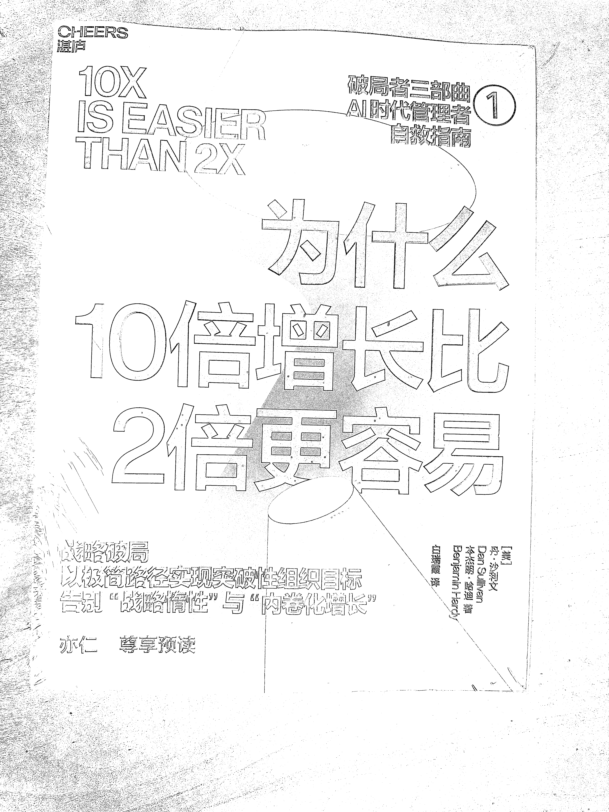

# ('(189 赞)10x is easier than 2x 中文版终于要上市了，等正式上市后，想组织大家一起共读下', (2, 58))

10月18日，龙哥的一则动态让不少人眼前一亮：《10x is easier than 2x》中文版终于要面世了。他透露，等正式开售之后，想组个局，带大家一起共读这本。消息刚发出来，就获得了189个赞。

评论区里，“期待”成了高频词。有人恨不得马上开始，有人已经把共读日程安排上了。当然，也有网友认真分析了版本问题。

一位朋友发现，简体中文版和早前的台版译者并不相同，这一版是白老师独自翻译的。就目前公开的反馈来看，白老师的译本总体收获的是好评：读者普遍觉得文字通顺、读得进，加上译者本身专业背景扎实，为译作增色不少。不过这人也提到，现在能看到的多是笼统的好评，真正围绕译本的细节讨论还很少——比如具体词藻选得准不准、文化意思有没有到位、译者的风格和口吻处理得如何，都还缺少那种“这里译得妙”或“这句翻歪了”的深度切磋。

另一位网友的态度则很直接：他认为台版才是更优解，读起来更容易理解；他评价这版中文版像是被“动了刀子”，行文逻辑也不够顺畅，并称自己在推特上看到有人提前预览后同样表示失望。

面对这些争议，龙哥本人倒是看得很开。他建议，英语过关的朋友直接读原版，或者用AI给自己生成一个译本；在他看来，翻译并不是这本书最要紧的部分。还有人在评论区补了一句：台版的电子书如今在博客来、Readmoo等平台上已经可以找到了。

不管怎样，中文版的上市总算是个好消息。至于最后选择简体、台版还是原版，就看个人口味了。