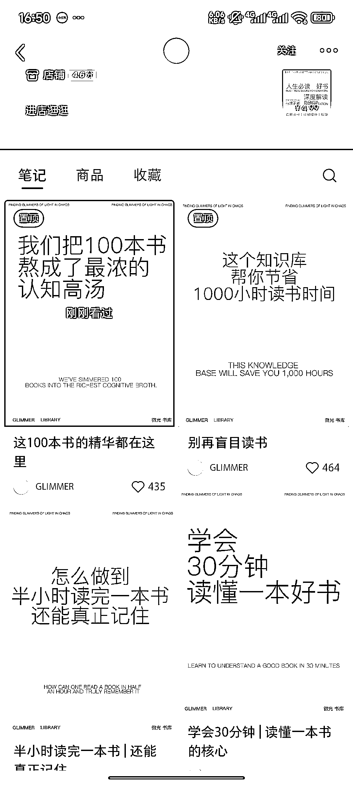
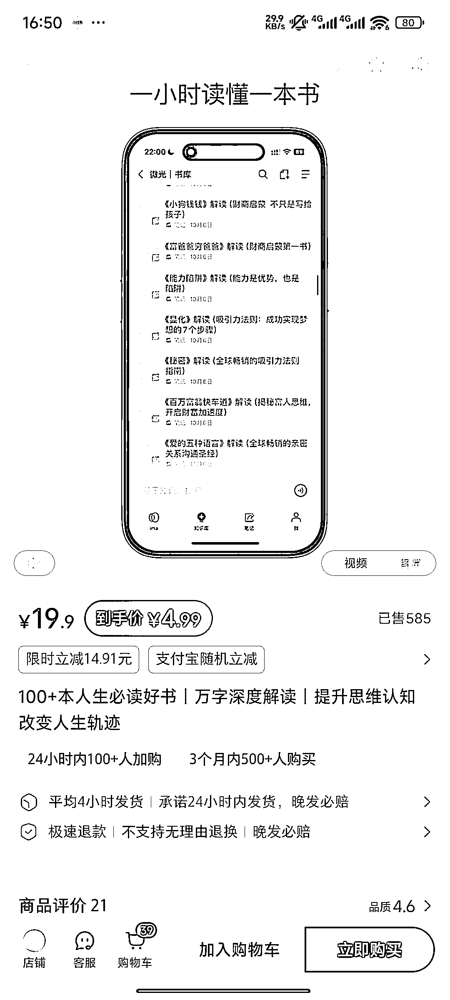
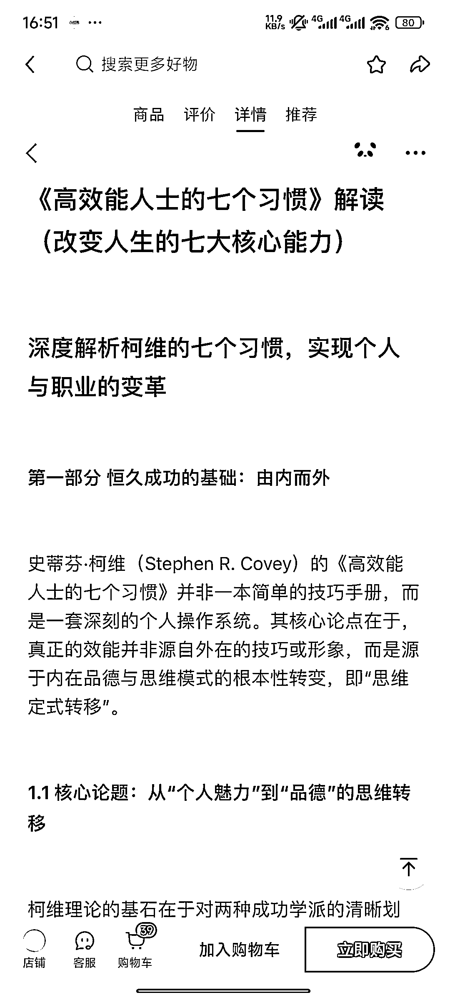
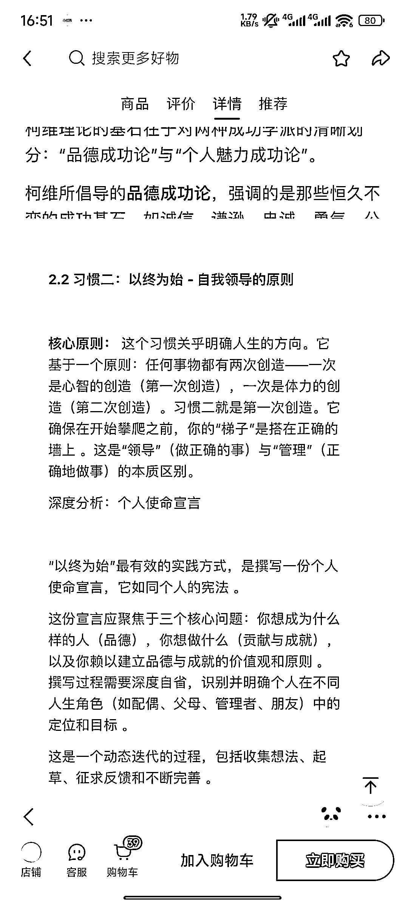
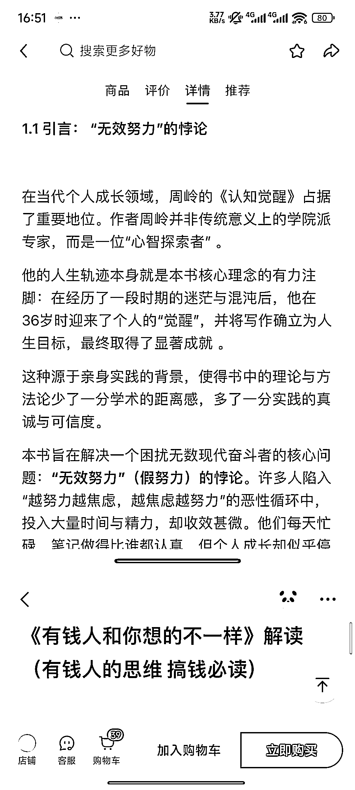
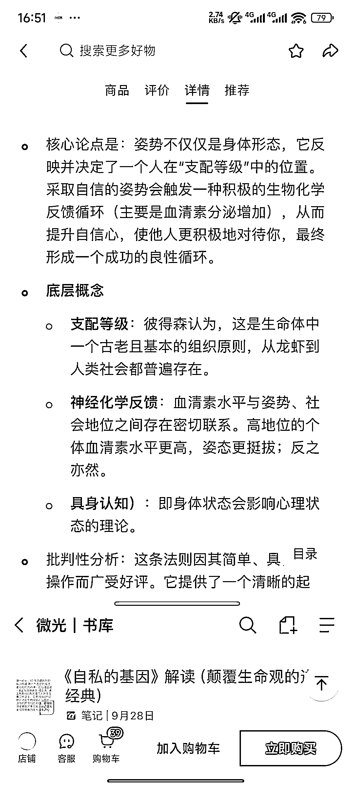
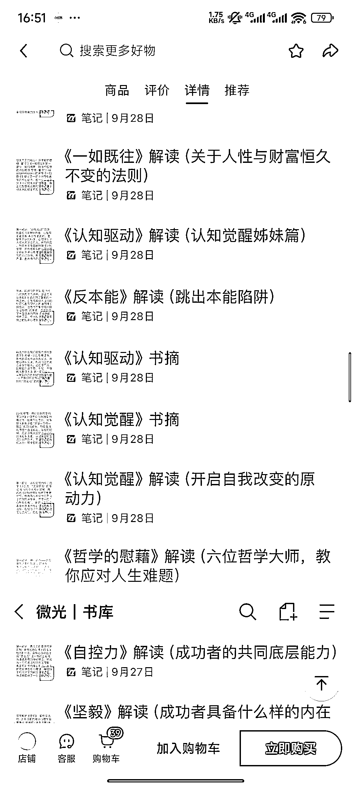

最近刷到一个挺有意思的案例：有人在小红书上靠卖读书笔记，轻轻松松跑了600多单。你可能觉得不可思议，点开那些交付的笔记内容，是不是有种似曾相识的感觉？没错，这些笔记压根不是人工一个字一个字敲出来的，而是AI批量生成的——先产出初稿，再做整理、排版、上架，最后通过内容引流开卖。

怎么做到高效产出呢？这里有两个亲测好用的路子：

第一招：用Coze搭建工作流，一次能开十个分支，把十本书丢进去，靠着预设的大模型提示词，瞬间就能得到十份读书笔记初稿，之后再按自己的想法微调优化就行。

第二招：用飞书多维表格，直接把100本书一次性粘贴进去，调好AI，唰的一下，100篇读书笔记初稿就齐活了。

更值得一提的是，评论区有人透露，这个账号起量特别快。作者自己也晒了数据：11月9号下午4点56分，已经卖了585单；到11月11号下午5点57分，数字直接飙到793单。这增长速度，确实有点东西。

说到底，这套玩法的核心就是：用AI把“读一本书”变成“批量生产笔记”，再用平台流量把笔记变成实实在在的订单。至于有人吐槽“信息差太大”，但现实就是——市场永远存在，就看你怎么抓住机会。

