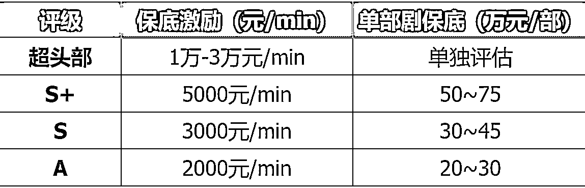

# (45 赞)抖音漫剧激励政策更新！竖屏漫剧的春天来了！
作者：龙哥

最近，抖音短剧赛道又放出一个大消息——竖屏漫剧的创作者们，机会来了！

抖音短剧版权中心这次专门针对竖屏漫剧推出了一套全新的头部精品激励方案，注意，这次扶持的对象是竖屏漫剧，沙雕动画不在范围内。

政策的核心亮点在于，只要是番茄小说旗下的原创IP，漫剧改编权的费用由版权中心全额补贴，真正做到0成本启动改编。同时，根据IP的级别，分成超头部、S+、S、A四个档次，每一档都有对应的保底激励，单部剧最高可以拿到75万的保底金额。

换句话说，如果你手里有好的漫剧项目，又正好能对接上番茄的原创IP资源，这波红利确实值得冲一冲。

评论区里已经有人行动了，龙哥表示“感谢分享，已中标”，也有读者在追问具体的申请入口。看来，竖屏漫剧的这波政策东风，已经有人抢先上车了。

如果你也在做漫剧，或者正打算切入这个方向，不妨去研究一下具体的申请条件，别错过这波窗口期。