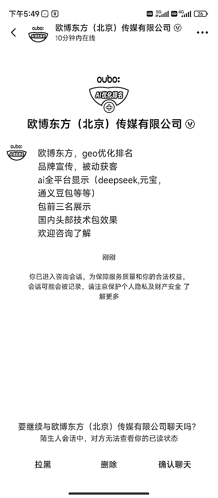
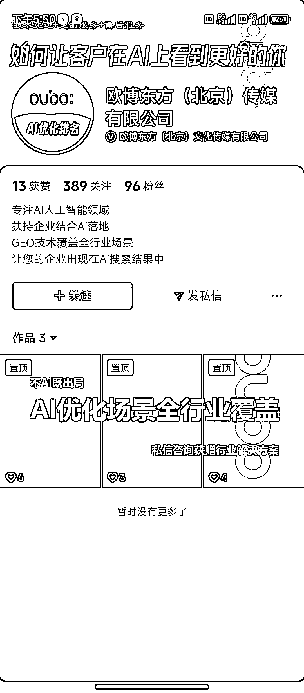

# GEO 来了，线下教培的下一波流量红利？

今天照例打开后台，突然被一条广告吸引住了——一家叫欧博东方的服务商在推广 GEO 优化排名，也就是说，能帮我们这种成人技能类实体培训公司，在 DeepSeek、豆包这类 AI 平台里冲到前三名展示位。

回顾一下我们的获客轨迹：十年前靠百度 SEO，五年前靠抖音、快手矩阵号拿精准线索。现在又冒出来一个 GEO，我不由得想：这是不是线下实体教培行业的又一轮流量红利？再往大了看，凡是依赖“线索型获客”的生意，都可能多出一个新入口。

眼下 AI 搜索正在悄悄分流传统流量，谁能先下场，谁就能吃到这波认知差。已经有越来越多人习惯用 AI 提问、找答案，可大部分教培机构别说布局 GEO，连这个概念都还不清楚。如果现在开始做，其实也未必需要从零造内容——把以前在百度、抖音、快手上验证过、转化效果好的内容，换一种形态放进 AI 的推荐回答里，就能直接触达用户。

另外一个好处是，GEO 本质上是被动获客，用户主动搜到才进来，说明需求本来就明确，意向度自然更高，转化成本大概率也会更低。

评论区里有朋友问：这种模式是卖培训，还是做服务？作者回复说，是做服务，像他们这样需要销售线索的实体培训业务，非常依赖这个。亦仁也在下面留言：感谢分享，已中标。