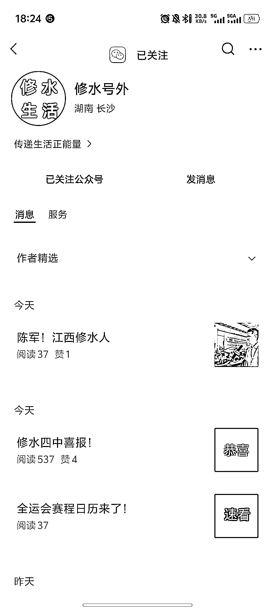
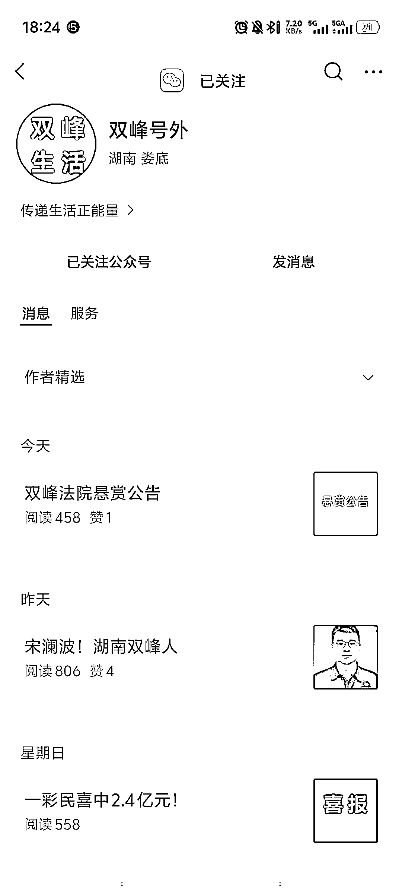
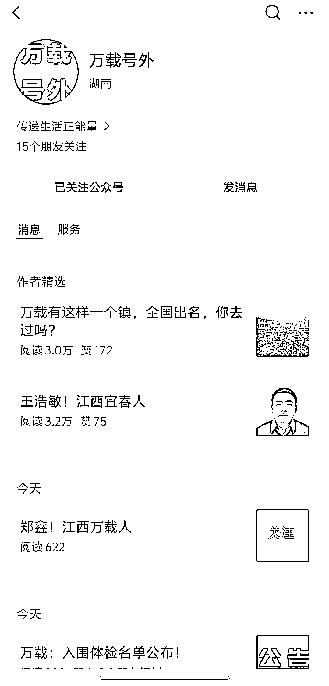

# 地方号矩阵玩法拆解：从0到变现的完整路径

最近刷到一批做得很猛的地方号，基本都是矩阵化运作，效果拉满。特意整理一下思路，给想入局的朋友一个参考风向。

我这几天盯了一波账号，发现它们的起号套路高度一致：名字直接用“城市名+号外/快讯”这类地名组合，开头内容全是本地名人轶事。很有意思的是，这批号的登录IP集中在湖南方向。

为什么这个方式能跑通？很简单，信任感拉满。举个例子，杭州本地人看到一个叫“杭州号外”的账号在推送本地资讯，第一反应就是官方或半官方，心里天然觉得靠谱。只要内容沾边本地生活，关注转化就很容易来。

**起号的关键点：**

1. **名字选城要讲究**。大城市名通过率低，比如“杭州号外”这种大概率被驳回，反而“万载号外”“醴陵号外”这种小县城名更容易通过，也竞争小。
2. **内容有现成素材**。不用自己写，直接去百度百科搜对应城市的名人事迹、历史典故。同乡的归属感一下就被点燃了，评论区互动也自然起来。
3. **矩阵才有势能**。单打独斗很难起量，这种玩法拼的是覆盖面和爆款率。建议批量上号，形成区域垄断感。操作上可以用多开浏览器来做协同管理，效率更高。

**变现方向也很清晰：**
1. 流量主广告分成，粉丝基数上来后很稳定；
2. 本地同城付费服务，比如本地团购、招聘信息、特产推广等，转化更快。

* * *

补充细节：号里发的素材很多都是百度百科、政府公示文件和地方官媒的整理内容，甚至会翻出来几年前的旧资讯。

评论区补充提醒：官媒内容最好别直接搬运，《互联网新闻信息服务管理规定》里明确要求，未经许可不得开展互联网新闻信息服务，违规可能面临停更和罚款风险。