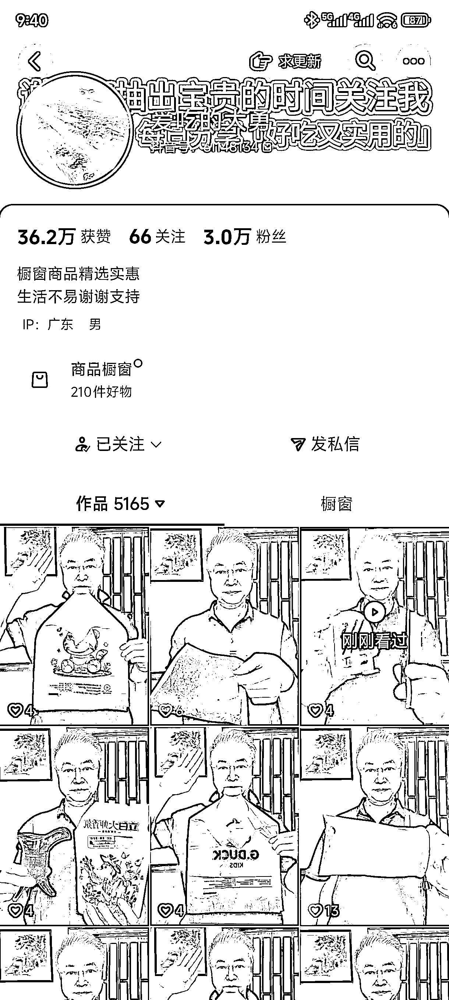
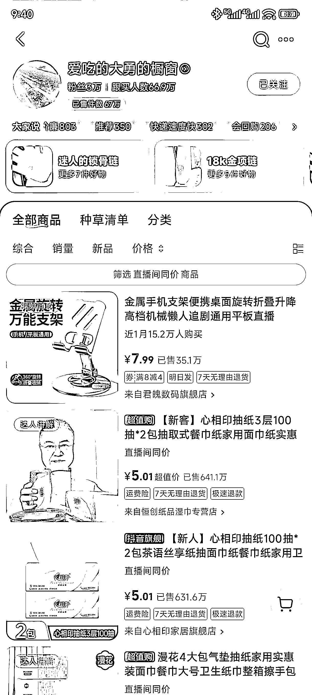
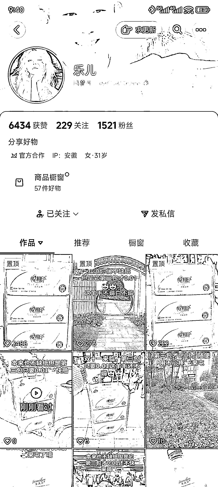
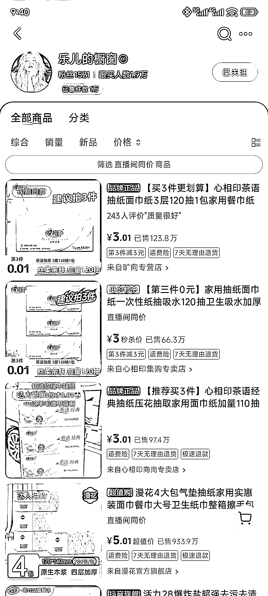

# (22 赞)亦仁大大的超级标垂直小店，让我联想到抖音上那批“不起眼”的小店

> 原文：[`www.yuque.com/for_lazy/zhoubao/bpatr2ac6xke6whp`](https://www.yuque.com/for_lazy/zhoubao/bpatr2ac6xke6whp)

## (22 赞)亦仁大大的超级标垂直小店，让我联想到抖音上那批“不起眼”的小店

作者： 东风

日期：2025-11-12

今天刷到亦仁大大分享的超级标垂直小店案例，脑子里立刻浮现出前阵子在抖音上看到的一个账号。 

那个账号粉丝量不算高，作品的播放和互动也都很平常，主推的商品价格偏低，但奇怪的是卖得还挺好。按这个表现来看，其实它也符合垂直小店的特征吧。

* * *

评论区：

亦仁 : 感谢分享，已中标