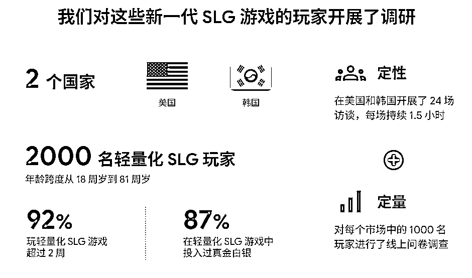
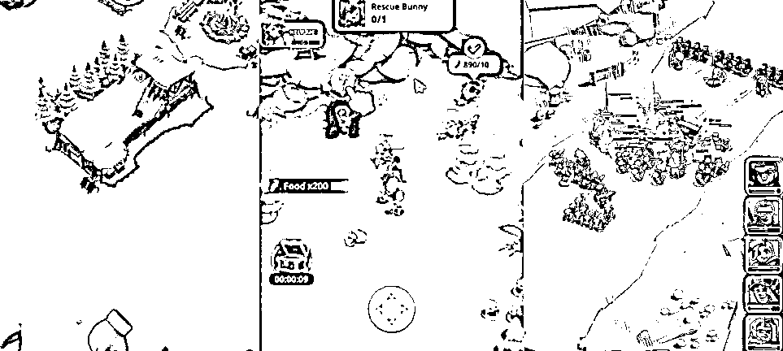

# 轻量化 SLG 正在改写出海规则，创意驱动让中小团队成为新赢家

轻量化 SLG 的崛起，正在打破传统 SLG 出海的红海僵局。过去靠重度数值和长期运营堆量玩法已经很难突围，如今借由轻量化设计，中小开发者完全可以靠创意和产品打法，杀出一条高潜力的盈利路径，成为中国游戏出海最具想象力的赛道之一。

核心的玩家基础已经跑通。美国和韩国两大核心市场的资深 SLG 用户与拓圈潜在用户，都展现出强付费意愿：超 92% 的玩家留存超过两周，87% 的人群产生过付费行为。这证明了轻量化 SLG 并非降维妥协，而是找到了更宽的商业天花板。

做对轻量化并不等于做简单。视觉上要在亲切可爱和新鲜差异化之间找到平衡点，让人一眼想点进来看；操作上要极致简化，把学习成本压到最低；联盟社交系统则需要在单人深度体验和多人联动之间做好度，避免社交绑架核心乐趣。宣传承诺与实际体验必须一致，否则高获客成本很快会被流失吞掉。

用户分层运营是关键。拓圈玩家更看重可控的易上手体验和内容丰富度，如果引导得当，能顺利转化为高价值付费用户；资深玩家则不能丢掉策略内核，需要在经典 SLG 框架上叠加个性化定制和创新玩法，去满足那些已经被传统产品忽略的进阶诉求。社交驱动和创新体验，正是推动付费转化的核心引擎。

* * *

评论区：

亦仁 : 感谢分享，已中标