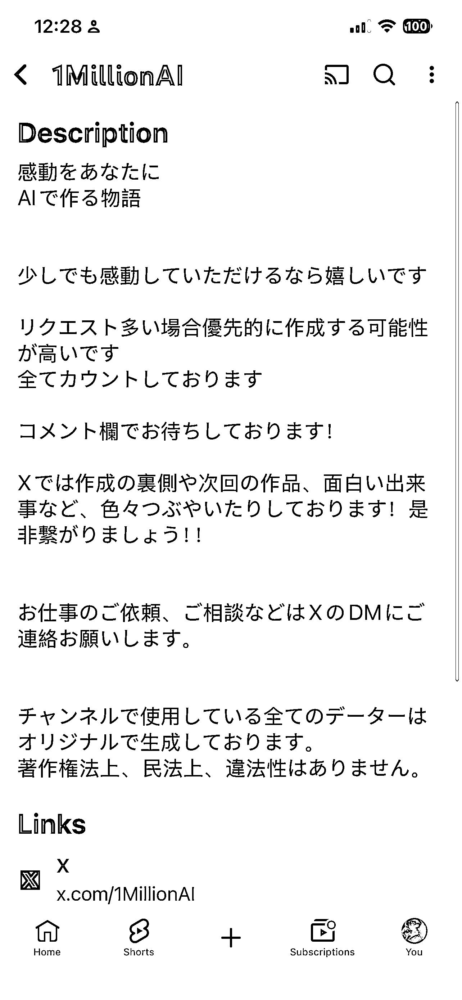

# 上线三个多月狂揽2700万播放，这个AI频道靠的是“名人编年史”
作者：龙哥

7月19日注册的YouTube账号，短短三个多月，已经收获了2700万次播放，而它发布的视频不过37个。更值得注意的是，这个频道的定位非常清晰：面向日本观众，用AI把那些日本重量级人物的一生做成“编年史”——出生、成长、高光时刻，重要经历按时间线一一铺开。

这种内容最厉害的地方在于，它自带“看一眼”的吸引力。哪怕你并不感兴趣，刷到也会想知道：这个人到底经历了什么。

如果想把这套玩法复制到自己手里，其实并不难。换个国家就有新素材：美国、印度、加拿大、德国，任何一个国家都不缺有影响力的名人。或者换个维度，按领域来切：科学家有牛顿、爱因斯坦、图灵，艺术家有达芬奇、梵高。只要人物足够有国民度，流量就有了基本盘。

评论区里已经有人按捺不住：感谢分享，已中标。看来，这个路子的可行性已经有人开始验证了。

