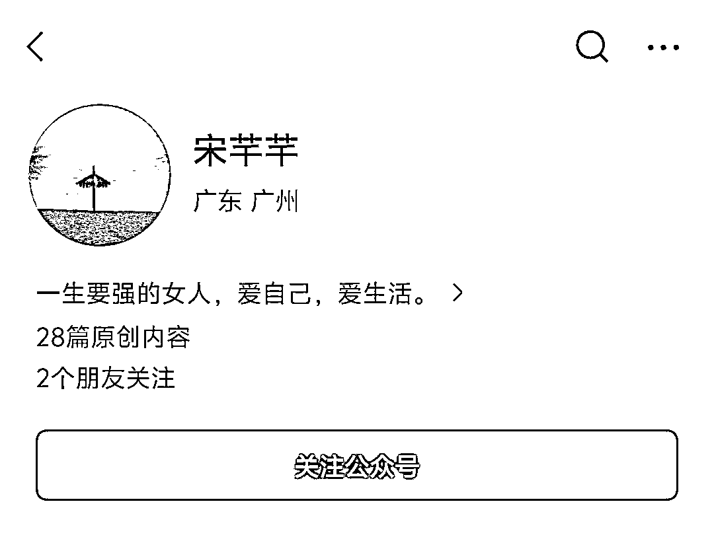
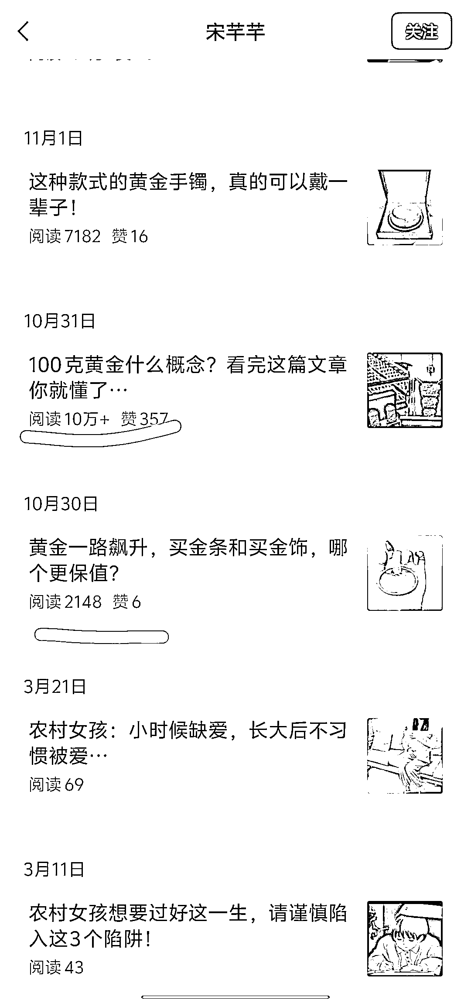
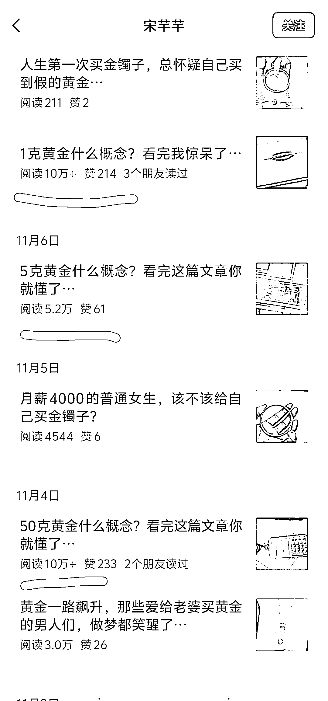

# 一个沉寂老号重启两篇就起飞10万+，这个赛道现在真能冲
作者：龙哥

最近复盘到一个很有意思的案例，账号宋芊芊。

10月底才重新开更，第一条内容勉强破千，第二条直接飙到10w+，之后更是连续多篇保持高光，数据曲线非常漂亮。

为什么偏偏是现在？

核心就在于题材本身在发力。黄金最近的行情波动太大，加上交易征税的讨论持续发酵，整个话题的热度被推到了前台。我自己刷信息流的时候，也陆续看到好几位以个人买金经历为切入点的创作者突然火了。

这就说明赛道有明确的情绪共振点，用户在问价格、在问税、在问要不要买，内容供应刚好对上需求。

老号的优势也很明显，基础权重还在，容易起量。而现在这个窗口期，黄金相关的话题具备天然的传播力和争议点，入场成本比冷启动其他赛道要低很多。

* * *

评论区观点供参考：

尺子白 : 我自己感觉，现在这种老号新发，第一篇流量都很好。

龙哥 : 感谢分享，已中标