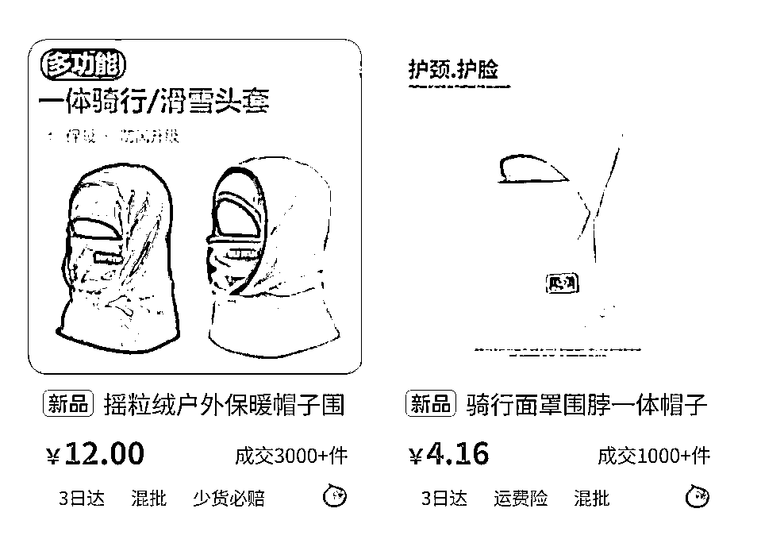
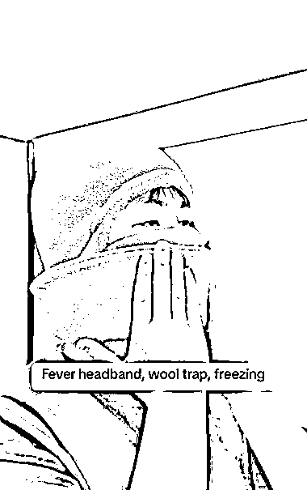

# (30 赞)TikTok 卖家引燃的寒冬经济，席卷北美的寒潮正催生巨大的“寒冬商机”
作者：龙哥

北美的冬天还没正式发威，TikTok 上的中国卖家已经提前“燃”起来了。一场席卷美国多地的寒潮预警，正悄悄带火一门“冷生意”——有款滑雪面罩，成本只要 4 元人民币，挂到 TikTok 美区却能卖到 11 美元，而且销量火爆到让人眼红。

就在最近一周的 TikTok 美区带货视频榜上，这款面罩以一条视频拉动 7300+ 件周销量的成绩，杀进榜单前列，直接冲上第六名。更夸张的是，它从 10 月 29 日上架到现在还不到半个月，累计已经卖出 1.77 万件，GMV 达到 19.45 万美元，折算成人民币约 138.5 万元。

这款面罩之所以能“爆”，一方面是因为它打破了以往运动户外大类的品类垄断，另一方面则踩中了今年冬天可能格外冷的预期。有气象专家预测，美国中西部和太平洋西北部地区的气温大概率低于往年平均水平。寒潮越猛，保暖装备的需求就越旺，而这波由 TikTok 卖家点燃的“寒冬经济”，才刚刚开始。

