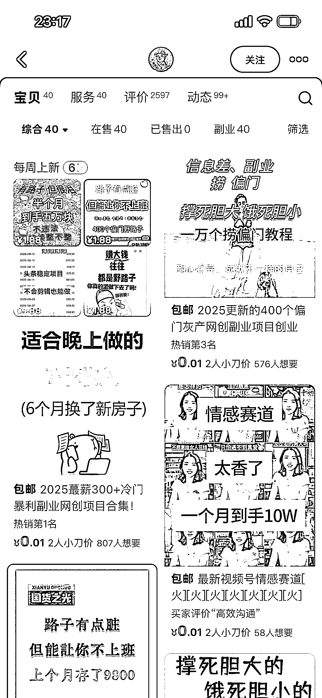
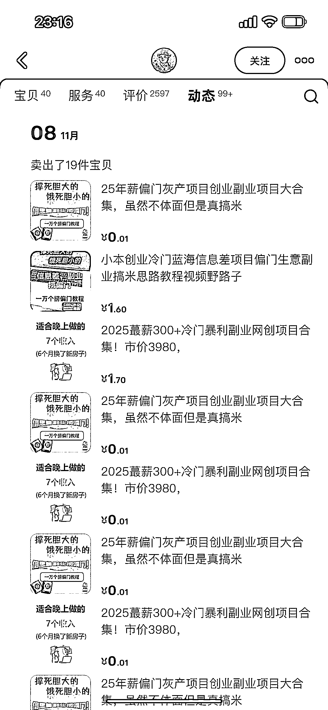
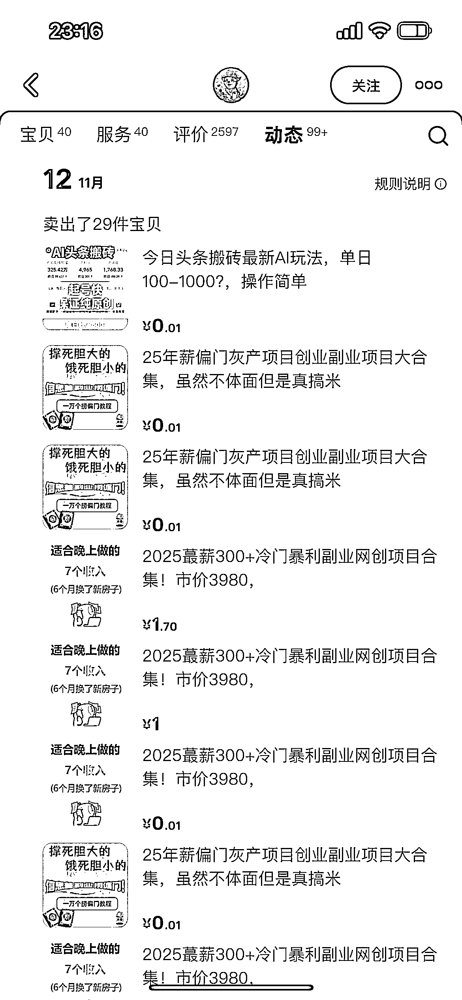
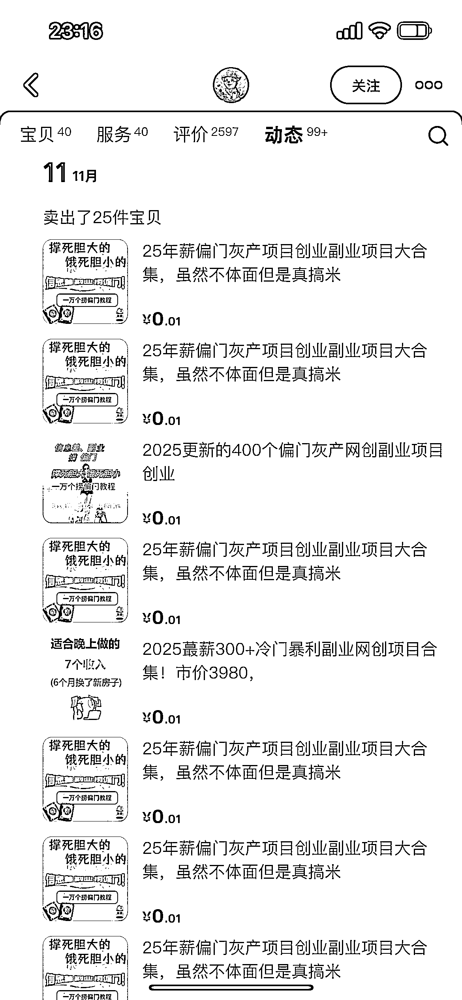

# ('(26 赞)闲鱼引流创业粉，0.01 的链接，每天成交 20-30 个，非常有用', (2, 42))

闲鱼上有个冷门玩法，居然靠一个标着“0.01元”的链接，每天稳定捞到二三十个创业粉。看上去不起眼，实操性却很强，值得一试。

具体思路很简单：在闲鱼发布低价链接，吸引对创业、副业感兴趣的用户点击，再通过后续承接把他们转化为精准粉丝。一分钱的门槛几乎为零，但筛选效率很高，来的基本都是带着明确需求的人。据分享者反馈，一天成交20到30单完全没问题，效果相当可观。

评论区也有不少老哥补充了关键信息。有人直接点赞，说这招确实有料，已经被收录。也有人分析，这种玩法真正的变现点可能是网盘拉新，靠链接引流后赚推广佣金。还有做这行的指出，市面上也有直接卖粉的，一个粉大概3到5块钱，但质量参差不齐，不如自己引流来得精准。

总之，一分钱链接只是个钩子，背后的粉丝价值和后续转化才是重点。如果你正在找低成本获取创业粉的路径，可以往这个方向试试。