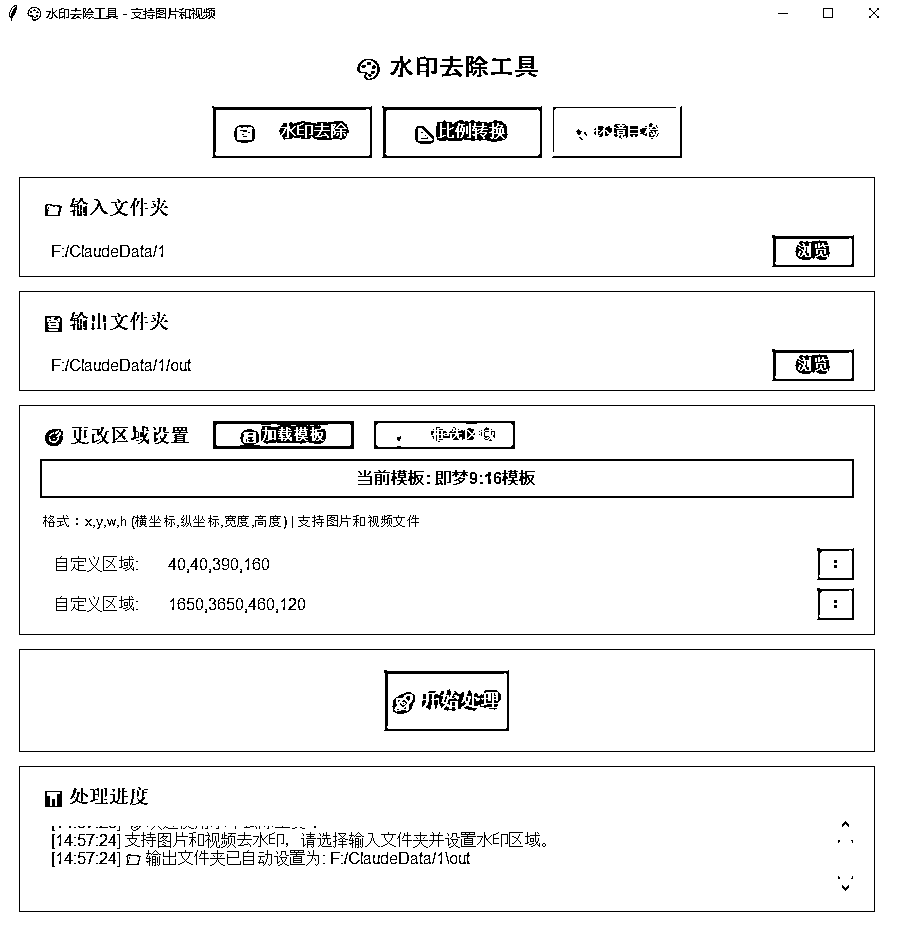
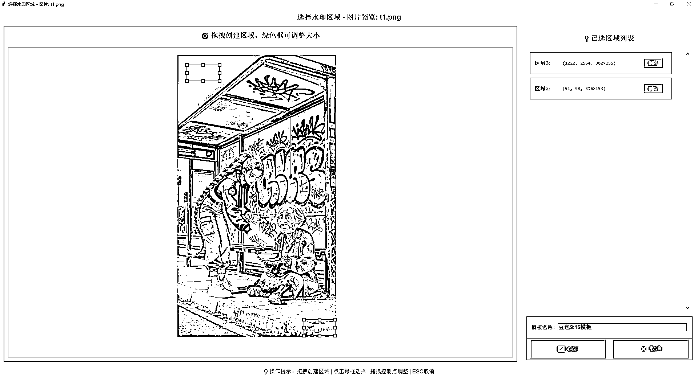
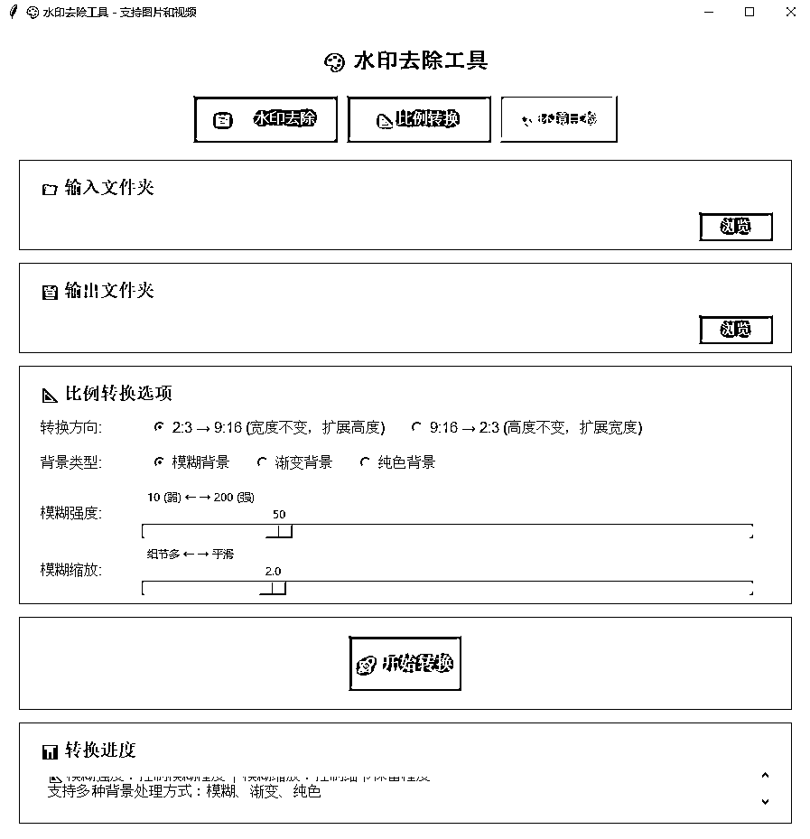

我用Claude Code写了款去水印小工具，亲测好用，分享给需要的朋友

做视频、做图的圈友，是不是常被水印整得头疼？我最近在折腾YouTube，还经常用即梦、豆包出图出视频，结果素材上总是带着一层水印。为了去水印，我试过不少现成工具，要么效果一般，要么收费还不便宜。正好之前买的GLM Coding一直没想好写点什么，索性就用Claude Code自己写了一个去水印工具。实际用下来感觉不错，分享给同样有需要的圈友。

工具主要有两个功能：

1. 批量去水印
支持一键处理指定文件夹里的图片和视频，操作方式是用鼠标直接框选，可以一次标出多个水印区域，选完还能保存成模板，方便下次直接调用。需要特别注意的是：如果同一个文件夹里图片和视频都有，程序只会处理视频，不会碰图片。

2. 图片比例转换
用Sora批量出图时默认得到的是2:3比例，想适配短视频的话，可以批量扩展成9:16，上下两端自动补上模糊背景，观感非常自然。

使用起来很简单：先执行pip install -r requirements.txt装好依赖，然后双击start.bat就能启动程序。我目前是在Windows上用的，没有在Mac上测试过，所以Mac用户可能需要自己验证一下。

帖子发出后，已经有圈友上手指了。有人反馈说比例转换没问题，但去水印一直不成功，而且无法框选区域。作者自己也出来做了排查指引：先检查requirements.txt里的依赖是否装全，运行start.bat后点界面上的“环境自检”，然后指定输入文件夹，等图片或视频加载出来后，用鼠标框选水印区域，再点处理即可。作者表示在Win10和Win11上都验证过，没有遇到问题。还有圈友在评论区留言：感谢分享，已中标。

如果你也在被水印困扰，不妨试试这个工具，期待你的反馈。