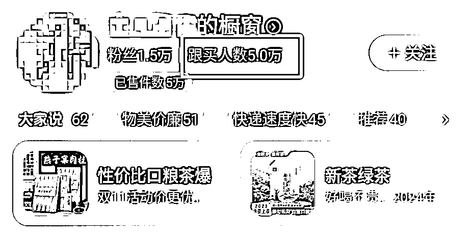
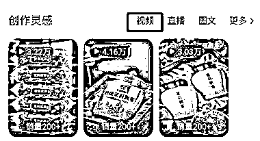
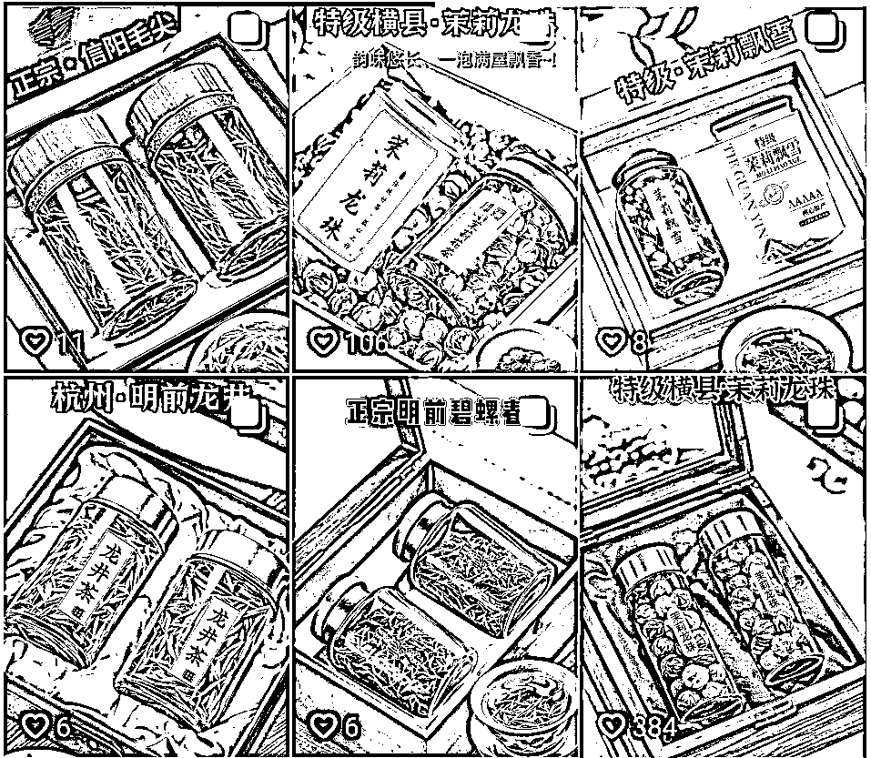
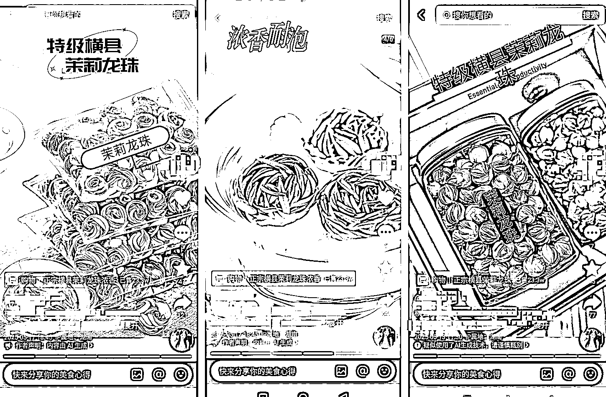

# (30 赞)各赛道商家榜单，已被 AI 内容全面渗透！

## (30 赞)各赛道商家榜单，已被 AI 内容全面渗透！

作者： Miles

日期：2025-11-13

现在打开几乎任何一个赛道的商家榜，排在前面的视频、图文，基本都是 AI 做的。

刷到这篇总结才恍然大悟。过去做抖音带货，要自己拍、自己剪、自己上镜、再花钱投流。如今，一个人加一部手机配上几款 AI 工具，就能实现内容批量化生产并直接挂车变现。对普通人而言，AI 图文带货正处在明显的红利窗口。

仅凭做 AI 电商，就靠茶叶这一个垂直品类，半年时间就产出 2071 条内容，收入相当可观。AI 图文带货为什么这么吃香？因为这个赛道具备三大优势：画面感强容易被 AI 渲染、无需真人出镜、生成门槛低。它的底层打法很简单，就是高频持续输出来换取稳定标签沉淀，只要你不断发，就有被流量试出来的机会。

目前在抖音上，AI 带货内容大致可以归为三类玩法。第一类是 AI 纯图文。第二类是 AI 实况图文。第三类是 5 秒 AI 短视频。

* * *

评论区：

LJL : 我去翻了下 这个账号从 23 年 8 月就开始发挂车了 五万单的销量是两年的总销量 2071 条内容也是两年的总计（另外：隐藏的还没算）

龙哥 : 感谢分享，已中标