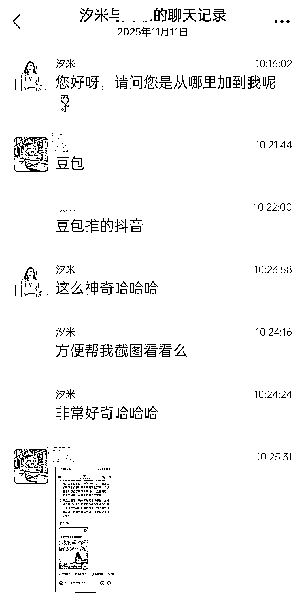

# (36 赞)客资可以从豆包来！

豆包居然还能“送客户”？这事儿真让我赶上了！

年初在抖音铺了一批短视频，后来一忙就断更了，算下来有大半年没怎么管。本来都以为这号要凉了，结果最近陆陆续续有客户找上门，一问才知道：他们是通过豆包推荐，刷到了我之前的视频。

说实话，这一下让我回过神来——AI搜索时代的流量逻辑，真的跟以前不一样了。哪怕你不再日更，优质内容依然可能被AI重新翻出来，推给正好有需求的用户。这等于给普通人多了一个“被动获客”的入口。

所以别只盯着老渠道了。豆包这类AI入口，甚至背后的GEO玩法，很可能就是下一波红利。早布局的人，早吃流量。

想被豆包推荐？评论区已经有朋友指路：去赚钱搜 GEO。