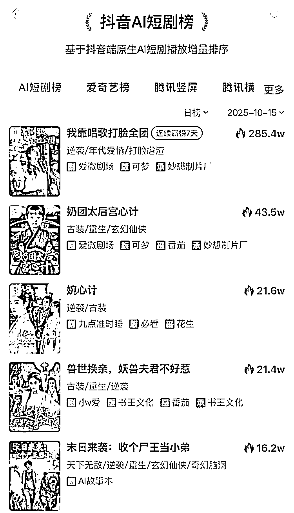

# AI短剧成本腰斩在即，千亿赛道迎来爆发窗口

当制作门槛被技术砸开，短剧行业的游戏规则正在被改写。

现在用AI来做真人短剧，每分钟的花费比起传统拍摄已经砍掉了六成以上；如果换成AI漫改路线，成本更是直接压缩到传统动画短剧的五分之一。成本下来了，产量自然上去。

供给端井喷只是开始。随着内容供给变多、观看人群持续外扩，以及广告、分账、IP联动等变现路径越来越多元，AI短剧的想象空间只会跟着技术迭代和内容精进一起放大。业内普遍判断，到2027年，在体量已经迈向千亿级的微短剧市场里，AI短剧的渗透率有望站上30%到35%。

成本降了，什么内容最吃香？目前来看，容易破圈的集中在三条主线上。

第一类是偏情绪的爽感逆袭剧，强情绪价值叠加高爽感剧情，观众代入感强、转发欲高。

第二类是年代情怀向作品，用细节还原唤醒集体记忆，年代感越真，传播力越强。

第三类是轻科幻生活流，把科幻设定做轻、做近，贴合日常场景的想象更容易出圈。

* * *

评论区：

龙哥 : 感谢分享，已中标

心怡啊🎈 : 这要怎么变现呢