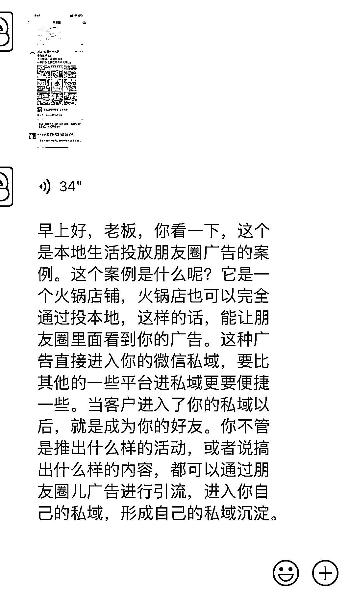
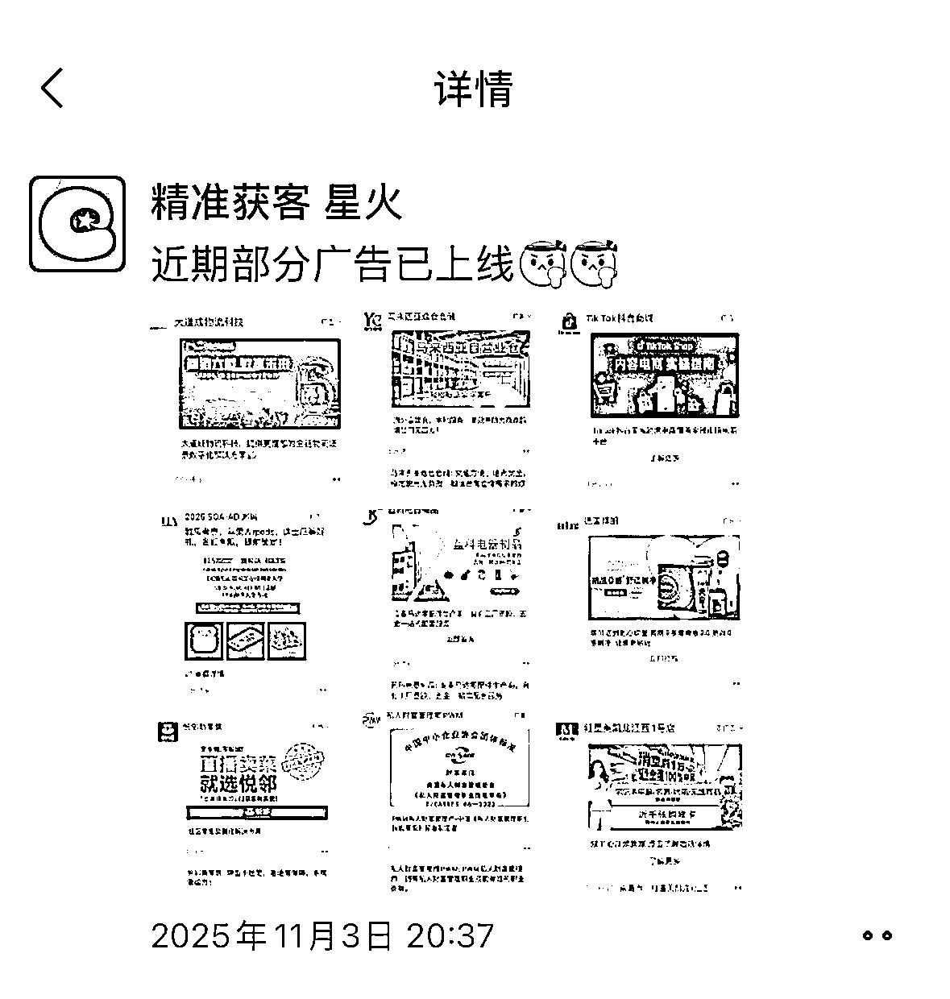
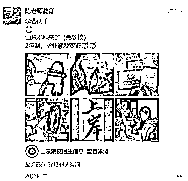
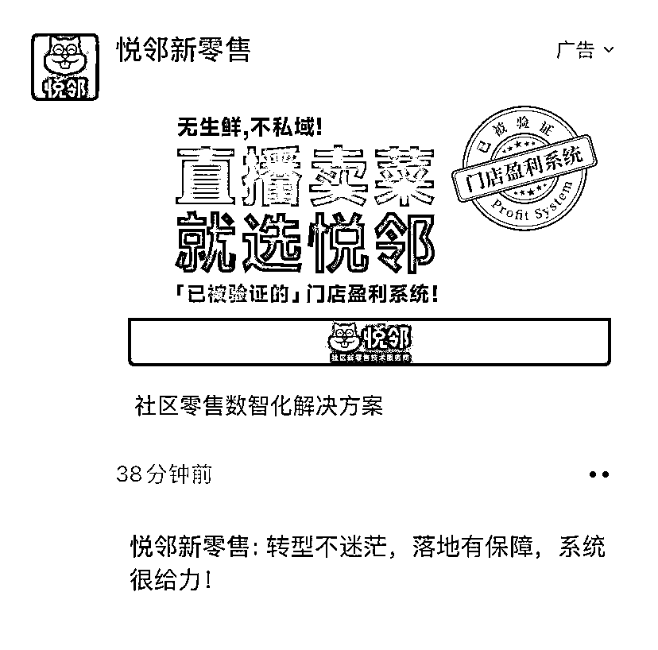
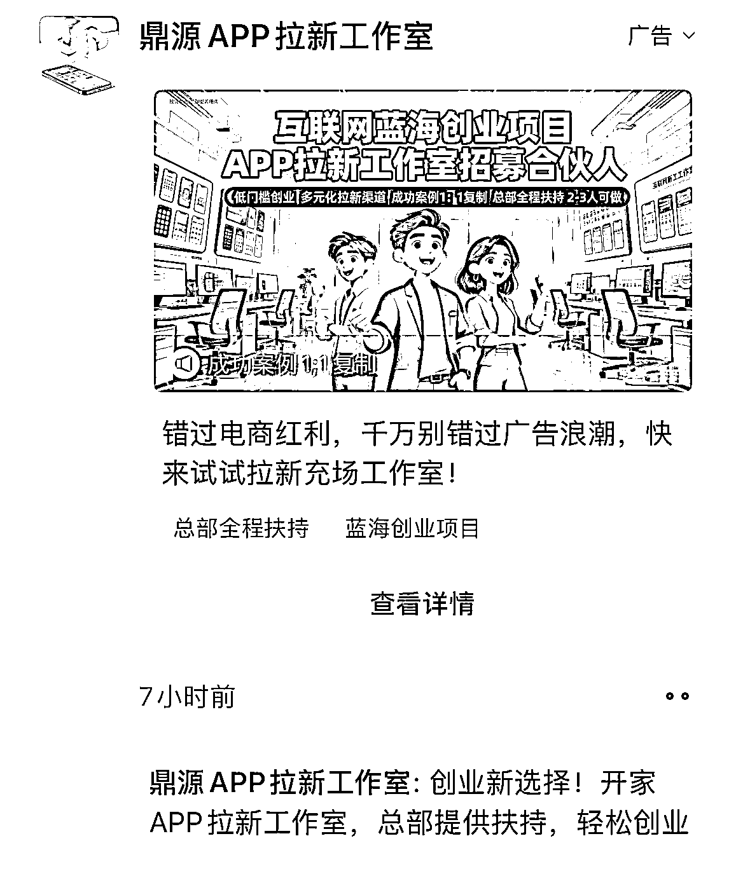
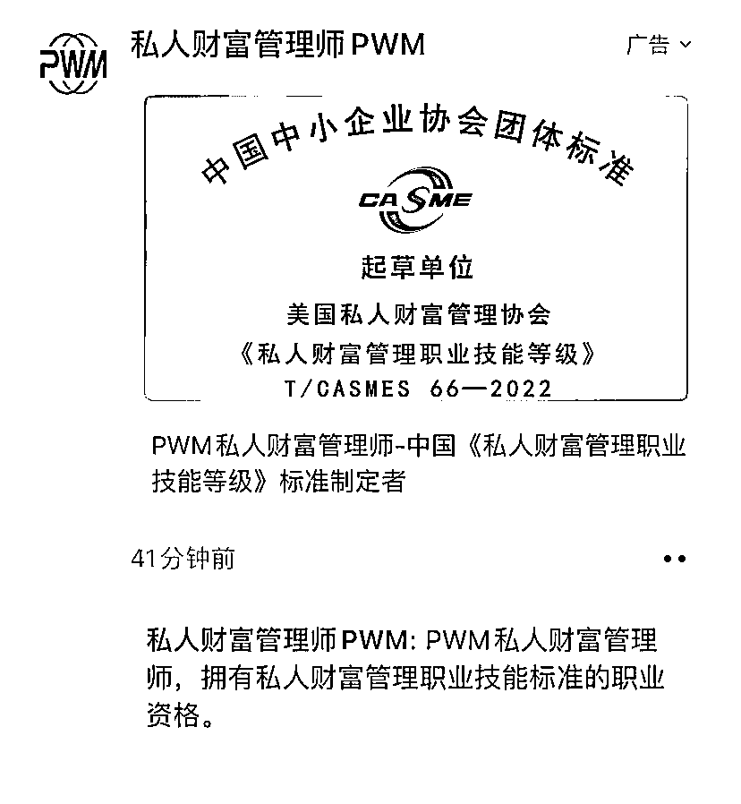
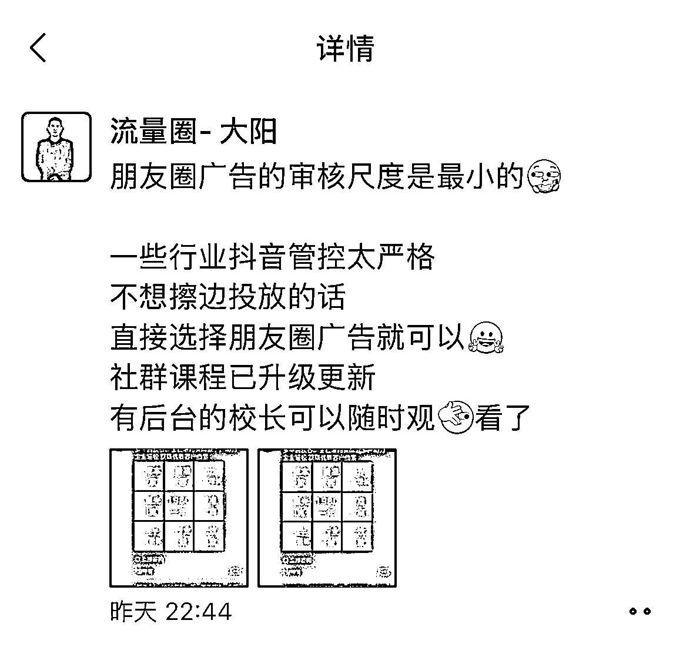
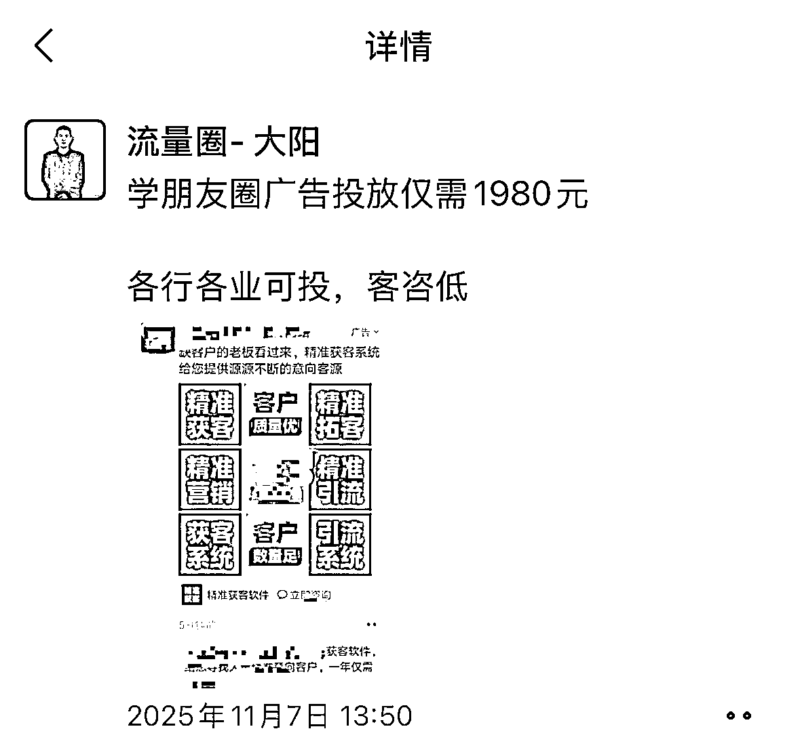

# 私域获客新打法：朋友圈投放正在取代抖音，成为更省钱更准的获客渠道

作者：馆主
日期：2025-11-10

最近一周我重点盯了一个方向的动向，结论越来越清晰：用朋友圈做获客，已经从小众尝试变成主流趋势了。

为了验证，我特意聊了不少已经在做的商家。他们的反馈很一致，越来越多人开始撤掉抖音获客预算，转而all in朋友圈。原因也很直白：同样拿客户，朋友圈的获客成本更低，而且进来的用户质量更高、转化意愿更强。

核心区别在于呈现方式。广告不是硬广，而是以朋友圈原生内容的形式出现，属于典型的软植入。用户在日常刷朋友圈的场景下被自然触达，看到感兴趣的内容会顺手点咨询，干扰感很小。

整个跑量逻辑也很顺滑：朋友圈广告曝光 → 用户主动点击咨询 → 客服承接对话 → 名片或链接沉淀到私域微信。

* * *

评论区：

烽火 : 朋友圈获客不就是腾讯广点通嘛

龙哥 : 感谢分享，已中标