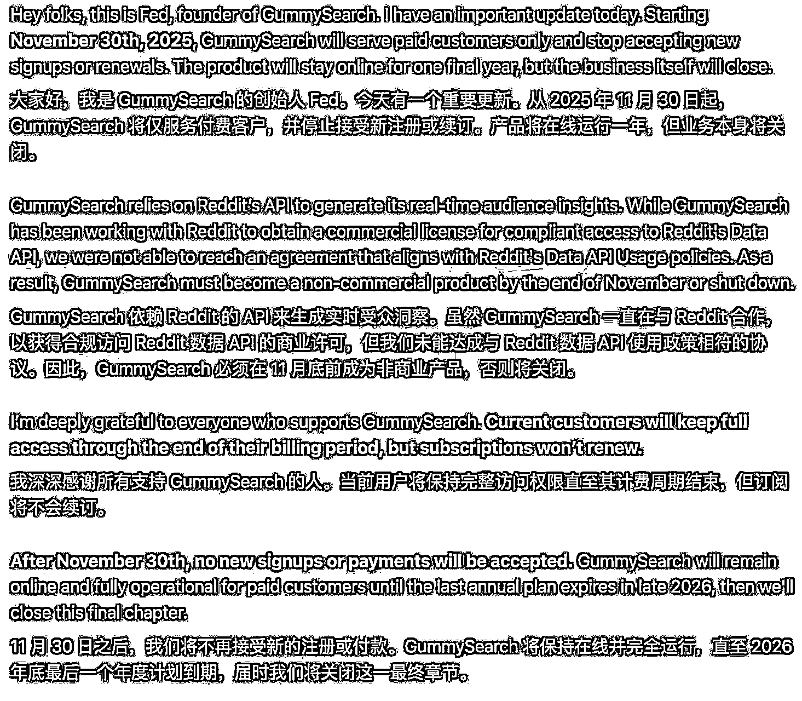

# GummySearch 正式下线：当 Reddit 研究第一工具倒下，生态缺口由谁来接盘？
作者：龙哥

海外 Reddit 数据挖掘赛道的第一梯队玩家，GummySearch 宣布关停。

传闻是与 Reddit 官方在 API 合作上谈崩了，没能就使用条款达成一致，只能选择停运。这个曾被大量从业者依赖的工具，本质上做的是一件事：帮用户把散落在 Reddit 各版块里的用户痛点、需求苗头和商业机会，快速结构化、检索出来。

它的退出，直接让市场上出现了一个显眼的空位。对一直关注 Reddit 商业情报、社群洞察的开发者和团队来说，这或许是一次重新切入的机会，看谁能先补上这块拼图。

与此同时，GummySearch 的结局也发出了很直接的提醒。当你的产品核心能力完全建立在第三方大平台的 API 上时，你的生死就握在别人的定价表和政策文件里。一旦平台提高准入门槛、抬高商业授权费用，整条业务线可能在一夜之间失去根基。

* * *

评论区：
龙哥 : 感谢分享，已中标
星吟 Singing : 使用折扣码 XYCODE，购买可享受 9 折优惠