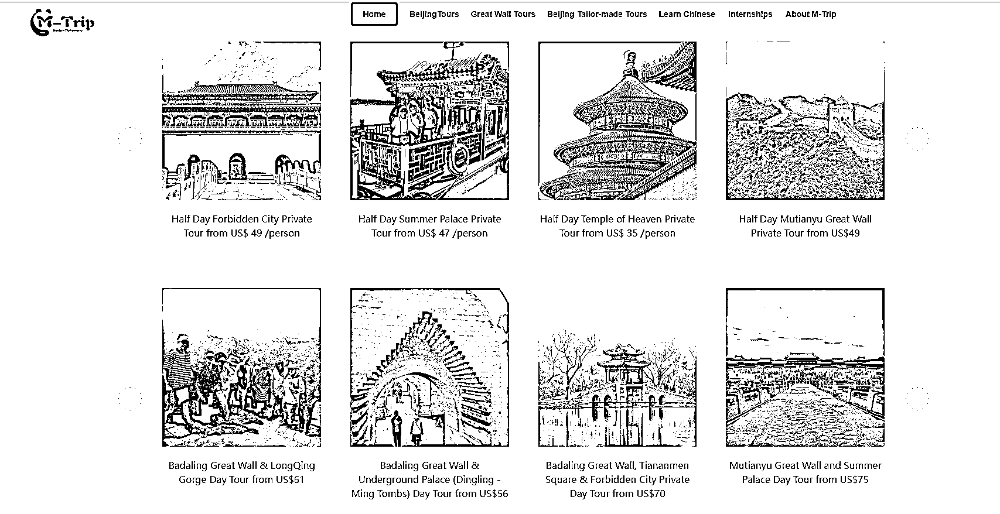

# TikTok 上“带路人”IP 正在成风口：用本地资源做成个人生意

最近在 TikTok 上，导游型 IP 的玩法明显在升温。核心套路其实很清晰：陪玩式带逛 + 城市深度探索 + 生活方式种草，把个人的人设和本地资源绑在一起，既能做内容引流，也能顺势做私域沉淀，变现路径特别多元。

这类账号的本质是把“逛城市”做成服务。不是干巴巴的景点介绍，而是用第一人称的探路、吃喝玩乐体验，去建立信任感。一旦粉丝认可了你的眼光和路线，你手上的本地资源就全活了。

目前常见的本地资源变现打法，大致有这几条：

1. 本地私人地接与向导，按人头付费。用户要来城市，你直接上门带，全程陪逛、解说、带节奏，比传统旅行社更灵活、更私密。
2. 私人定制行程规划。把城市拆成不同主题，情侣线、摄影线、探店线，针对需求做一对一行程方案，按单收费。
3. 本地 VIP 代办服务。接送机、专业拍照、餐厅预定、门票加速入场等高频刚需，打包成服务套餐提升体验感。
4. 合作商家返佣分销。把常去的咖啡馆、民宿、工作室、特色店变成你的推广渠道，靠到店核销拿佣金。
5. 与国内旅游平台联动分销。把你的路线、资源对接到携程、同程等平台，或者反向承接平台流量，把私域和公域打通。可以参考图中网站的做法。

总的来说，TikTok 导游 IP 的价值在于用内容做信任，用本地资源做闭环。内容负责吸粉和种草，服务负责收钱和留人，再用私域把复购和裂变做起来，就是一个可持续的本地生意模型。

* * *

读者留言：

龙哥 : 感谢分享，已中标

陈去野 : 抖音的风终于吹到了 tiktok