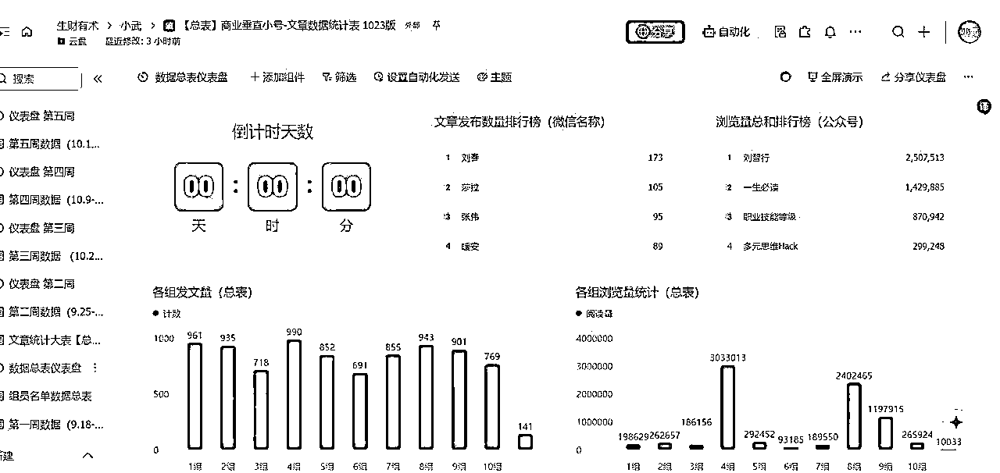
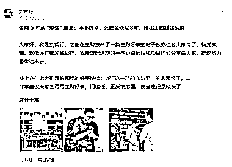
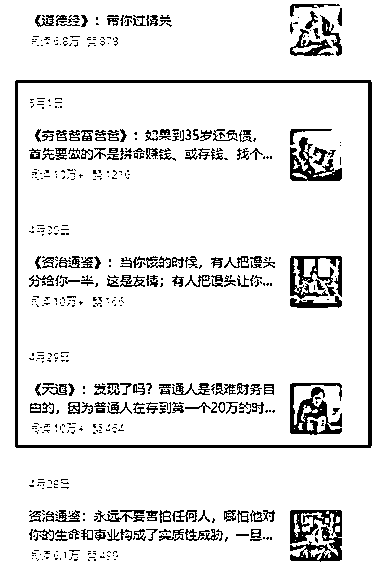

# 用AI撬动公众号矩阵：从月薪3600到副业月入10万+的垂直小号实战笔记

前段时间我在赚钱社区分享小灯塔运营心得被评为精华帖，感谢大家的认可和鼓励。趁着这股劲儿，我把自己这几年深耕微信公众号垂直小号、结合AI实现内容自动化批量生产的完整路径整理出来，希望能给正在摸索的同行们一份可复制的参考。

我的精华帖小灯塔链接在此：养成定期复盘并输出的习惯，既能助力自我成长，也能带动更多人一起进步。

我在赚钱潜水了四年，几乎没有产出；第五年开始发力，才真正找到方向。今年是我全职工作之余沉浸副业的第一年，恰好也是我和公众号垂直小号较劲的第八年。

曾是月薪3600、商业认知几乎为零的三线城市打工人，如今通过副业实现单月收入突破10万+，手上运营着20多个垂直领域的小号矩阵，逐步建立起可长期复利的睡后收入体系，完成了一次人生赛道的切换。

这次拆解主要围绕三块展开：
1/ 公众号及垂直小号的底层运转逻辑
2/ 如何搭建“内容王国”和“流量王国”的实操打法
3/ 矩阵规模化后如何放大收益

如果你正做着类似的方向，或者对入局时机、变现路径感到迷茫，这份基于一线实操的经验或许能帮你少走弯路。本文篇幅较长，完整版已整理在飞书文档，方便大家系统阅读： [`t.zsxq.com/8odKn`](https://t.zsxq.com/8odKn)[`xc8pgi2dy9.feishu.cn/wiki/VC9vwJeFOiKN5vkl9uicBPB3nsb?from=from_copylink`](https://xc8pgi2dy9.feishu.cn/wiki/VC9vwJeFOiKN5vkl9uicBPB3nsb?from=from_copylink)

* * *

评论区精选：

路遥 : 刚看完，信息量非常大，细节很扎实，看完就能直接开干。本身也在做垂直小号，刚起步阶段，选题、撰写、排版、发布一套下来要两小时以上，流量不稳定，还在琢磨引流和变现，很及时。

万能的星星 i : 还没看完，效率感太强了，思路很清晰👍

刘智行 : 这篇花费了我一周时间，昨晚才赶完稿。内容偏长，建议分段阅读，觉得有用就更好了。[玫瑰][玫瑰][爱心][爱心]

石榴爸爸 : 先点赞再慢慢看👀👀👀

刘智行 : 不用一次读完，能吸收到一点启发也值了。[玫瑰]

萧然自得 : 实操性强，很值得学习

蓝狐 : 干货满满，受益很多

刘智行 : 感谢支持，一起进步。[爱心][爱心][爱心]

刘智行 : 谢谢☺️互相加油。[咖啡][咖啡]