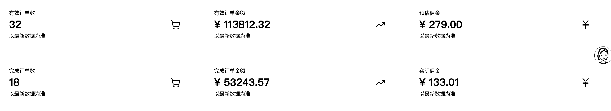
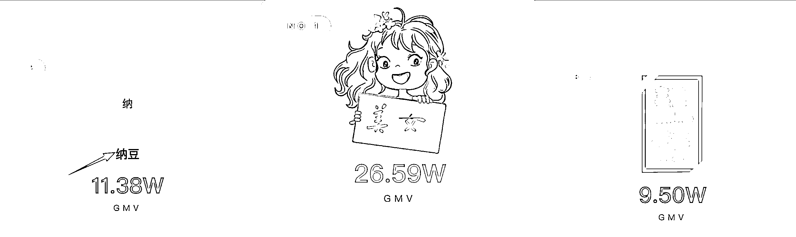

# 航海第六天破十万：一次抖音自然流 CPS 的实战拆解

航海第六天 GMV 突破十万+，抖音自然流 CPS 的实战复盘与建议

作者：纳豆卡玛
日期：2025-11-02

大家好，我是龙哥。

这次想把我在抖音自然流 CPS mini 航海里的真实进展摊开聊聊。

到第六天，销售额已经站上十万以上，目前在航海榜单上排在第二。

下面说说我为什么会报名、具体怎么做的、卡在哪、以及能给同行的一些实操建议。

**一、我是谁、从哪来**

2020 年我就进了赚钱，到现在快六年了。

前几年工作稳定，一直在潜水看大家分享。

2024 年情况发生变化，才真正开始系统找项目。

这两年我试的方向大多围绕流量变现：视频号、📕、抖音都踩过。

2025 年初离职转自由职业，半年 IP 操盘手的经历让我觉得还是在替别人打工，后来撤了。

现在主战场是📕电商，还在慢慢爬坡。

**二、这次航海的起步条件**

招募一出来我就动心了。

拍摄、剪辑、种草这些我熟，航海正好能把老本行用上。

再加上两位教练很强，又赶上双十一，窗口期很好。

名额开放我就第一时间报了名。

我是全职状态，时间比较自由。

目前手上在跑三个号：一个真人出镜口播，两个曼波账号。

前期没把握哪种更好转化，就一起测。

目前日更 3 到 6 条，高峰期到 8 条，累计已经发了二十多条。

**三、流量和内容怎么跑**

和第一名不一样，我的播放没有大爆发，是个稳步上扬的曲线。

大部分视频在百到三百播放间波动，最高的那条破了两千。

选品基本听教练的安排：

口播号聚焦 iPhone 17 系列，订单也主要集中在这块；
曼波号除了数码，也试了部分国补相关的种草。

**四、现在还在补的短板**

爆款框架还没固定下来，还在持续试；
素材库没有做成系统，爆款开头、文案要素还在整理归档；
复盘的频率和深度不够，后续要重点加码这块。

**五、给不同阶段伙伴的建议**

**1、已经在发但还没转化的人：**
去找最近七天内的低粉爆款做对标。参考标准是点赞过百、粉丝小于一千，严格按航海手册来。
挑出能复刻的范式，复杂的不碰，直接逐帧仿制。
逐帧复刻的操作思路：
先把对标视频导进剪映；
模仿它的开头钩子、转场节奏、字幕样式、BGM 氛围；
素材不要直接搬运，可以截图截取或用同风格素材替代，避免限流。

**2、还没入场的船员：**
航海有外卖线和 3C 数码线。制作逻辑相近，我建议主攻 3C 数码。
原因：
双十一期间数码消费热度高，转化一旦起来收益明显高于外卖，且长线可做。走真人口播还能持续沉淀个人 IP。
外卖赛道现在竞争很激烈，个人在公域很难拿到体量，自用可以，但不建议all in。

**3、一定要去看榜一的复盘**
她的内容很细很真，实操性强。做到一比一复刻，效果会很快显现。

**六、实操 Q&A**

Q1：先养一个号还是多号一起测？
时间充裕全职可以多号并行测试。单号也能跑通，榜一就是单号出的成绩。关键先把内容质量拉满，方法对了流量还是起不来再考虑开新号。

Q2：曼波和真人口播怎么选？
我这边数据基本持平。口播多在三位数且稳定；曼波平均也在三位数，有低谷也有单条两千多的。没有绝对优劣，选自己更舒服的就行。

Q3：iPhone 17 这种高客单有意义吗？
非常有。虽然佣金比例不高，但京东推广期激励叠加后整体回报不错。核心看激励力度和产品热度。

Q4：每天 3-8 条怎么保证效率？
别为了效率而效率，先选对对标。选准了就事半功倍。我现在熟练后，口播一小时一条，曼波半小时一条。

Q5：零短视频经验能做数码吗？
能。不需要做成大片，短视频靠运气但更靠方法正确+数量堆积。按航海手册执行，持续输出就有机会。

Q6：如何规避违规？
仔细阅读手册和教练直播要点，避免极限词和站外词，不要做虚假宣传，比如“几百块拿下 iPhone17”这类表述。怡然教练说得好，我们做的是信息透传，让用户知道京东有红包、优惠券，能省钱，这本身就有价值。

**七、两个密令词的使用方式**

数码红包全站通用，用户用密令搜索或领红包下单都能产生佣金，覆盖范围最广。
手机会场客单价普遍千元起，单笔利润可观。

**八、最后说两句**

以上就是我目前的阶段性复盘和心得。接下来我会继续打磨内容模板，每天做更扎实的复盘，争取早日出爆单。

感谢赚钱给的平台，感谢怡然教练和海宇教练的指导，也感谢自己这一年的坚持。

积累从不辜负人，每一步都在为爆发铺路。一起加油！