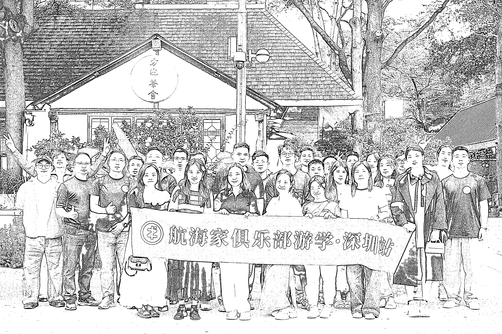

# 深圳航海家游学现场实录：紫菜的年终复盘，牌桌哲学、自由职业与人生管理的全图

原文：[`www.yuque.com/for_lazy/zhoubao/dqqr9kmyhwr917lx`](https://www.yuque.com/for_lazy/zhoubao/dqqr9kmyhwr917lx)

作者： 咕咕

日期：2025-11-02

上周五下午我特意跑去深圳参加航海家组织的游学，本质上是紫菜的 2025 年终复盘会。

紫菜在我心里一直是标杆型人物。Web3 赛道上他能把事业做起来，领导力也在线，手下带的人多，资源调动能力强；私下又是德州扑克的职业玩家；生活态度尤其洒脱自在，这些特质加在一起，很容易让人产生羡慕和向往。​

他的👸号我早早就关注了，一直盼着能有机会当面听他聊。这次场次只有 25 个席位，全靠抢，30 秒内就被抢光，我算是手速刚好卡到边，运气不错。

下面是我现场听完后印象最深的几段分享。​ **开场先安利一本《最优解的人生》，把有限时间用在最值钱的地方​**

分享一上来，紫菜就推了一本书《最优解的人生》。

这本书的核心命题很直接：如何在有限的生命里创造最大价值、获得更多快乐？作者本身既做投资又打德州，经历很饱满。书里反复提到目标与过程的关系，并不是只盯着终点冲刺，也要懂得享受当下；面对不同局面，要去寻找叫做「自由解」或「当下最优解」的路径，让生活状态更从容。

整体的倡导是：**在有限的生命里尽可能发挥价值，追求幸福感，同时减少无谓的消耗**。例如要把钱用在刀刃上，投在健康、体验等真正重要的地方，保持生活的平衡感。

这个思路和常规的“多赚钱多投入”不太一样，紫菜说这本书值得抽时间看，能打开不同的视角。​

感谢紫菜最后还给到场的小伙伴每人赠送一本《最优解人生》  Q_b52UrnuW6H-KdGvoOGwM)**自由职业者的一课：配一个靠谱助理是刚需** 随后他聊到自由职业的实操问题。

做自由职业最吃力的往往是琐碎事项，单打独斗很容易被细节拖垮。花钱请一个助理把琐事接过去，能极大释放精力，让自己更专注在核心事务上，生活和工作的体验都会提升。

另外，带助理本身就是锻炼带团队的能力，思维方式会发生变化。

我现场追问：像你这样的人，挑助理最看重什么特质？他回答得很干脆：

别把人框在 “助理” 这个标签里。一个真正合格的助理，最核心的是 **无条件可信赖**，靠谱是底线；还要有较强的责任心和专业度，即使从零开始也能快速获得信任。这些本质上是人格综合素养的体现，而非岗位技能。

他总结了一句很到位的话：**你愿意和什么样的人做朋友，就用同样的标准来筛选助理**。听完我觉得被点醒了。​

**人人都该经营个人 IP：日更和表达是信任的复利** 紫菜特别强调：**每个人都需要做个人 IP**。

因为个人 IP 能带来“活人感”，同时产生影响力。我们常说的复利，在个人品牌上同样成立。靠持续的日更、出镜、公开表达，慢慢沉淀出自己的标签，再通过这个标签换取信任和回报，为事业拓展链接。

我自己就深有体会，现在每天写👸号也是受他影响，想通过持续输出让更多人认识我、信任我，建立起靠谱的关系网络，这就是我坚持日更的初衷。​

**别沉迷消耗型爱好，要偏爱能留下成果的输出型爱好** 分享里让我最有感触的一点是：**多做输出型爱好，少碰消耗型爱好**。

输出型爱好是什么？就是能产生沉淀与复利的爱好。写作、摄影、播客、视频剪辑、做读书笔记、写总结、做社群分享、公开演讲、写教程，编程、设计、建模、产品开发、数据分析都算。

这类爱好的共性是 **创造性与积累性**。时间越久，成果越厚，别人能长期看到，形成杠杆效应。你写的东西、做的项目，不只是一次性消费，几年后还能被回溯使用。

消耗型爱好呢？典型的就是刷短视频、追剧、无目的刷社交媒体，还有那种“只学不做”的模式：拼命报课、听讲座、做笔记，却从不实践，学完就忘。它们只提供短暂的爽感，结束后没有沉淀，也没有复利，本质是在透支时间。

紫菜的建议很清楚：把精力挪到能留下痕迹的输出上。​

**低谷手记：2021 年直播带货翻车、团队瓦解，是靠“持续做事”扛过来的** 我还问了他一个问题：这几年有没有掉进过低谷，怎么爬出来的？

他说最低点是 2021 年。那年直播带货没起色，团队内部矛盾不断，核心成员陆续离开，最后团队直接解散。那段时间他自己也很恼火，但改变不了每个人的选择，只能接受现实。

他走出来的办法很朴素：**持续做事**。

情绪再差，该做的事也不会消失。**不管高兴不高兴，该做的事就是要做**，把注意力钉在当下可执行的事情上，持续推进，机会自然会回流。

他补充：**做好当下，别胡思乱想**。要学会课题分离，情绪是情绪，行动是行动，别让心情拖累手头的进度。​

**从德州扑克提炼的人生法则，四条通用在赚钱与生活上** 最后他把打牌的经验提炼成了四条心得，用在生意和生活里都通用：

**1、90% 的手牌不值得入局，尤其是位置不佳时：**  
纪律松懈就会不断放宽底线，入局越多输得越快。注意力涣散时尤其容易亏。分享进行到下午五点时，他举了个例子：当时正有个项目要他砸不少资金和人力，PPT 讲到这里他突然决定放弃，因为投入与回报不成正比，回本率不到 1%。这就是典型的 90% 不值得玩的牌。

市场上 90% 的机会都是噪音。很多人筹码亏光就是因为入局率太高。只要把标准收紧到 70%-80%，就能明显跑赢大多数人。

**2、别给自己设定错误的目标：**  
以前他打线下赛总给自己定“进前十”“拿第一”，后来发现这不现实，受变量太多。换个思路：不去执着最终排名，而是把每手牌打好、把每一个当下决定做好。

能保证的不是名次，而是当下的执行质量。做对每一步，好结果自然会来。

**3、别被对手吓住，该出手时要果断：**  
打牌时遇到该 3 泵加注的局面，常因为对手是高手而犹豫。后来复盘发现，很多时候一旦果断出手，对手就会弃牌。现实里很多该出手的时机也是如此，别因恐惧而错过。

**4、情绪管理是长期盈利的关键：**  
有一次他一手牌输掉一天的盈利，当时情绪没有波动，继续正常处理，最后仍以健康筹码晋级。如果像以前那样一波情绪发泄，很容易乱打毁掉全天。稳住情绪，才能保证整体表现。

这次航海家游学对我而言收获很大。听别人的复盘，本质是在“借用别人的经历”。能少走弯路，更清晰地看清自己的下一程。很感谢紫菜的坦诚分享。

* * *

评论区：

游阿贝 : 感谢分享，没加入航海家，都不知道深圳有这些活动