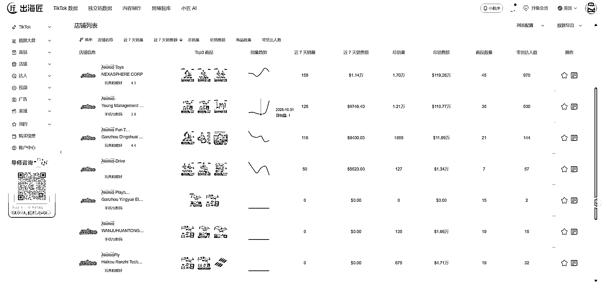
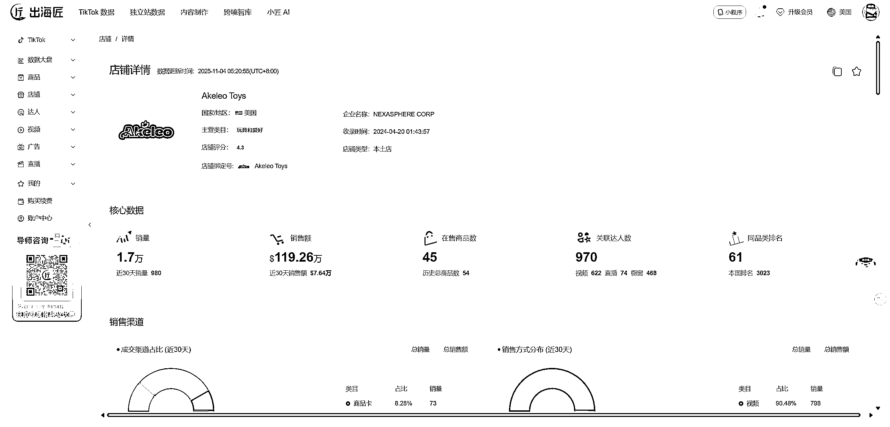
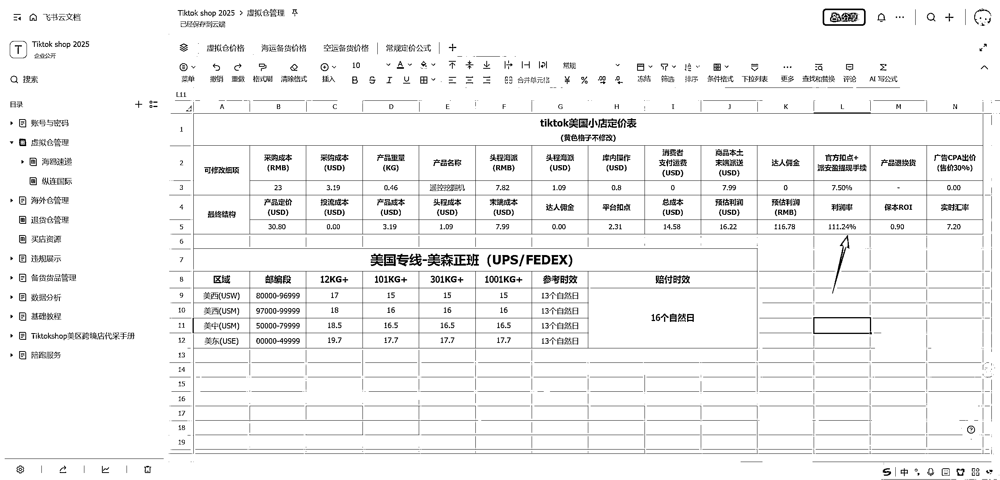
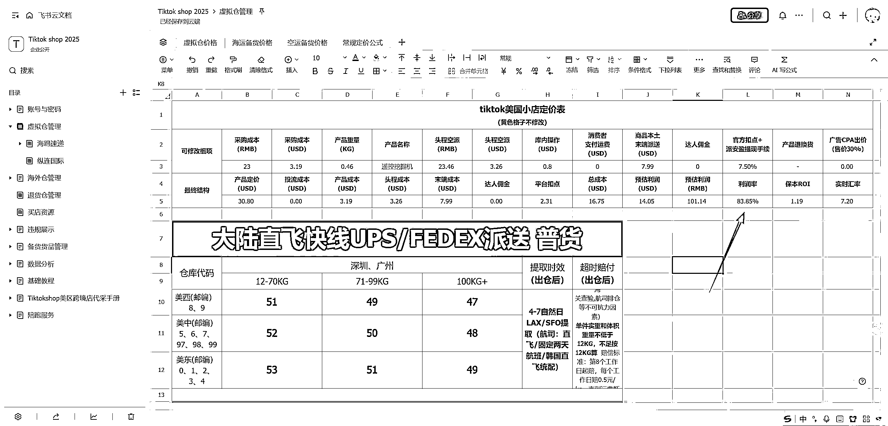

# (精华帖)(41 赞)月赚 500 美金；TIKTOK 无货源虚拟仓进阶版教程 02
作者：龙哥

最近我在找品的时候，发现一批国内公司做TikTok美区店铺+短视频带货，数据相当猛。像akeleo的系列账号，卖的是遥控挖掘机、遥控飞机，靠混剪素材批量去重发布，再配合小额投放冲商品卡排名，同时拉着达人带货。结果大店营收做到几十万美金，小店也有十几万。按文档里的利润率估算一下，空间真的很大。

顺着这个现象往深了看，虚拟仓无货源并没有跳出货架电商的框架，跟代采本质一个路子，所以单月利润也就是500美金左右的水平。也正因为这样，我更想把TikTok Shop的玩法和基础搭建持续整理出来，多写多输出。这篇是系列的第二期，围绕“美区无货源电商进阶”展开，内容分四块：

- 无货源玩法解析：把核心逻辑和操作要点讲透；
- 虚拟仓流程讲解：从搭建、运营到订单处理全流程拆解；
- 选品与商品计价：这块直接决定收益，要重点学；
- 资源与获取方式：分享实操里用得上的渠道和方法。

如果飞书链接打不开，试试复制到浏览器地址栏。