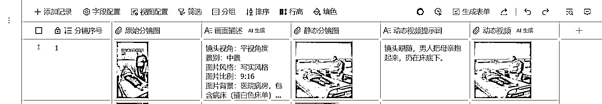

# AI 视频工具太分散？用飞书搭一个新手也能上手的“短视频生产中枢”

大家好，我是森林。

过去 8 年，我在部队工作；如今，我把精力投入到 AI 短视频变现这件事上。实操一段时间后，我发现很多新手并不是不会用 AI，而是被工具之间的切换和等待拖慢了节奏。

做一条视频，往往要同时打开一堆网页：图片工具还在生成，视频平台仍在排队，提示词、素材和成片又散落在不同地方。等结果、找文件、逐个下载，时间就这样一点点被耗掉了。

尤其对于不会使用 Coze、也不懂代码开发工具的朋友来说，想搭建一套能真正提升效率的工作流，并不容易。网上虽然有不少零散教程，但能够从零开始、一步步讲清楚的内容并不多。

因此，我用大约 6 个小时，把一套适合新手的飞书 AI 短视频工作流整理并跑通了。它以飞书多维表格为核心，相当于给短视频制作搭建了一个统一的“作战指挥中心”。

这套流程重点解决两个高频痛点：

- 不必再反复打开不同工具，逐项处理素材；
- 减少长时间等待，让碎片化时间也能被利用起来。

对我来说，每天原本只能被浪费掉的 1 小时，现在也有机会转化为实际产出。即使没有编程基础，也可以按照流程搭建属于自己的 AI 视频生产系统。

完整教程和工作流示例，可以查看这里：

[`pxnncqmeelz.feishu.cn/docx/F27ddyx0YoceMXxSefRcGuU0nkc?from=from_copylink`](https://pxnncqmeelz.feishu.cn/docx/F27ddyx0YoceMXxSefRcGuU0nkc?from=from_copylink)

* * *

评论区：

芷蓝：写得很明白，尤其是“字段捷径”的设计，让我有了新思路。

一生何求：已经成功跑通了！想问下，动态视频提示词需要自己准备吗？

来来：讲得不错，简单易懂。

柯林：内容很细，先收藏，之后试试提升效率。[强]

monica：方便提供链接吗？

森林：可以联系鱼丸，加我🛰️。