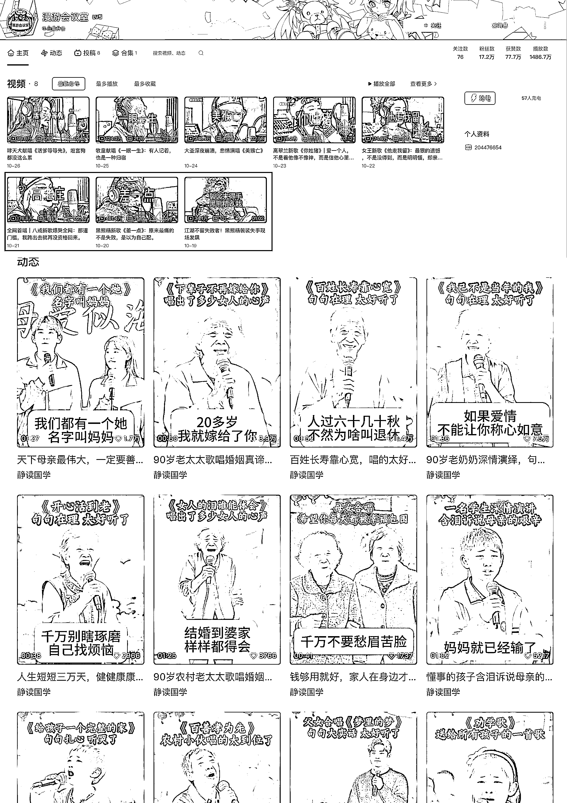
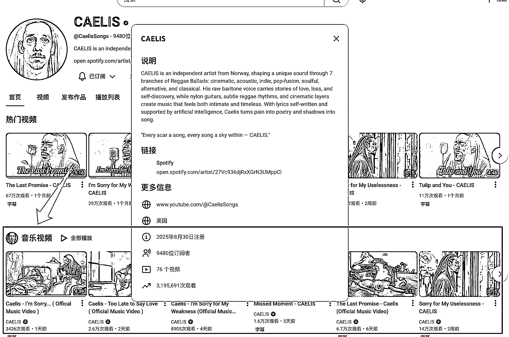
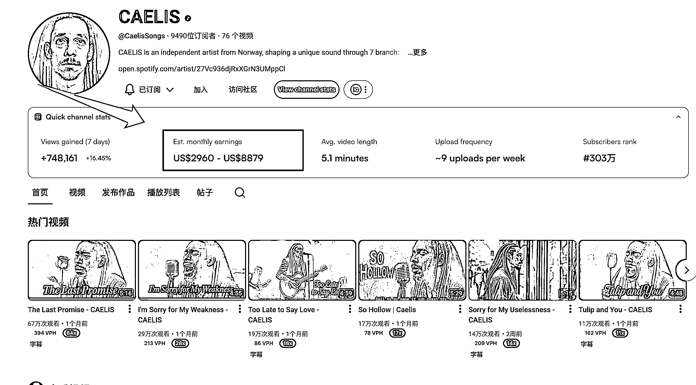
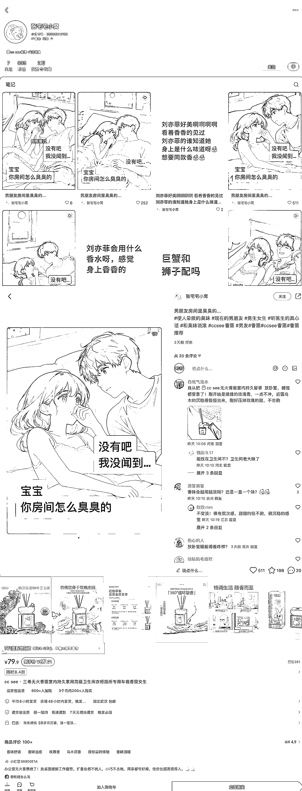
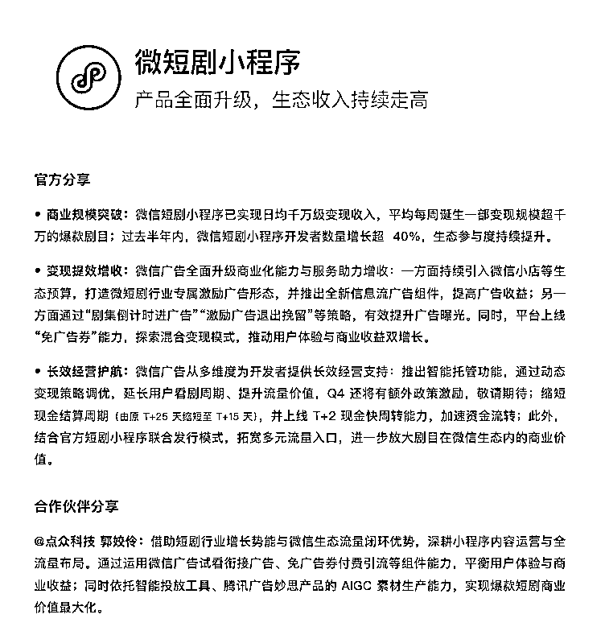
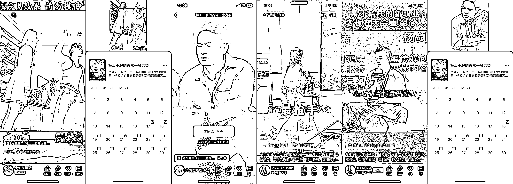
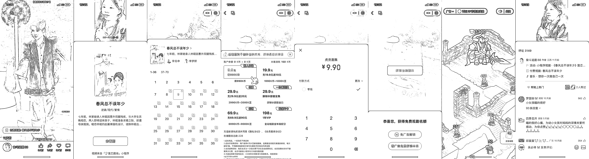
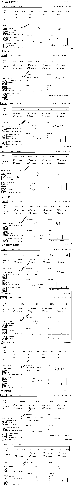
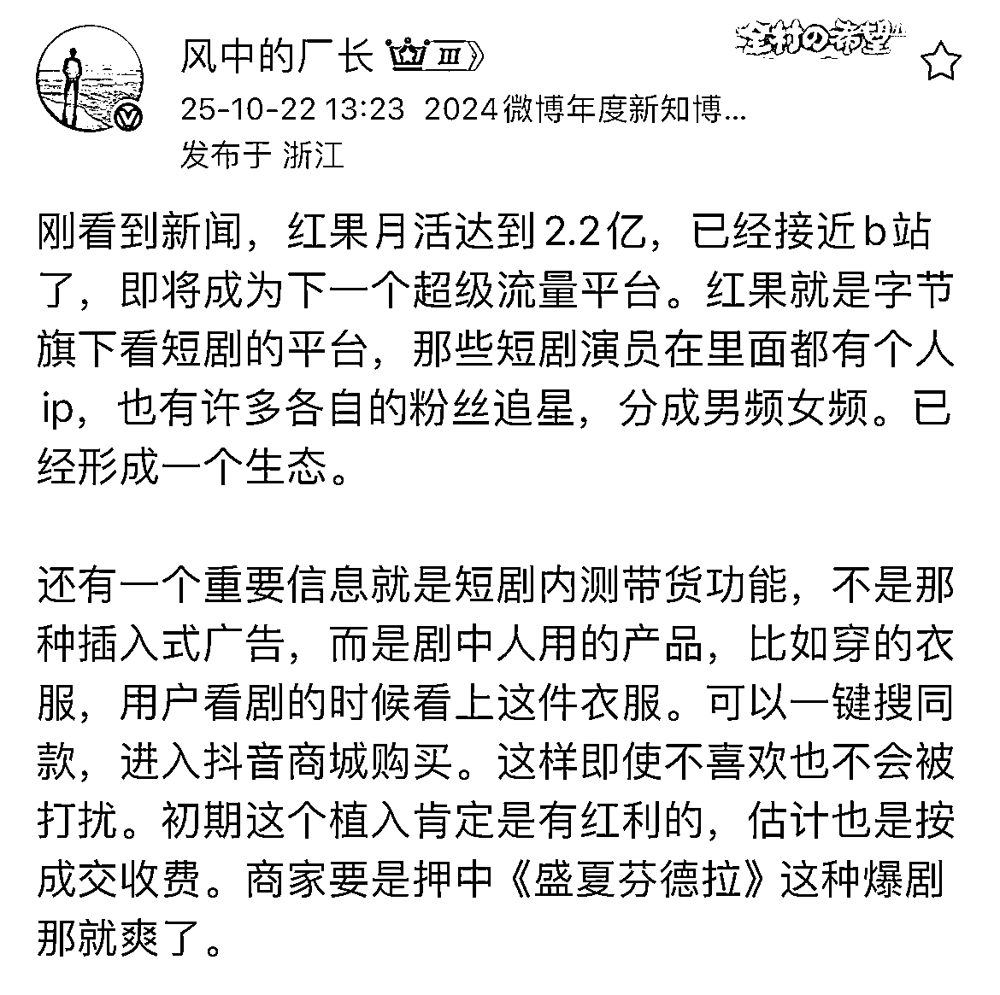

# SCBI 第四期：三个正在冒头的内容变现机会

作者：杨爽@龙哥盟  
日期：2025-10-29

催更的朋友们，终于等到了。

最近我们开始扩大情报员队伍，和更多圈友一起寻找项目、拆解项目、验证项目。第一期招募时，收到了不少简历，也因此认识了很多正在研究“如何找项目”的朋友。

交流之后我发现，大家寻找机会的方式，真是各有一套：

有人愿意连续花上几个小时，只为捕捉到一个让自己眼前一亮的项目；

有人长期混迹于不同社群，搭建自己的线索网络，充当一线情报员；

有人订阅了数百位海内外创作者，把各种信息汇总、筛选，再转化成项目线索；

还有人直接借助 AI 做自动化抓取，一天就能收集几百条信息。

方法不同，但都在做同一件事：更早地发现机会。

也正因为从大家身上学到了很多，所以这次一有时间，就赶紧把 SCBI 第四期整理出来，和大家分享三个近期比较有意思的项目。

如果你还不了解 SCBI，可以先看看前几期：

1. 第一期：SCBI 是什么 👉 [`t.zsxq.com/CaJxT`](https://t.zsxq.com/CaJxT)
2. 第二期：高通过率线索长什么样 👉 [`t.zsxq.com/NWFTD`](https://t.zsxq.com/NWFTD)
3. 第三期：那些奇怪但有趣的野路子 👉 [`t.zsxq.com/wezdY`](https://t.zsxq.com/wezdY)

这次我们挑了三个方向。它们的玩法并不相同，但背后都能看到内容生产和商业化正在发生新的变化。

---

## 案例一：AI MV，连孙悟空都开始唱歌抒情了

图 1、图 2

图 3

最近在 B 站和 YouTube 上，一类名为“AI MV”的内容开始流行。

一开始，看到孙悟空演唱《美猴亡》、艾莎演唱《后来》时，我也以为只是简单的玩梗。可真正点进去之后会发现，无论是声音、画面，还是整体情绪，都已经做得相当像样。

通常来说，一条 AI MV 大致可以拆成四个步骤：

1. **生成角色和场景**：借助 Flux、Runway 等工具制作人物与画面；
2. **模拟人物声线**：使用 Suno、So-VITS、DiffSinger 等完成 AI 拟声；
3. **创作或改写歌词**：让 Claude、DeepSeek 等模型根据剧情和人物设定生成歌词；
4. **完成视频包装**：套用录音棚、舞台等 MV 模板，快速合成成片。

根据我向相关创作者了解的情况，目前单条内容的制作成本大约在 40—200 元之间。

这类内容在 YouTube 上的发展尤其明显，已经出现了上百个 AI Music Cover 频道。@吴必得 发现的一个案例中，一个 8 月底才注册的新账号，不到两个月，单月预估收益已经接近 2000 美元。

视频号上也出现了不少类似账号，不过它们主要面向中青年和中老年用户，内容集中在情感治愈、经典怀旧歌曲等方向，播放表现同样不弱。

从生产角度看，这个赛道的门槛并没有想象中高：

一个人、一台电脑，再配合一套成熟模板，就可以持续制作。现在，播放量破万甚至破百万的 AI MV，已经并不罕见。

过去制作音乐视频，往往需要歌手、编导、摄影、后期等多人协作。如今，AI 正在把声音、画面和情绪表达整合到一个人的工作流里。

这意味着什么？

内容成本被压低了，情绪传播效率却被提高了。谁能持续做出有辨识度、有稳定风格的 AI MV，谁就有机会抢先进入这片新流量区域。

---

## 案例二：如此直接的广告，为什么在📕也能卖货？

第二个案例来自📕。

账号「张宅宅小窝」的粉丝还不到 1000，但已经卖出了 261 单香薰。

它的内容并不复杂。画面是一张 AI 生成的动漫风情侣图，配上一段非常生活化的对话：

“宝贝，你房间怎么臭臭的？”

“没有吧，我没闻到啊……”

紧接着，画面切换到香薰产品，并附上购买入口。

没有复杂剧情，也没有大制作场景，本质上就是：

一张抓眼球的 AI 图片，加上几句像真实聊天一样的文案，再接一个商品链接。

整个项目的路径非常清晰：

1. **用 AI 图片替代传统拍摄**，降低内容制作成本；
2. **通过小剧场式对白包装产品**，减弱广告的生硬感；
3. **借助📕垂直流量完成转化**，直接把内容和交易连接起来。

这就是“AI 内容+商品销售”最直观的一种组合。

它不完全依赖粉丝规模，也不一定需要投放预算。只要图片能够吸引用户停留，文案能够让用户产生代入感，产品又和内容场景匹配，就有可能形成成交。

对于有一定文字能力和审美判断的人来说，这是一个上手门槛较低、反馈相对直接的项目：

AI 图负责吸引注意力，小剧情负责建立需求，垂直商品负责完成转化。一个人，也能搭建出完整的图文带货流程。

---

## 案例三：短剧推广与短剧带货，微短剧还会出现哪些新玩法？

图 1

图 2

图 3

图 4

图 5

9 月 25 日，🛰️宣布“微短剧小程序”完成升级。过去一段时间，我们持续观察这个生态，也确实发现了不少新的变现方式。

### 场景一：看广告，解锁下一集

图 2

短剧通过广告解锁后续剧情，已经不算新鲜事了。

用户看到关键节点时，会弹出提示：

“观看广告，即可解锁下一集。”

点击之后，用户会跳转到另一个视频号，观看大约 10 秒广告，之后再自动回到短剧并解锁剧情。

我当时测试截图，甚至被跳转到了航海家 @孙圈圈老板 的视频号。

这背后说明，短剧生态已经不只是单向分发，而是开始实现内容之间的互相导流。

广告效果到底怎么样，大家可以自己体验看看。如果这期内容的点赞数超过上一期，我就去邀请圈圈老师来分享一下实际效果。

### 场景二：在评论区挂付费小程序

图 3、图 4

最近在短剧内容里，评论区的商业价值越来越明显。

不少账号会在置顶评论中放入付费小程序、短剧入口，或者音乐推广链接。用户刷剧时往下一滑，就能看到类似这样的信息：

“活动：小程序短剧”  
“付费短剧”  
“音乐：XXX”

点击之后，便会进入对应的小程序页面或音乐推广页面。

它的商业逻辑很简单：

**剧情负责吸引和留住用户，评论区负责完成转化。**

短剧往往能带来较长的停留时间，而剧情转折、悬念卡点，恰好也是用户注意力最集中的位置，因此评论区广告的点击率可能会比较高。

对于广告主来说，这种曝光位置也更有价值，所以愿意支付相对更高的费用。

有圈友分享过，热门短剧在播放量足够高的情况下，单靠广告分成，一天就可能产生数千元收入。

当然，前提是短剧本身足够热门，视频也真正跑出了数据。

### 场景三：把短剧里的商品直接变成购买入口

图 5

这是一种近期在抖音和小程序短剧中逐渐开放的内测玩法。

过去，观众只是跟着剧情看故事；现在，剧中的服装、道具和消费品，都可以直接成为商品入口。

例如：

- 女主穿的毛衣旁边，弹出同款购买链接；
- 男主使用的咖啡杯，可以点击购买同品牌产品；
- 剧中的香薰、首饰、眼镜等道具，也能直接挂上商品卡。

它的本质，是把故事场景转化成商品展示场景，把观看路径顺势延伸成购买路径。

观众沉浸在剧情中时，也会自然注意到人物正在使用的商品。这样一来，短剧除了可以依靠播放和广告获得收入，还能通过商品销售实现进一步变现。

如果剧方愿意在服装、化妆和道具上真正投入，把商品合理地融入剧情，这个方向非常值得继续观察。

前段时间的爆剧《许我耀眼》，就带动了不少服装类账号获得关注和成交。

---

## 最后总结

这三个案例虽然分属不同平台、不同内容形态，但背后其实指向了同一件事：

**AI 正在持续压缩内容生产成本，而平台也在重新定义内容与交易之间的关系。**

内容不再只是用于讲故事、获取播放量，它正在越来越多地承担引导点击、承接商品和完成交易的功能。

AI MV，是用更低成本制造声音、画面和情绪；

📕 AI 图文，是让内容直接连接商品；

短剧生态，则是在剧情中嵌入广告和购买入口。

未来，内容和商业之间的界限可能会越来越模糊。谁能更早理解平台机制，找到内容与交易的结合方式，谁就更有机会拿到先发优势。

今天就先聊到这里。

如果你最近也发现了什么奇怪、有趣，或者正在冒头的项目，欢迎在评论区留言，也可以私信告诉我。

下一期 SCBI，说不定写的就是你发现的机会。

* * *

## 评论区

**勤学：**  
感觉杨爽老师正在打开赚钱自营内容生产的新空间。[庆祝][庆祝][庆祝]

从杨爽老师开始，未来赚钱的各个业务板块负责人，也许都可以在星球持续更新内容，比如风向标、大航海、深海圈、航海家、线下办公、官网进化等。

这种方式既能帮助圈友更深入地理解和使用赚钱提供的资源，也能让更多人参与到共创中来。

当一个板块发展到一定阶段，复杂度不断提升，负责人定期出来和大家交流，其实很有必要。

以我自己为例，过去主要关注航海手册和精华帖。持续追更 SCBI 之后，我才逐渐意识到，原来风向标还可以这样使用，里面确实有很多值得挖掘的东西。

如果赚钱的其他板块也能进行类似的定期分享，相信会帮助大家更充分地用好平台资源。

**刘同学：**  
建议大家多看看风向标。

**杨爽@龙哥盟：**  
感谢勤学的反馈，也很开心这些内容能够对你有所帮助，之后欢迎继续关注！

**搞钱萌新：**  
很难不说一句，哇塞。

**篮子🍀：**  
感谢更新。