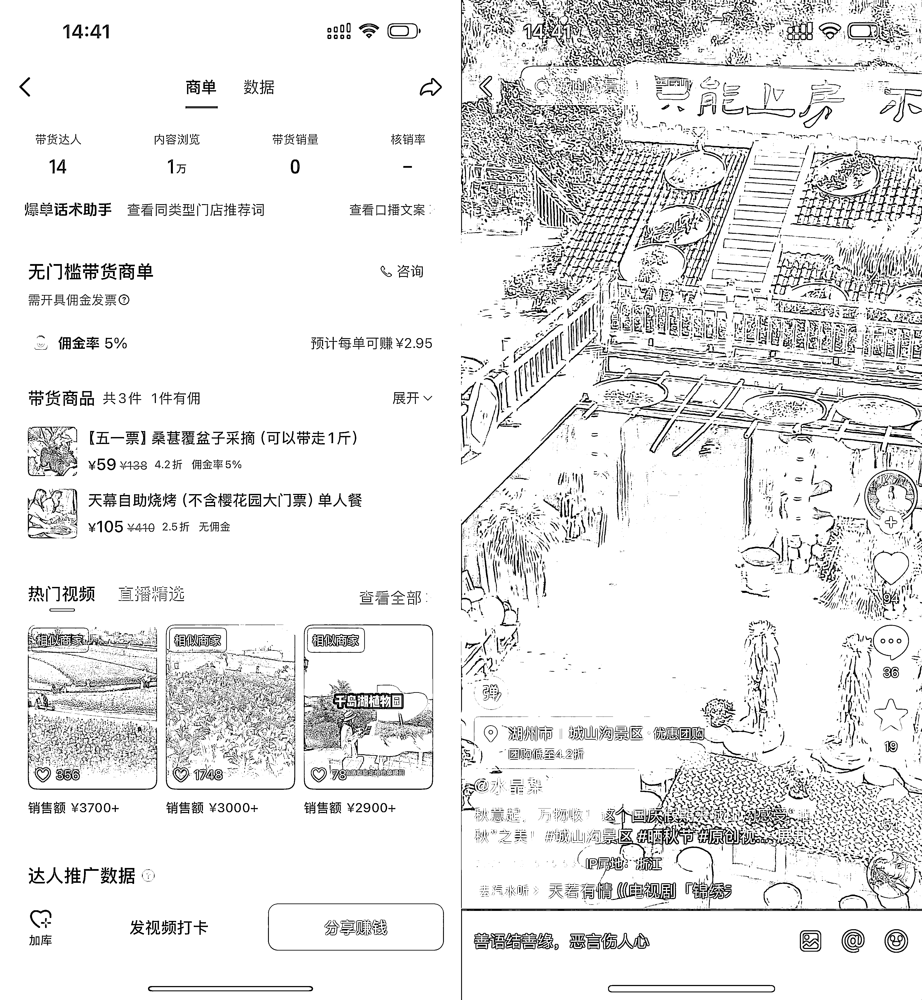
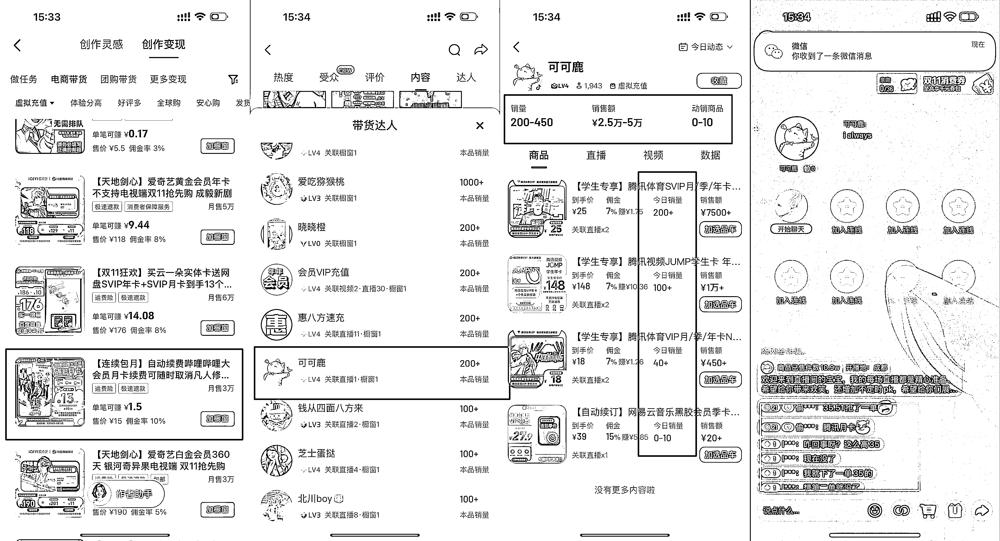

# (精华帖)(77 赞)SCBI 第五期：我们到底该给圈友喂养“量”还是“质”？

## (精华帖)(77 赞)SCBI 第五期：这样的 SCBI 真的是大家需要的吗？

作者： 杨爽@龙哥盟

日期：2025-10-31

昨夜的深夜局，群里又是一片熬夜的迹象。

朋友们，前两天龙哥丢给我一个问题：

这件事我在脑子里盘了很久，甚至拉着组里的人吵了一晚上。

> 有人主张——“两小时直播，就得把能挖到的线索全倒出来”；
> 有人反驳——“与其撒网，不如把几个真正能打的机会讲透，让大家摸到风向的脉”；
> 还有人直接质疑——“真的有人能连续听我们讲满两个小时吗？”

说实话，复盘那场内部讨论时，我心里还有点小骄傲。

骄傲的点在于，没人觉得项目好找、好分享。大家都在真心实意地去找东西，而不是敷衍了事。

正当我们聊得火热，我又收到了龙哥的第二条信息：

我瞬间被浇了盆凉水。原本雄心勃勃想大干一场的思路，戛然而止。

他没谈增长，没谈流量峰值，也没要求内容要炸裂。只有一个问题：**假设圈友每周只挤出一小时来了解外面在赚什么钱，你会给他看什么？**

龙哥永远是这样，寥寥数语，却能把事情拽回本质。

每次和他对方案，我都带着一套自以为很全的盘子去，最后都被他几轮追问拆得只剩一句话的本质。而那句话，往往就是：**这，圈友真的想要吗？**

想了很久，我也想大道至简，直接问大家：

**1. 你们一周愿意拿出两小时的直播，来扫一眼市场上有哪些新赚钱机会吗？**

**2. 如果愿意，在这两小时里，你最想听到哪类信息？**

**3. 到第五期了，我现在的这种项目颗粒度，是你想要的吗？**

**4. 对这个栏目，你有什么建议和期待？**

不白来，今天照常用点干货，先把这期抖音专场的线索放出来：

### 案例 1：抖音带火文旅，一场军事主题策展能卖到几千万

这个方向是圈里做文旅的朋友告诉我的。国庆阅兵刚过，各地“军事策展”“主题展”像雨后春笋一样冒出来。龙哥参加完航海家大会回来，特意让我们估算一下，一场这样的活动能赚多少。

答案是：过千万。

乍听觉得离谱，细想就通了。现在文旅的生意，已经基本搬到了抖音。景区、展会、节日活动、乡村游，所有流量的入口都集中在短视频。

最近刷到不少景区号，视频下面直接挂着团购链接。以前是纯拍风景，现在是直接卖票。

比如前阵子看到一个湖南郊区的采摘点，挂的是“桑葚采摘票”59元一单，佣金5%，一条视频卖出的话作者能拿2.95元。播放量不过几千，却能卖出3000单左右，也就是150-200元的收入。虽然单条不高，但跑通了，一个月三五千很轻松。

更夸张的是，现在做这种抖音卖票的遍地都是。花海、农场、游乐园、军事展、游船、露营地，都在上架。甚至有圈友专门承包地方活动做线上投放，一场下来营收上千万。

我们自己出游是不是也变了？先在抖音里刷地方，再下单，再去。视频就是导购入口，链接就是收银台。

另外一个有趣的点是，AI 让制作成本接近于零。圈友说，一台电脑、一人、一小时，能出三条有“探店感”的视频，根本不用跑现场。

### 案例 2：抖音的静默带货，虚拟充值凭啥能一直卖

最近刷抖音，倒在几个虚拟充值号上。

一个卖“腾讯会员9.9元”，一个推“中国石油加油卡156抵200”。内容极简，就是一个封面加一段循环静态视频，从2月份更到现在，评论区热度却一直在线。

起初我以为是小众玩法，后面一查才发现，这类账号并不少见。有的挂绿幕循环，有的直接开语音直播。

举个例子，有个叫“可可鹿”的号，全程放歌不说话，成交却一直在走。评论区全是“我买了35块的”“第二个没了”。情绪很淡，剧情为零，就是在卖。

逻辑其实很清晰：

1. 高频复购，会员、加油卡、流量包，本来就属于刚需回购品；
2. 自动履约，下单即发货，无需人工；
3. 门槛极低，不露脸、不剪辑，语音+挂车即可运营。

在抖音的灵感页搜索“虚拟充值”“会员卡”“加油卡”，都能找到官方的带货类目。有达人靠这种语音直播，一个月稳定出几千单。

当很多人还在卷人设、卷剧情、卷剪辑时，有人回到了最朴素的生意本质：满足即时刚需。用户不是因为喜欢你才买，是因为“正好要用”。

### 案例 3：谈电商不如谈甄嬛传，抖音创作者伙伴计划正在吃AI红利

这条主要来自星球里圈友的一手实操，我直接放原链接方便查看。

跳转链接 1：[`t.zsxq.com/9w7la`](https://t.zsxq.com/9w7la)

跳转链接 2：[`t.zsxq.com/C7hgF`](https://t.zsxq.com/C7hgF)

跳转链接 3：[`t.zsxq.com/bJH75`](https://t.zsxq.com/bJH75)

同事@彩虹在找航海教练时跟我说，抖音创作者分成是不是迎来爆发。她提到的一个圈友，30天涨粉1万，单号月入数千，已经不带货了，全心搞精选视频。

这个现象我7月就开始关注了。@浮生若梦、@唐杰 等人都反馈，加入创作者伙伴独家签约和精选计划后，收入非常可观。

他们给的数据：

360.9万播放 收益11051.48元；

25万播放 收益2104.61元；

2.6万播放 收益1142.78元；

...

一个关键点是，抖音已经开始给AI创作内容放量。AI+剧情类视频被纳入轻创意赛道，用户对AI的夸张、违和感接受度越来越高，停留时长反而更好。

AI的加持，让甄嬛传人人可当主角，唐僧能喝红酒说rap，亮剑的老李能隔空20年对话。成本降了，想象力被放大了。

机会点就两件事：一是平台在主动拉新创作者，二是用户审美从“真假”转向“有趣、有节奏、有想象力”。抖音创作者伙伴和精选视频，本质就是新一轮内容红利的入口。

这一期的三个线索，乍看不相关，其实指向同一个判断：

地方文旅靠短视频做到千万级营收；

静态语音直播做虚拟充值稳定出单；

AI内容吃平台激励成为新赛道。

写到这里，我才真正理解龙哥那句“如果圈友每周只有一小时，你会呈现什么”。也许我们不需要每周堆几十个项目，而是提炼出几个让人心动、愿意立刻去验证的机会。

这也是SCBI一直想做的：**不是给最多的项目，而是给最快、最靠谱的赚钱机会。**

最后把问题抛给你——如果你每周只有一小时，你希望我在直播里讲什么？

留言告诉我，后续我会据此调整。

一个小提示，如果你是第一次看到SCBI，可以先补一下前几期。

1. 第一期：SCBI 是什么 👉 [`t.zsxq.com/CaJxT`](https://t.zsxq.com/CaJxT)
2. 第二期：高通过率线索长什么样 👉 [`t.zsxq.com/NWFTD`](https://t.zsxq.com/NWFTD)
3. 第三期：那些奇怪但有趣的野路子 👉 [`t.zsxq.com/wezdY`](https://t.zsxq.com/wezdY)
4. 第四期：一些正在发生的“新内容实验”👉 [`t.zsxq.com/NHAyq`](https://t.zsxq.com/NHAyq)

祝周末愉快！☀️

* * *

评论区：

感恩学习相信-小陶 : 我是对风向标非常感兴趣的人[偷笑]如果有直播，记得通知我[玫瑰][玫瑰][玫瑰]

杨爽@龙哥盟 : 好嘞，我记下了！

锦拾年(同路人) : 我也对风向标感兴趣，经常挖标[得意] 哈哈，备注一下。感谢啦 [调皮]

浅笑 : 我也是对风向标非常感兴趣的人，如果有直播，也请通知我🤪🫡🤭[玫瑰][玫瑰][玫瑰]

金天 : 哈哈。微信生态，公众号，视频号，直播可以多拆解一些风向标信息吗？

张昭 : 漏斗应该是：先铺信息面，然后看项目点击热度，然后针对项目拆解，然后组织 mini 航海，再大航海，再挑选精锐进孵化器。这样才能串联和联动。各个板块割裂的太严重了。

阿牛 : 我也对风向标感兴趣，如果有直播麻烦也请通知我下，谢谢！

杨爽@龙哥盟 : 好的好的，默默记下了！