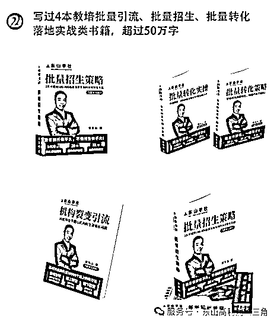
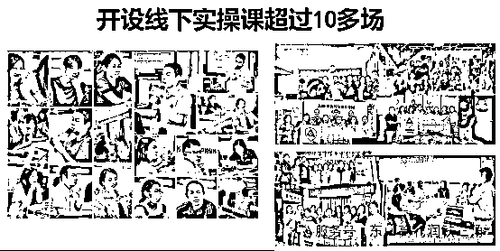
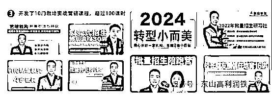

# 那些闷声赚钱的小公司，都藏着一个共同秘密

## 那些闷声赚钱的小公司，都藏着一个共同秘密

作者： 东山老师

日期：2025-10-25

**01**

**为什么那个轻松赚钱的人，不能是你？**

“创业这条路，如今太难走了。”

这话在我耳边响了整整十年，上千回，但我始终没点过一次头。

我自己的创业史是从 2003 年拉开的帷幕，到今年正好跨过 22 个年头。从山沟里的农家少年，到电子厂流水线上的一员，再从开工厂喝到胃出血，到投身电商把家底败光，最后成了全国各地跑的招生人。这一路跌跌撞撞走过来，我最大的感触只有一条：

利润丰厚的买卖，从来不是靠硬撑堆出来的，而是让一套对路的系统慢慢“养”出来。创业像种树，土壤对了、根扎深了，枝繁叶茂是迟早的事。

所以，每回有老板跟我倒苦水说创业太难时，我都喜欢问他一句：

“你周边三公里之内，朋友圈里头，有没有什么人几乎不怎么费力，就赚得满盆满钵的？”

得到的回答几乎一个样：“有啊，某某人也不知道用了什么‘偏门’，这几年闷声发大财！”

这时候我会马上接一句：“那凭什么，这个不用费力就能赚钱的人，就不能是你呢？”

这一句话，往往就把所有的抱怨都顶了回去。

要说实话，这几年的大环境确实不对劲了。过去靠一把子力气加一点运气就能吃到肉，现在那套早就不灵光。特别是疫情过后，老板们的唉声叹气比针还尖，隔着电话线、透过聊天群、刷着朋友圈，全都扎进我耳朵里。

上个月的某一天清晨，我打开手机，看到一条凌晨三点发来的消息。是个做培训学校的女校长，带着哭腔写的：

“东山老师，我被一个招生团队骗了 17 万，那是我准备给老师发工资和交房租的钱……我真的不知道怎么办了。”

隔着屏幕我仿佛都看见了那个画面：空荡荡的屋子里，她死死捂着嘴不敢哭出声，手机冷白的光正好打在她挂满泪水的脸上。

我攥着手机，心里一阵发酸。这几年，我收到过太多类似的求助。有老板在车里哭到天亮，有人把父母养老的钱都填进了公司的窟窿里，还有人盯着空荡荡的教室发呆，说学生都走了，只有桌椅板凳还留在这里嘲笑他。

可转念一想，我自己 22 年的创业路，哪一步不是踩在刀尖上走过来的？

1998 年，我中专毕业，揣着一张没人看得上的毕业证四处碰壁，最后进了深圳一家电子厂，在流水线上拧螺丝拧到手指全麻；

2003 年开厂那会儿，为了追回 25 万货款，我硬生生喝了 25 杯白酒，胃出血进了医院，醒来的时候手里还攥着那张皱巴巴的欠条和一嘴碎牙；

2013 年我杀进天猫做电商，囤了一百多万的货，结果流量没抢到，仓库堆成了山，积蓄赔得一干二净，人躺在医院里，看着输液管一滴一滴往下掉，眼泪也跟着一起掉；

2016 年开始跑全国招生，常常凌晨五点就赶飞机，女儿在视频里问我什么时候回家陪她过生日，我一边擦汗一边偷偷抹眼泪。

我见过不下八千个老板，也亲眼看着好几百家公司在我眼前倒下。所以“难”这个字，我说第二，没人敢说第一。但我更明白：

难，从来都不是垮掉的借口。

如果创业真像喝汽水那么简单，那凭什么成功的人会轮到你？

整天嚷嚷着创业难的人，都只顾着看脚下的泥坑，忘了抬起头来找🪜。

我身边就有不少靠“系统”赚钱的老板：

一个做培训的校长，用一套体验课转化流程，把成交率从 25%干到了 87%；

一个做美容的老板，靠差异化护理套餐，客单价直接翻了三倍，客户还要排队等；

一个健身教练，用体态评估加私教话术，9 块 9 的体验课愣是转化成了五万块的私教订单……

他们同样在拼命干活，但区别在于——他们把劲儿都使在了建系统上，而不是消耗在硬扛困难上。

这篇文章，我不想讲那些有的没的大道理。我想把我 22 年踩过的坑、流过的泪，还有花了整整十年打磨出来的【高利润铁三角】，原原本本地摆在你面前。

看完你就明白了：原来创业根本不用把自己逼得那么紧，生意照样能赚得稳、做得久。也千万别再像头倔驴一样，只顾埋头苦干。

**02**

**我踩过最深的坑：以为拼命就是一切**

我是在田埂上长大的，跟地里的庄稼一个命。童年里最熟悉的背景声，就是田间的虫鸣和母亲抡锄头时粗重的喘息。

家里穷得叮当响。父亲常年跟着村里的包工头去海南做泥瓦匠，一年到头也就回来一次。母亲一个人在家种田卖菜，拉扯着我们兄妹三个。

那七八亩薄田、十几头猪，就是全家人所有的指望。我打小学五六年级起，就得学着犁田、耙田、割稻子、插秧。暑假的毒日头把我后背晒得一层层脱皮，稻叶子割得我手指全是口子。我蹲在田埂上喝冷粥的时候，就在心里发了毒誓：这辈子绝不困在这山沟里，绝不像这样靠天吃饭过一辈子。

1995 年，我初中毕业。县一中的录取通知书拿在手里，纸面都发烫，我却咬着牙把它撕了，转身报了“模具设计与制造”的中专。原因很简单，听说这个专业好找工作、工资高，能让我赶紧逃离这片破山沟。那会儿的我恨不得连夜就走，少读三年书就能少干三年农活。

这个选择，成了我一生最后悔的决定。

直到现在，每回面对纪老板、龙哥这些学历高、认知高的人，我心里还是会不自觉地发虚。我常想，如果当年咬牙多念了三年书，考个好大学，我的人生会不会完全是另一副模样？

可世上哪有什么如果。你做的每一个选择，背后都悄悄标好了要付出的代价。

中专的学费对我来说高得离谱，每学期都是东拼西凑到处借的。生活费就更别说了，全靠我白天黑夜地给各家小报社、杂志社写稿子赚稿费，再做点小买卖贴补。我还张罗着办了学校的文学社，带着上千号人搞活动，顺便靠这个每年也能赚几千块钱生活费，做得挺带劲。

整个中专期间，我基本上没正经学过专业课。所以 1998 年毕业的时候，我的模具设计水平烂到没法看，最后是连蒙带骗、托关系找门路，才勉强混到了一张毕业证。

就凭这水平，在深圳连个模具学徒的工作都摸不着。走投无路的时候，我站在布吉关口的街头，看着车来人往，脑袋里一片空白。面前摆着两条路：一条是回老家种田，另一条是进电子厂当流水线工人。我咬咬牙选了后者——至少，城里的霓虹灯比田里的毒日头温柔多了。

电子厂的日子无聊到骨子里。每天重复着拧螺丝的动作，拧到十根手指头全麻了。我常常在机器的轰鸣声里盯着自己的影子出神：这辈子，难道就交代在这条流水线上了？

可我怎么也没想到，就是这点“不甘心”，成了我命运裂开的那道缝。

有一天下班，我看见隔壁新开的台湾电子厂在招业务员。底薪才 250 块，剩下全靠提成。不甘心一辈子拧螺丝的我，揣上那张没什么分量的中专文凭就去试了试。结果，那张破毕业证没能让我做成模具设计师，倒成了我进业务这行的敲门砖。

我很珍惜这次翻身的机会。那会儿还没有网络，我每天翻着黄页打一百多通电话，只要电话那头的人肯见我，不管多远，我都坐公交车去见面。

那几年，珠三角的角角落落我几乎跑了个遍。三个月就能走烂一双鞋，脚底的泡变成了厚茧，人也晒得跟块炭似的。一年不到，我就干成了厂里的销冠，我一个人出的业绩，比其他 11 个业务员加起来还多。

2000 年之后的那两年，我每个月能拿两万多的提成。那会儿深圳布吉关口那边的龙珠花园，一平米还不到两千块。我看着工资条，嘴都咧到了耳朵根：原来，拼命是真的能改变命运的。

但那时候的我根本不会想到：靠拼命赚回来的钱，早晚会被拼命的惰性一点一点亏回去。

2003 年，我决定出来单干开工厂。可以说，我把“拼命”这两个字直接刻进了骨头里：

每天早上七点到厂，打包、对账、跑客户、送货，样样都是我。一天干十几个小时，全年没有一天休息。

绝大部分采购商只认我一个人，说找别人不放心。员工也都依赖我，连个订单怎么接都要打电话问我。

有一次我出了个小车祸，在医院躺了几天，整个工厂就停摆了——没人知道怎么排单，客户也找不到对接的人。等我撑着没养好的身子回去，好几单生意早就黄了。

我还安慰自己说：“没事，我再拼命一点就好了。”现在回过头来看，那时候的我就是个不知死活的疯子。

当时我以为，只要我比以前更拼命，就一定能成。可现实给了我一记响亮的耳光。

从账面上看，工厂每年能有个三五百万元的盈利。可事实是，我常年被困在低利润加三角债的死循环里。我每天像个陀螺一样，催款、付款，催回来的钱转手就给了催得更紧的供应商，自己手上基本没见过什么钱。最难的时候，为了发工资，我差点动了母亲的救命钱。

还有一次，为了要回那 25 万货款，对方说喝一杯酒给一万，我硬是干了 25 杯，最后胃出血被送进医院。醒来的时候，手里还攥着那张欠条，还有个想杀人的心。

我肚子里烧着一团火：拼命到底有没有用？我都把自己逼到这个份上了，怎么还是赚不到钱？

我不认命，2013 年前后听人说做电商赚钱，我又一头扎了进去。都说电商是轻资产，结果我还是踩了坑。双十一为了冲销量，囤了上百万的货。结果没经验抢流量，仓库堆得满满当当卖不动。

我像个傻子似的，天天盯着后台看数据、改详情页、跟同行打价格战，利润薄得跟刀片一样，一毛一毛抠出来的钱，转眼就全烧给了直通车。

有一回为了抢一个活动位置，我熬了三个通宵优化页面。好不容易报上了，结果因为库存没算准，超卖了几百单，赔了钱还被客人投诉。那一刻我才真正理解了什么叫“坑位”。

做电商这个决定，把我这些年攒的家底全部搭了进去，还倒亏了一两百万。一夜之间，我又回到了原点。

我躺在病床上，看着药水一滴一滴往下走，眼泪也顺着脸颊往下流。那一刻我总算想明白了：

创业这件事，光使劲没什么用。我天天忙得团团转，到处防火救火，结果一个闪失，就全完了。

拼命干活，赚的只能是最苦的辛苦钱。只有搭好一套赚钱的系统，钱才会自己找上门来。这个道理，我用了十年血泪才真正参透。

**03**

**从“招生锦鲤”到胃痛难眠：我跑了 1400 场活动，才看清一个真相**

创业赔光了家底以后，我才彻底意识到自己书读得少、认知不够的短板。于是我开始疯了一样地补课：学教练技术，混各种互联网社群，一个连 PPT 都做不利索的工厂老板，硬着头皮啃起了线上运营的各种资料。

2015 年前后微商和社交电商风头正劲，我也跟着做了些朋友圈文案培训和微商个人品牌培训的活儿。

2016 年，我和搭档晓婷稀里糊涂接了个单子：帮一家少儿美术机构做招生。那会儿我哪懂什么培训行业？全凭一股子蛮劲和死磕精神。

我们熬了两个通宵，把体验课拆成了“孩子作品展示+家长见证分享”，再用当时流行的朋友圈裂变和社群裂变的套路去推。

结果三天时间招来了 150 个精准体验生。校长激动得抓着我的手喊：“东山老师，你就是我们的锦鲤！”

就是“锦鲤”这个词，让我们稀里糊涂地闯进了教培招生这个赛道。

接下来四年，我们组了个十几人的小团队，彻底变成了“空中飞人”：每周飞一到两个城市，一年要跑几十个地方，前前后后做了 1400 多场招生活动。

校长们追着我们喊“招生锦鲤”，可没人看到背后的狼狈：

我常常周三凌晨十二点还在给机构做复盘，周四早上五点的飞机已经等在登机口了。矿泉水配面包是常规操作，胃药常年揣在包里。半夜在陌生的酒店里胃痛到打滚，蜷在床上盯着天花板，连起身倒杯水都够不着。

女儿在视频那头问我“爸爸你什么时候回来陪我过生日”，我当时正蹲在机场大厅里给手机充电。屏幕上映着她的小脸，我抹了把汗，又偷偷擦了擦眼角。

我捏着手机问自己：这钱，赚得值吗？

比胃痛更让人难受的，是一个越来越藏不住的残酷事实：我们费劲招来的体验生，就像泼出去的水，大部分根本留不住。问题出在这些机构的体验课转化流程上，太随意、太粗糙了。

有个舞蹈学校的校长，我们帮她招了 200 个体验生，她就随便排了排课，让新来的老师上去讲，等要转化续费的时候，就递过来一张价目表完事。结果只留下 20 个人。

还有一家琴行，等不及我们的排期，自己找了个“299 元 48 节课”的联合招生团队。结果招来的全是只图便宜的家长，不但没赚到钱，还倒欠了 21 万的课消，直接把机构给拖垮了。

我发现一个问题：90% 的校长都陷在同一个误区里出不来——他们总觉得“机构不赚钱”，全部怪在“生源少”头上。

于是他们疯狂地找招生团队来“救火”，病急乱投医，结果就成了那些骗子招生团队眼里的“肥肉”。大多数机构被坑得血本无归，最后只能关门大吉。

2022 年春天，我和晓婷帮安徽阜阳一家大机构做完招生，在合肥转机回广州时，被隔离了。这突如其来的暂停，让一直连轴转的我们不得不停了下来。

晓婷看着窗外说：“我们能帮 1500 家机构做一场招生，可整个教培行业有几十万家。我们这样一家一家救火，什么时候是个头？而且孩子都快不认识咱们了……我们难道要一直这样飞到老吗？”

那一刻我如梦初醒：我们一直都在治标，治不了本。帮他们招生是给他们输血，可他们自己得学会造血才行。

输血管得了一时，只有自己造血才能活命。

那隔离的七天，我们下了个重大的决定：“我们不当‘锦鲤’了，改当‘医生’。”我对晓婷说，“我们可以教他们自己做招生、自己做转化，让他们自己长出赚钱的能力。这才是真正的帮忙，也能让我们有时间陪陪孩子。”

做了这个决定的那天晚上，我头一回没被胃痛弄醒。当月光洒进窗前的时候，我突然明白了：真正的赋能，不是替他走完路，而是教会他自己奔跑。

**04**

**三次顿悟：高利润铁三角，让利润自己长出来的秘密**

回到广州的当天，在一片不解和遗憾的声音里，我们解散了团队，在家门口租了一间办公室，开始了新的征程。

之后谁再喊我出去跑招生，我都摇头拒绝：“我们不帮你们招生了，但我们可以教会你们自己招生。”

于是，我们从“帮”校长做招生，转型成了“教”校长自己搞定招生和转化。

**第一次顿悟：转化不是“说出来”的，是“看得到”的**

转型第一步，除了继续做线上的裂变式招生陪跑之外，我把目光盯在了校长们最头疼的“体验课升单转化”上。我下决心要把这个难题彻底解开。

我花了半年时间，把这些年支持校长做体验课转化的经验，细细嚼碎了拆开来看，写出了 35 万字的两本书，一本叫《批量转化策略篇》，一本叫《批量转化实操篇》。

然后我用这两本书打磨出了对应的线下课【批量转化实战营】，后来又录成了 60 节的线上课【批量转化特训营】。

这套课，成了我手里的“手术刀”，直接剖开了机构提转化的真相：家长掏钱，不是因为你课程讲得多好，而是因为他们亲眼看到了孩子实实在在的变化。

有个教少儿口才的校长，学完之后把体验课从“教孩子练绕口令”改成了“带着家长看孩子上课的录像”——他指着画面里孩子从躲在桌子底下不敢吭声，到后来站在台上大方演讲的对比，问家长：“如果跟我们学一年，您觉得孩子会变成什么样？”转化率从 25%直接飙到 55%。

还有一位昆明做中国舞的机构老板，我把她 10 次体验课压缩成 6 次“主题训练营”，每 2 次课中间嵌一次成果展示，最后再安排一次 1 对 1 的家庭沟通。家长看着自家孩子从手脚不协调到能利落劈叉的视频，转化率从 40%冲到了 87%。

她在电话里喊：“以前总以为是生源不够，现在才算明白——转化不是说出来的，是要让家长亲眼看见钱到底花在了哪儿！”

**第二次顿悟：没有差异化，就没有定价权**

陪跑了一年之后，到 2023 年，我发现一个现象：80% 的校长还是泡在“低利润的泥潭”里挣扎。明明招生量上去了，转化率也提上来了，可还是一个劲儿地喊穷。

有个校长苦笑着跟我说：“别看我在外面开着奔驰，其实背地里加油的钱都是赊来的。”

为什么会这样？

因为利润太薄了！

于是我和几百个老板在线下课里一起算账，在社群里一起算账。直到有一天，我一个人蹲在办公室，翻了 100 家机构的价目表，才终于看清了真相：

90% 机构的定价，都远远低于它本该有的水平。

他们只是靠招生、转化、续费这套现金流勉强维持着运转，但根本没有产生真正的利润。

再往下挖，我发现了他们定价偏低的根源：产品太同质化了，只能靠打价格战来生存。

别看每家的招牌长得不一样，但回到产品本身，基本都是一个模子刻出来的：

**第一种：卖时间的思维**

不管是少儿培训、体验课还是常规课，全都逃不出“多少钱多少次课”这套卖时间的逻辑。

你课程内容做得再好，但在家长眼里，就是一串数字：XXX 元 XX 次课。他们心算一下就知道你一次课多少钱了，然后就能算出你家比别人贵了 5 块钱。

这时候，不管你嘴上怎么强调你的课有多好，家长都捂着耳朵说：我不听我不听，只要你不降到和别人一样的价，再送我一个礼品，我就不报名。

**第二种：宣传物料的全然雷同**

钢琴课都说“专业师资”，美术课都喊“创意教学”。所以大家的宣传语、课程定价、服务流程、机构介绍、师资介绍，几乎全是同一套模子印出来的。

对家长来说，她真的没法从一堆大同小异的海报里看出你比别人强在哪里。就像菜市场里卖白菜的，大家都卖白菜，那就只能拼谁卖得更便宜了。

所以，90% 的机构卖的根本不是“价值”，而是“时间”。书法课强调“专业师资”，最后拼的是谁便宜 50 块；机器人课喊“培养创造力”，最后变成了“99 元 10 节课”的白菜价。

有个校长愁眉苦脸地跟我说：“东山老师，我想涨价，但又怕家长都跑了。”

我反问他：“那你能说清楚你的课比隔壁好在哪里吗？”他张了张嘴，一个字都说不出来。

从那天起，我们开始带着客户往死里抠“产品差异化和价值塑造”：

我帮一家书法机构做了一个“3 周练好名字”的训练营，海报从“招生”改成了“孩子名字被老师贴在班级光荣榜上”；

我给一家机器人机构设计了“体验课-竞赛营-名校升学通道”的进阶路线，家长的原话是：“别家卖的是课，你们卖的是孩子的未来。”

更狠的是一个做少儿口才的合伙人，暑假期间打磨了一个“班干部竞选训练营”。孩子经过暑假的特训，新学期真的当上了班长。

消息一传开，她干脆把课程涨了 30%，结果报名人数反而翻了一倍——家长说：“以前觉得贵，现在知道贵在哪里了，值了！”

看着校长们在电话那头报喜时兴奋的声音，我突然参透了：利润从来不是看你招了多少人，而是看你每一单能赚多少。

你的课程如果没有什么独特之处，没有明显的差异化和价值感，那就跟在菜市场卖白菜一样，只能看谁更贱卖。你卖三块，别人敢卖两块五，最后大家一起饿死。

产品没有差异化，就没有定价权。你卖的是白菜的价格，凭什么赚龙虾的钱？

**第三次顿悟：酒香也怕巷子深，获客要靠“信任种草”**

帮客户解决了转化和产品这两个大难题之后，校长们的新问题又冒了出来：“课确实是好课，可是压根没人知道啊！”

有位做青少年编程培训的负责人，对课程内容有着近乎偏执的追求，每节课都打磨得像一件精致的作品，我看了都忍不住想，要是能把孩子送过去学就好了。

可她的经营方式让人憋屈——每天在个人动态里发“求介绍生源”。我忍不住跟她讲：你是做教育的人，别把自己活成讨饭的样子。

后来我们一起调整打法，不再依赖一年三四次的大型裂变活动，而是转向内容经营，让家长通过故事建立信赖，主动产生了解的兴趣。

她不再发课程广告，而是发孩子的真实变化。有个叫小宇的男孩，刚来时连鼠标都拿不稳，一个季度后却独立做出了一个小游戏。她配了一条很简单的说明：“8岁，上周的作品，刚来的时候还是个电脑小白。”

短视频平台也不拍教室环境了，改拍一位妈妈的真心话。那位妈妈说着说着就哽咽了，讲孩子现在回家会主动跟她讲程序逻辑，很多她自己都听不懂。结果视频下方的留言区，清一色在问怎么报名。

图文专栏不再写介绍机构的推文，而是写一个男孩的故事：从坐不住板凳，到下课了还想留下来问问题。文章结尾放了一个试听入口，没有催促，自然成交率达到两成。

她按这个方向坚持了90天，短视频账号累计带来超过200个高意向咨询。她后来跟我说：“以前我是求爷爷告奶奶地找人帮忙介绍，现在是家长跑来告诉我，关注我半年多了，就信我这个人。”

这件事让我更加笃定一件事：**产品、流量、成交必须组成闭环，三者环环相扣，缺少任何一个都转不起来。**

等帮她把整条链路理顺之后，我又发现一个普遍现象：很多老板刚尝到一点甜头，就开始瞎折腾、乱转型。于是我们引入了一张**年度作战表**，把产品、获客、成交这些核心工作拆解成表格，钉在办公室的墙上，让大家抬头就能看到自己的主线。

配合**固定节奏管理法**，把不同周期该做的事提前安排好：年度定方向，季度定重点，月度定目标，每周有复盘，每天有执行。慢慢地，大家真的开始用正确的方式做正确的事情，利润也像流水一样一点一点汇聚起来。

他们每天雷打不动先做三件事，然后再处理别的：

一是产品上打造辨识度，别人卖课程你卖成长结果，家长自然觉得“贵一点也值”；
二是用内容做信任资产，不做硬广，让真实的客户故事替你说话，咨询量自己就会涨；
三是设计体验式的成交路径，让家长看到价值之后再付款，成交率翻倍并不是难事。

我一直觉得创业本身没什么玄妙的，只要你每天把精力投到开发产品、吸引客户、推动成交、维护续费这些能直接产生收入的事情上，每天都有正反馈，哪还有心思去内耗。

广州有位做少儿美术的创业者，跟着这套方法走了一年，从每个月亏五万、撑不下去，到第二年赚了一百万。

昆明有一对做练字的夫妻，离婚协议书都写好了，听了我的课决定再拼一把，现在换了更大的新场地。

他们复盘时说了差不多的话：以前觉得是自己命不好，现在才懂，做生意靠的是系统，产品、客户、成交三件事配合好，利润自己会说话。

这是我从二十二年摸爬滚打里换来的体会——**赚钱靠的不是运气，而是设计。** 让每一个业务环节都为你创造收益，而不是消耗成本。

把“**产品体系、持续获客、升单成交**”这条链路吃透，利润就会像植物一样自然生长。

**跨行业的真相：所有体验型生意，底层通用一套逻辑**

说实话，我以前是个特别固执的人，眼里只有青少年素质教育这一个赛道。别人在社群里加我，我视而不见；线下活动有人凑过来交流，我也爱答不理。总觉得你们不是做教培的，跟我说得着吗？

有一次，一个美容院的老板拦住我，问我能不能把帮培训机构做的那套方法用到她店里。我当场回绝：教培是教培，美业是美业，隔行如隔山，我教不了你。

她红着眼眶怼回来：“你们卖体验课升年卡，我们卖体验护理升年卡，不都是先让人尝到甜头再谈长期合作吗？有什么区别？”

我一下子答不上来，心里却像被什么东西扎了一下。三个月后，一位前辈在创业者聚会上说了句话：“做生意的底层逻辑都是通的。”那一刻，我脑子里的雾散了。

回头再看，青少年培训的低价体验课，和美业店里的体验护理本质相同；健身房的私教试课，与装修公司的免费上门测量异曲同工；宠物店的训犬试训，说白了就是知识博主们用来吸粉的低价公开课。

剥掉所有行业的外壳，里面的骨架完全一样：**前端用体验品把人吸引进来，后端在体验过程中把价值呈现出来，引导客户升级消费。**

从那以后，我像着了魔一样去拆解各种体验型生意，越拆越觉得后悔。瑜伽馆的低价课和培训机构的体验营，都是让客户先尝甜头，然后靠效果锁定长期关系；装修公司的免费方案，本质上就是体验课的一个变体；训犬试训跟公开课转化用的是同一条路径——用看得见的效果，让主人心甘情愿掏钱办卡。

所有依托体验去撬动消费的模式，赚钱公式都是同一个：有辨识度的体验产品做引流，真实的内容建立信赖，阶梯式设计放大成交。

我拿朋友的瑜伽馆做了个实验。以前他做的是9.9元三节体验课，来的全是占便宜的，练完就走。我让他改成“三天体态评估加一节私教体验”——体验过程中完全不提办卡，只是蹲下来帮学员放松僵硬的肩颈，指着评估报告解释“你的圆肩是长期低头造成的”。老会员带新朋友来，老会员拿一次季度复查，新朋友拿一份训练手册。一个季度后，他打电话的声音都在抖：“业绩翻了一倍，以前靠打折拉人，现在客户说你们懂我，贵点也愿意。”

后来我又帮一位做知识付费的朋友调整产品。他原本卖1980元的线上课，学员买完就消失，完课率不到两成。我让他别再卖课程，改卖结果：两万元一年的轻咨询加年度陪跑，每周做一次一对一诊断，每月拆解一个案例。改完之后，复购率直接冲到50%。有学员留言说：“以前买的是课，现在买的是有人陪我把结果做出来，这笔钱比请三个助理都值。”

行业只是不同的外衣，商业的底层逻辑才是真正的骨架。**体验是钩子，信赖是钥匙，利润是果实。** 不管你是教培、美业还是健身房，只要做的是“先体验后升级”的生意，这套逻辑就能往里套。

**AI不是来抢饭碗的，是帮愿意改变的人加速**

这半年我迷上了AI，每天至少要跟它泡上四五个小时，像琢玉一样反复打磨我的生意模型。用得越深，越确认一个感受：AI根本不是来替代人的，它是给敢于用新工具的人搭了一条云梯。

有个做课程运营的女孩战战兢兢地问我：“老板要是用了AI，会不会就不需要我了？”我没有回答，直接带她体验了一周。

以前要花一周才能做完的市场调研，AI两个小时就能整理出一份报告，连附近三家竞品的体验课定价漏洞都标得清清楚楚；过去做海报要等美工排期，现在半小时能出好几版，还能自动调成家长喜欢的色调；最神奇的是AI销售陪练，新人对着屏幕练话术，AI会突然切换成一个挑剔的家长，冷不丁问一句：“你们比隔壁贵500，凭什么？”答不上来时，AI立刻指出盲区：“你没告诉家长孩子三个月后会有什么变化。”半个月后，这个女孩的成单率从三成冲到了七成五。

很多老板看完AI生成的方案也松了口气：这哪里是来抢活的，分明是帮我们腾出手去做真正需要人的事——比如坐下听家长说“孩子坐不住怎么办”，比如把课程打磨到让家长觉得非报不可。

以前做产品调研是件特别痛苦的事：蹲在同行门口数人流量，翻几百条差评，忙活半个月还搞不清家长到底怕什么。现在你只要给AI一句指令，两分钟它就能列出不同年龄段家长的焦虑点——三到六岁的家长担心专注力，七到十二岁的家长在意作品能不能参展。

提炼卖点也不用再关起门来拍桌子。AI直接生成一份家长决策清单，连应对竞争对手的话术都替你写好了：“隔壁教孩子画画，我们教孩子三个月后敢站上台讲自己的画——你要的是一幅作品，还是孩子敢于表达的底气？”

八月份我办了一个小范围的AI训练营，十几个不同行业的人一起实操。有位快五十岁的少儿美术机构负责人，以前连电脑都不太会用，第一次看到AI生成的产品规划时，老花镜滑到鼻尖都没察觉，嘴里直说“太神了”。她照着调整了课程组合，国庆前把学费涨了一千块，报名人数反而多了三成。她在电话里一边笑一边哭：“本来打算关店回家带孙子，现在觉得自己还能再干十年。”

杭州有位做了十年房产中介的老张，之前天天跟同行卷佣金比例，卷到想把门店钥匙扔进江里。跟着AI拆解完高端房产的服务差异之后，他把“免费带看”改成了“三天家庭资产配置诊断”，给客户出一份包含学区、投资、居住三个维度的报告，连孩子十几年后的升学政策变化都写在上面。上个月签的第一单，客单价从两百万直接跳到八百万。现在客户不再叫他“小张”，而是客客气气地喊一声“张老师”。他咧着嘴跟我说，感觉自己离年入五百万的目标不远了。

结营那天，有位学员总结得特别好：AI就像一个万能翻译官，它能把一套商业逻辑转换成各个行业都听得懂的语言。我觉得这个说法很妙。**AI不会淘汰人，只会让愿意拥抱变化的人把成功提速十倍。**

你花三个小时用AI摸透的客户需求，对手可能要熬夜猜几个月；你用AI搭好的经营系统，同行半年后都未必看得懂。这就是降维打击。

**让好生意被看见，让认真做事的人赚到钱**

我熬了四十多个日夜，把过去二十多年掉过的坑和AI工具揉在一起，做成了两套课程：一套是五天的线上实战营，一套是三天两夜的AI线下闭门课。

我对这两套课有足够的底气，所以给了很足的承诺：

线上实战营只要9.9元，学完觉得没用，退你10块，赠品照送；线下闭门课4800元，上完第一天觉得不值，退你5000块，多出来的200算我请你喝咖啡赔罪。

从这次转型开始，我的客户名单上不再只有教培从业者。只要你做的是“前端体验、后端升单”的生意，不管是美业、瑜伽、健身房，还是知识付费、宠物训犬、高端家装，我都能搭把手。毕竟创业这件事，说一千道一万，赚不到钱等于白忙。

月初刚结束的线上实战营，像是一场利润魔术表演。第一天拆产品差异化，有人当场把书法体验课改成了“三周写好自己名字”的小特训营；第三天搭内容生产线，校长们用半小时就生成了够用三十天的文案素材；第四天练成交基本功，有人从说话打结巴练到三句话戳中家长心窝，还有人把9.9元的体验客户聊成了五千八的年卡会员。

最让我鼻子发酸的是云南一位做阅读培训的负责人。她学完第二天就改了课表，把十二节泛读课改成六节“阅读力突破营”，家长会上直接放视频——孩子从读得磕磕绊绊，到三分钟讲完《小王子》。学费涨了接近一倍，报名人数反而多了四成。她在直播里抹着眼泪笑：“以前怕涨价吓跑客户，现在才明白，好产品筛选客户，不是讨好客户。”

这门9.9元的实战营，我决定一直开下去。不是为了这杯奶茶钱——这点钱连成本都覆盖不了——而是因为每天收到的报喜消息，让我发自内心地高兴。

其实在转型之前，我也走过一段弯路。七月份去杭州学了一套微信获客方法，回来后日夜打磨直播话术，投了不少流量费，结果直播间来的一百个人里九十八个都不是目标客户。直到我把服务对象从教培扩展到所有体验型生意，正反馈才突然变得强烈起来。现在每场直播能有两三千人观看，报名的人也越来越多。

创业这件事，太轴了不行，太散漫更不行。方向对了，方法有了，剩下的就是坚持。

回望这二十二年，我从流水线上的工人，到应酬喝到胃出血的小工厂主，再到站在这上千位创业者身后的老参谋，我比谁都明白：创业不是马拉松，而是找🪜——找对了🪜，别人爬十年的坡，你一年就能登顶。**别把自己熬成一只陀螺，要让生意自己转起来，让利润自己滚起来。**

如果你也在做体验型的生意，希望未来的路上，我们能同行一段，把小日子过得更踏实。

最后一句话，还是那七个字：真的要狠狠用AI。