# 上万款 Shopify 应用、五十万条评论数据扒完后，我更确信这块市场远没到天花板

> 原文：[`www.yuque.com/for_lazy/zhoubao/sfdt8nnzekke2np3`](https://www.yuque.com/for_lazy/zhoubao/sfdt8nnzekke2np3)

## 上万款 Shopify 应用、五十万条评论数据扒完后，我更确信这块市场远没到天花板

作者： 吴大白

日期：2025-10-29

大家好，我是吴大白。

许久没发新内容了。最近生财找到我，想聊聊 Shopify Apps 这条路到底能不能赚钱。

我本身就踩在技术和电商的交叉口，几年前公司内部自己就做过两个给团队用的 Shopify 应用，所以这块并不陌生。为了更透彻地看清现状，我写了个爬虫，把 Shopify 应用商店里几乎全量的应用数据都拉了下来，这篇分享就是基于这批数据的观察。

下面就从这几个维度展开聊聊 Shopify App 能否变现。

一、Shopify App 市场全景速览

二、Shopify 应用主要怎么收费

三、评分与评论里藏着什么市场信号

四、个人开发者在生态里还能不能玩

五、数据指向的赚钱品类有哪些

六、结语：AI 时代的技术与电商结合点

## **一、Shopify App 数据总览**

坊间非官方统计，Shopify 全球商家已超 500 万家。我的采集里，剔除未上线和已下架后，剩下约 12000 个应用，到目前为止应该是最全的一份盘点。

我按地区、语种做了多轮补采，漏掉的应该有限。商家数和应用数的巨大落差，直接说明这块供给仍很稀疏。

这批应用散落在 32 个一级类目、110 多个二级类目里。发货解决方案相关应用最多，超过 2000 个；礼品类最冷门，只有百来个。

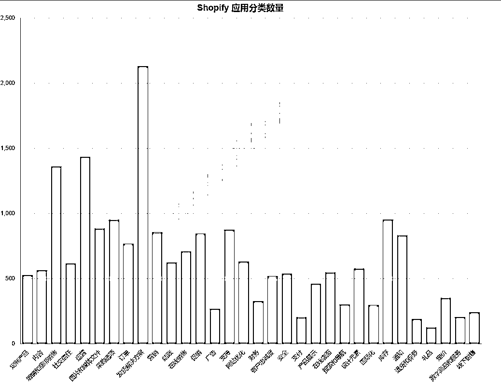

（图 1）

全部应用累计评论量预计超过五十万条，但评论为 0 的占比高达 56.2%，评论数破 500 的应用加起来不到 2%。

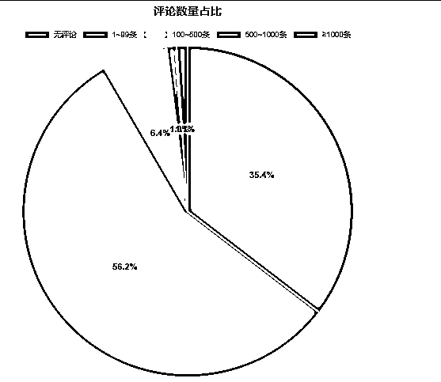

（图 2）

再看评分分布，有个反常识的细节：发货订单类应用占比超 30%，却是整体占比最大的赛道，但用户评分最高的反而是“定价”和“礼品”这类细分赛道。

竞争激烈不等于市场饱和，冷门赛道往往更容易出头。

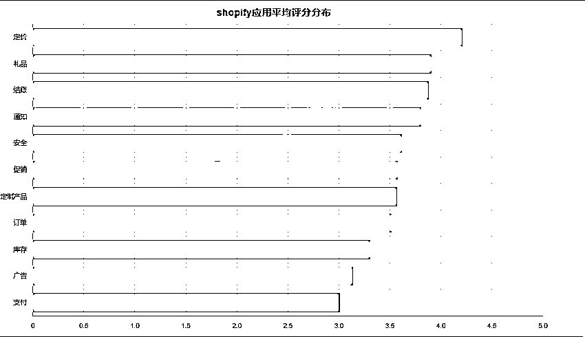

（图 3）

上架时间上，2009 年只上了寥寥几个，真正起量是从 2019 年开始，到今年每年新增都在递增，2025 年新增接近 2500 个，是历史峰值。越来越多开发者开始把目光投向这片蓝海。

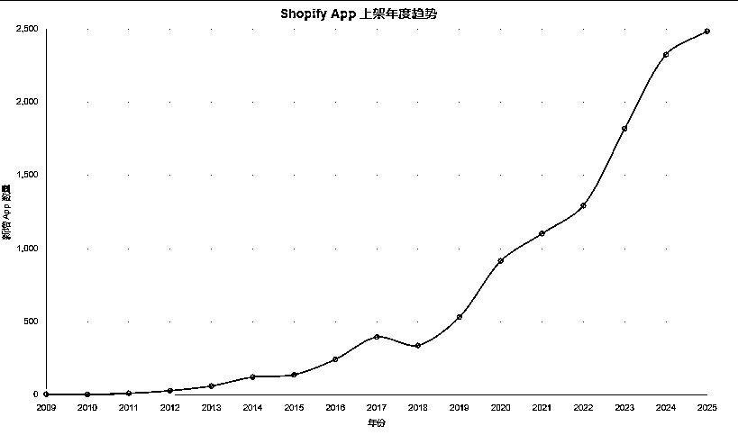

（图 4）

## **二、在 shopify 中主要的收费模式是什么？**

看完大盘，我们聊个更实际的问题：这些应用怎么收费，头部大概能赚多少。

先看收费形态：完全免费的仅占 3.1%，先免费后付费的占到 96.9%。几乎所有应用都用免费获客再转化的打法，免费门槛能更快吸用户。

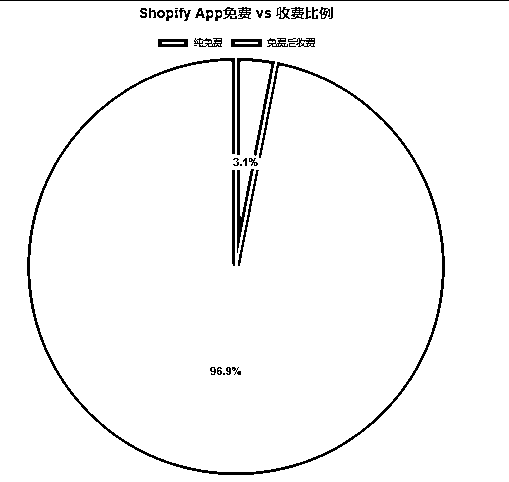

（图 5）

收费方式几乎清一色订阅制，和 Shopify 官方机制一致。再看价格带，

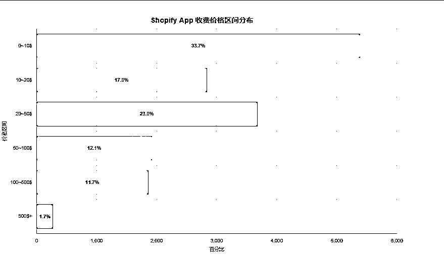

（图 6）

约 75% 的应用月费在 50 美元及以下，100 美元以上的只占 13% 左右，而且高价位多以年费为主。

举个真实例子，Essential Announcement Bar [[`apps.shopify.com/essential-announcement-bar?locale=zh-`](https://apps.shopify.com/essential-announcement-bar?locale=zh-) CN]([`apps.shopify.com/essential-announcement-bar?locale=zh-`](https://apps.shopify.com/essential-announcement-bar?locale=zh-) CN) 这个公告栏工具。

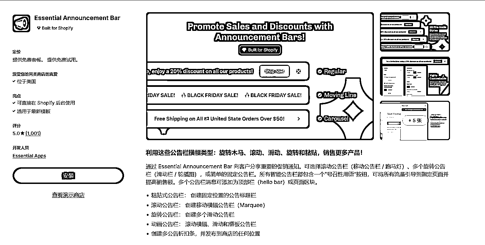

（图 7）

作者来自立陶宛，2023 年 8 月 9 日上线，目前评论 1001 条，综合评分 5 分，采用经典免费转付费，月费 19 美元，年费 199 美元。

做个粗略测算：评论转化率按 5% 计，1000 条评论对应约 20000 个装机用户。付费转化按 10% 估算，约 2000 个付费用户。按月费 70%、年费 30% 拆分，只算续费 6 个月：2000*0.7*19*6 + 2000*0.3*199 = 159600 + 119400 = 279000 美元，按汇率折算年收入约 198 万人民币。

这个体量在 Shopify 里不算个例。高分评价的工具型应用，一旦被商家养成使用习惯，续费率和稳定性都很强。

## **三、基于评分与评论背后的“市场需求”**

收费模式搞清楚后，再用评分和评论找切入点。

整体来看，应用评分集中在 4.5~5.0 区间。

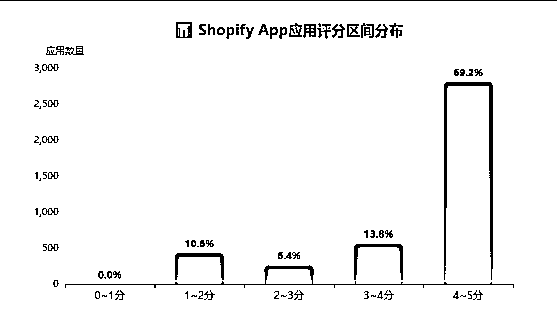

（图 8）

但评论量极度不均，图 2 也能看到。新应用想突围，口碑积累是硬指标。对独立开发者而言，前期用免费换评价是条捷径，同时要盯着功能空白点去做。

比如“定价”和“礼品”赛道，目前供给少但评分高，就是典型的未被充分满足的领域。

除了赛道选择，成熟应用的差评也能反向挖需求。还是以 Essential Announcement Bar 为例，1000 多条评论里高频吐槽集中在：动画太单一，仅支持滚动或静态；粘性公告栏常与主题头部冲突；免费版图标支持受限。

另有大量用户在反复呼吁：更丰富的动画、更好兼容各种主题、支持在更多页面区域灵活投放、多语言国际化等。

这些都是公告栏的常规诉求，却始终没被完全解决。对标头部产品，补齐这些未满足点，就是一个很清晰的切入路径。

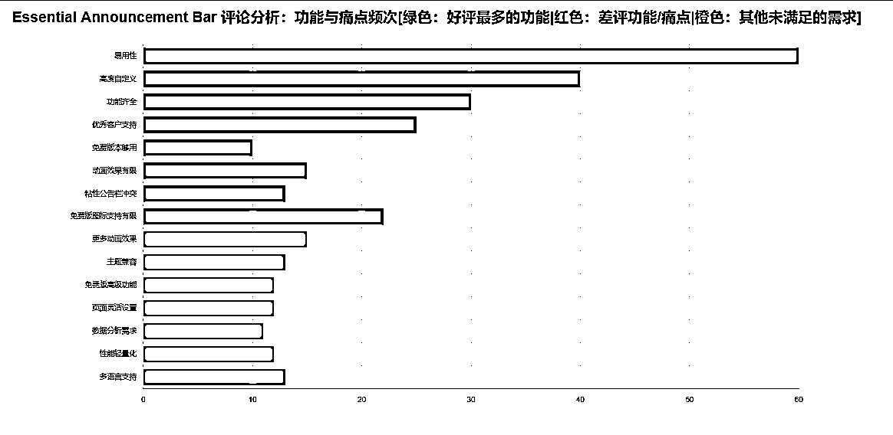

（图 9）

## **四、在 shopify app 生态中，个人开发者有机会吗？**

从技术门槛看，我认为并不高，AI 时代代码不再是瓶颈。

再看开发者生态：

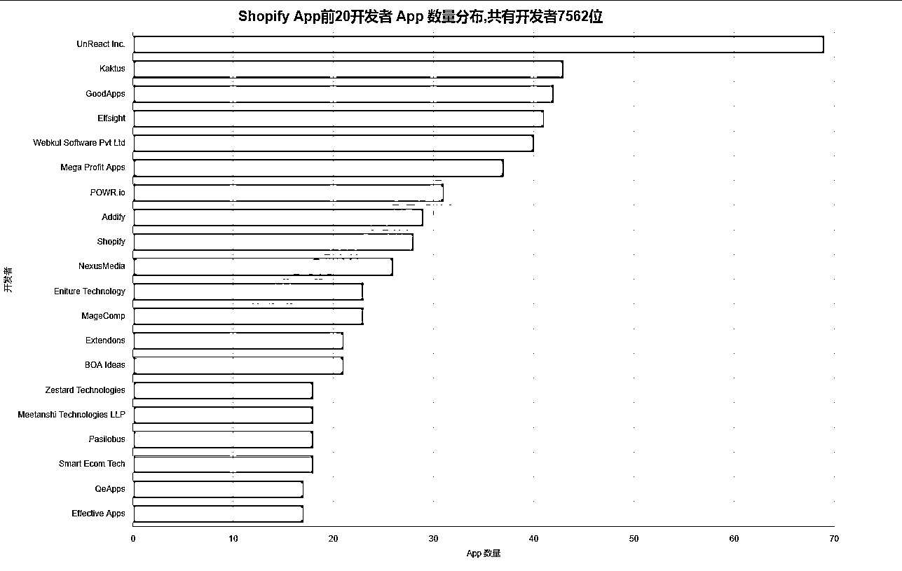

（图 10）

Shopify 应用商店目前约有 7562 位开发者，其中应用数量最多的一位有 69 个应用，是来自日本的 unreact5，地址 [`apps.shopify.com/partners/unreact5?locale=zh-`](https://apps.shopify.com/partners/unreact5?locale=zh-CN，大家可以去看一下。) CN

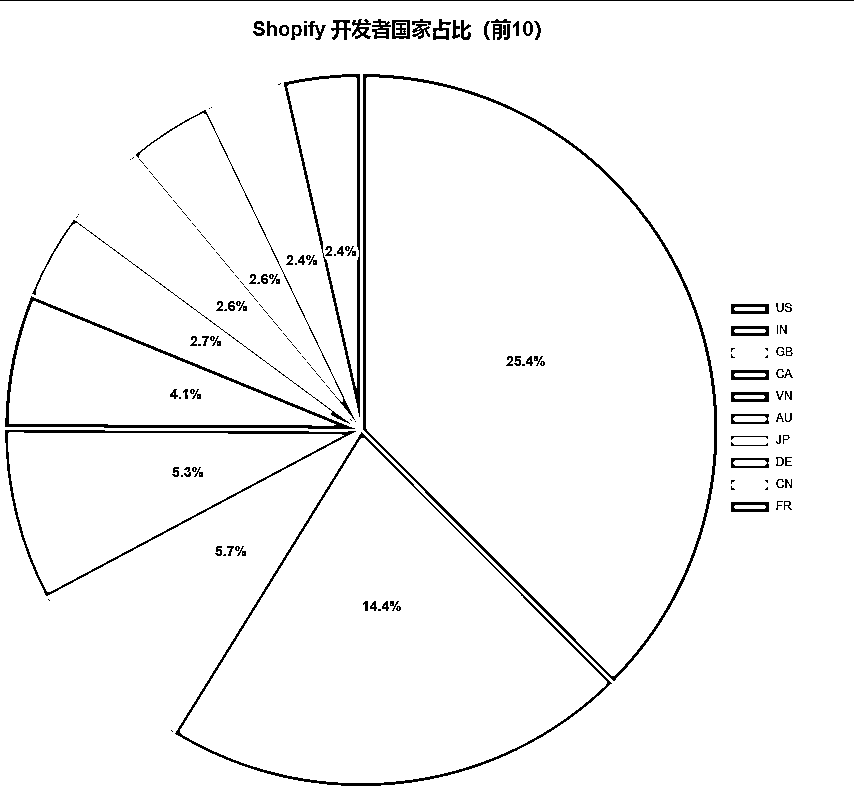

（图 11）

国家分布前十里，美国最多，其次印度，中国开发者占比不到 3%。

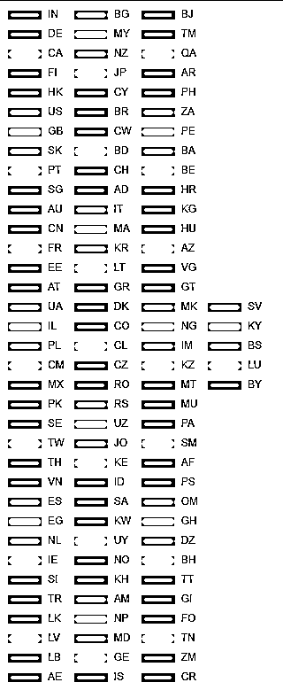

（图 10）

开发者遍布大几十个国家，说明生态是全球化的。

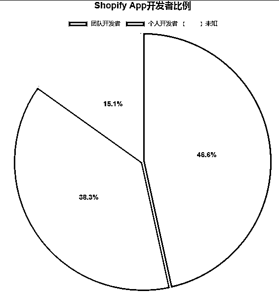

（图 11）

个人开发者占 38.3%，团队占 46.6%。从上架时间和评论轨迹看，很多团队其实都是从个人起步，收入起来后才组建团队、自建官网承接客服。

所以个人依然有机会，关键门槛从“会写代码”转向“能理解商家痛点”。

## **五、数据告诉我们什么样的 App 最有赚钱潜力？**

把整套数据跑完后，最直观的感受是：Shopify App 市场真的有想象空间。

Shopify 背后有数百万电商卖家，他们持续在寻找更聪明、更自动化、更划算的工具来提升转化。

结合评分、评论、更新频率、付费形态等多维度，我和 AI 一起筛选出了几类高潜力方向，供参考：

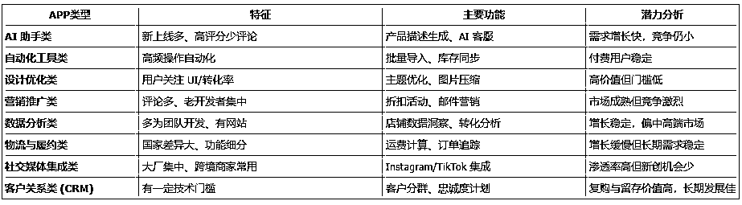

以上结论都源自数据，具体竞品可以去 Shopify App Store 官网实地验证，再用前面的分析方法深挖需求。

几年前我在生财分享过关键词挖掘的方法论，有兴趣可以翻看，里面有比较完整的需求挖掘思路。

## **六、写在最后：关于 AI 时代技术与电商结合的机会**

到这里，Shopify 应用的数据盘点基本结束。

我想强调的是，每个 App 的背后都是一类电商刚需，它现在落在 Shopify 上，换个场景依然成立。

比如 WordPress 生态的电商插件、基于浏览器的价格对比插件如 AliPrice、物流实时追踪如 17TRACK 等，无一不是技术+电商结合的成功样本。这些产品多以公司化运作，但独立开发者做的也不少。

在我看来，电商人群是互联网里最舍得付费的群体之一，能帮他们多卖一单，他们就愿意掏钱，而且一旦用顺手，迁移成本极高。

AI 时代，写代码已不再是难题。找到一个能解决部分商家痛点的点，一月破万对个人开发者并非难事。如果一时没灵感，可以先从 Shopify 应用商店这类成熟应用市场入手，成本最低、反馈最快。

不需要复杂的页面设计，不需要庞大团队，解决一个真实痛点，就可能变成月入几千刀的小生意。

感谢看到这里，如果对你有启发，我很荣幸。

**（此内容发于生财，谢绝任何形式的转载）**

* * *

评论区：

七天@生财有术 : 很干货，AI 产品的机会来源于最有粘性的群体的刚性增量需求，做电商的老板们就是这样的画像。分享很有启发的一段：如果实在没有什么头绪，那就从 shopify

app 这种基于应用市场的需求开始，成本最低，反馈最快。 无需复杂的前端设计，不必有庞大的团队，只要能解决一个痛点，就可能变成“月入几千刀的小生意

你在哪 : shopify 是干嘛的。。谁会在上面订阅？哪个平台的商家啊

龙咖 : 这个是绝对的干货！！

龙咖 : 这。。。。。。[撇嘴][撇嘴][撇嘴][撇嘴]

蓝星空 : 写的非常详细，感谢分享！

唐 : 好文，我最近也在看这方面的机会，期待更多 Shopify 的分享

希声 : 做海外独立站都会用的平台，准确来说是建站工具

希声 : 有启发，很棒的切入点