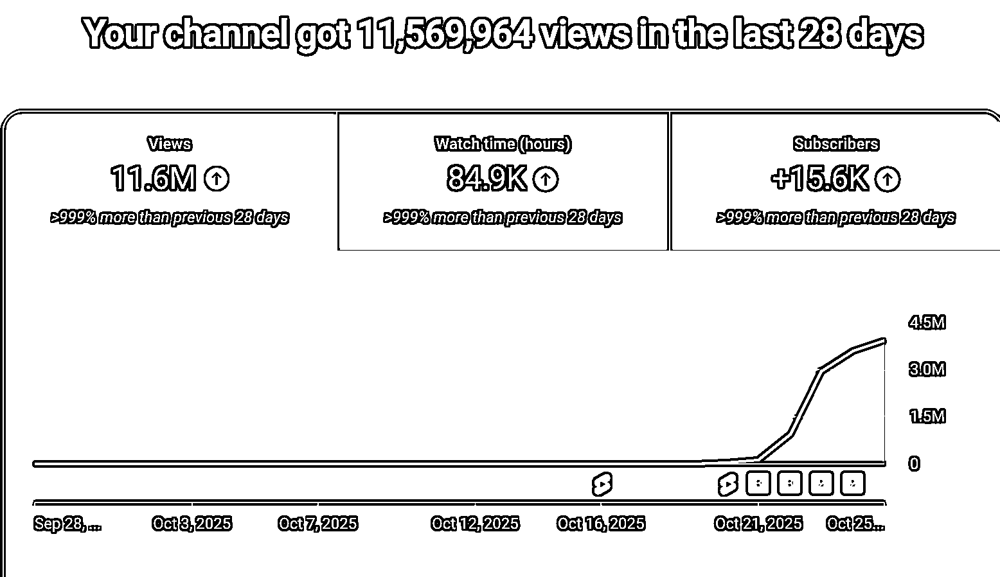

# ('(32 赞)7 天手搓千万浏览量，参加航海在编程和 YouTube 间抉择的那些事', (2, 43))

上周刚结束一场特别的“实战”，从19号到25号，整整一周，我亲手把浏览量拉到了千万级别。

说实话，这次出海前还挺纠结的——当时连问了三款AI工具，到底该专注写代码还是扑向YouTube，结果它们口径一致地指向后者。看来拿不准主意的时候，把选择权交给AI，倒是个不踩坑的解法。

更有意思的是，年初算命先生说我要遇贵人，当时半信半疑，没想到这一次竟然真的在网络世界里碰上了一群闪闪发光的人。感恩生财这个社区，让我这条航路越走越亮。

