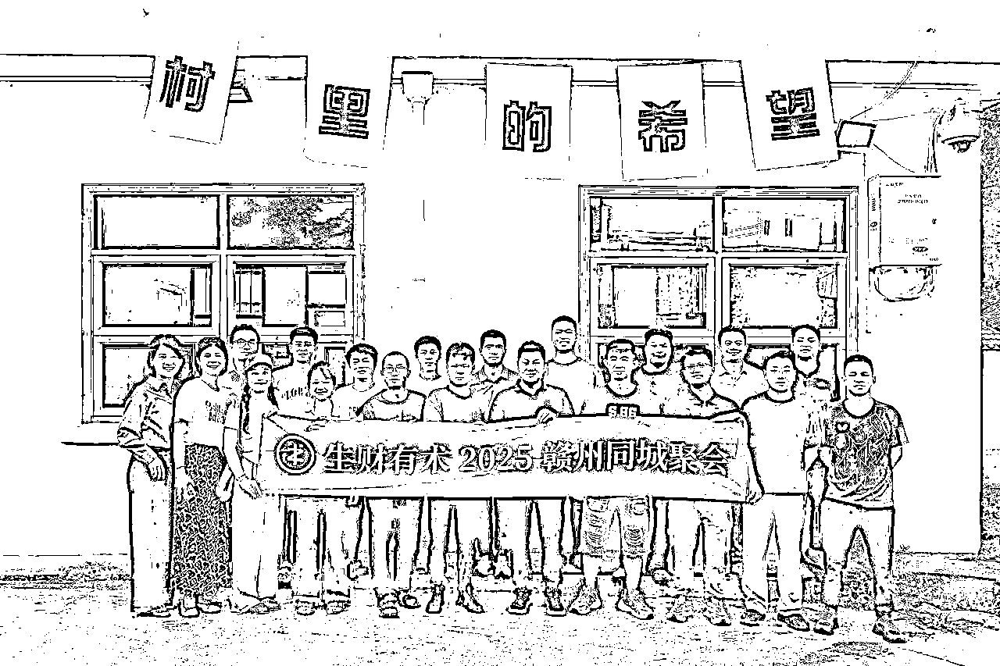
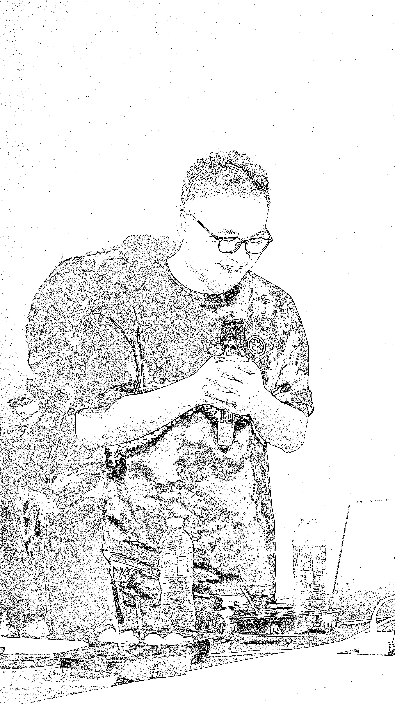
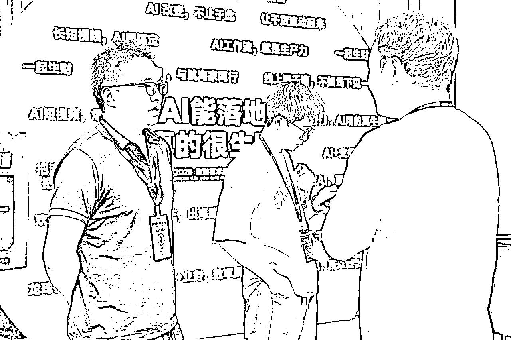

# (精华帖)(206 赞)赚钱 5 年从 “差生” 逆袭：不下牌桌，死磕公众号 8 年，搭出上瘾赚钱系统

赚钱5年，从“差生”到爆发：死磕公众号8年，我终于把自己的赚钱系统跑通了

大家好，我是刘智行。

之前在赚钱写过一篇“赚钱好事”的帖子，没想到被龙哥老大亲自推荐了，特别受鼓舞。就像他鼓励我的那样，我也想把这阵子的经历和心得整理出来，把这份能量继续传递下去。

先说说我的背景。

在赚钱这所“学校”里，我是个前四年基本没什么存在感的“差生”——一直潜水，看别人晒成绩、晒截图，自己却始终没做出什么名堂。但到了第五年，好像突然开窍了，开始一步步找到属于自己的路。

今年是下班后认真搞副业的第一年，也是我做公众号垂直小号的第八年。

有人可能会问：为什么是八年？因为这八年里，我几乎把“难熬”都体验了个遍——

阅读量常年挂零，好一点也就个位数；
变现路径怎么都走不通；
AI工具摆在那，我却完全不会用。

说实话，这些都是让人想原地放弃的至暗时刻。但每一次，我都选择留在牌桌上，硬着头皮继续啃。项目失败了一次又一次，但也正是在这一次次试错里，我慢慢沉淀出了一套可复用、可复制的方法论，也终于看到了结果。

这篇文章主要想聊三件事：

1. 讲讲我自己；
2. 聊聊拿到的一些项目成绩和成长收获；
3. 说说垂直小号这8年最真实的心路历程（掏心窝子那种）。

如果你也和我一样，曾觉得自己起点低、走得很慢，希望我的经历能给你一点启发和勇气。

由于篇幅有点长，完整版我放在了飞书文档里，感兴趣的朋友可以直接点进去看：

https://t.zsxq.com/UtwsX
https://xc8pgi2dy9.feishu.cn/wiki/BVM5wat1wizT9ckCHi7c2C1nnne?from=from_copylink

评论区里，龙哥老大还问起：“赣州原来有这么多圈友？”作者回应，确实不少，国庆期间还组织过线下聚会，很多外地圈友都特意回来碰了个面。还有圈友激动地说终于等到这篇帖子了，作者也透露，从0到1、从1到10的具体实操细节正在写，并且已经完成了一半，很快就会分享出来，大家一起期待吧。