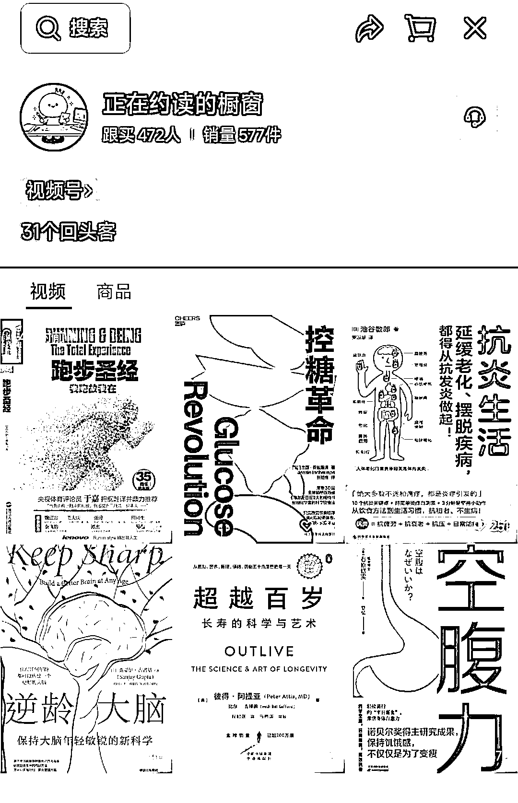
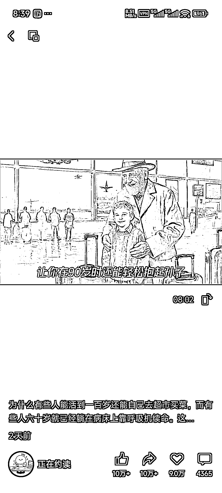

# 只发 6 条就卖出 500 多单：这个视频号案例，值得拆解

> 原文：[`www.yuque.com/for_lazy/zhoubao/zo4p44mb9apaxhe9`](https://www.yuque.com/for_lazy/zhoubao/zo4p44mb9apaxhe9)

## 只发 6 条就卖出 500 多单：这个视频号案例，值得拆解

作者：白杨

日期：2025-11-08

视频号｜商品转化｜智能内容生产

最近在视频号里看到一个很有意思的账号：内容几乎由人工智能参与完成，注册运营才没几天，累计成交已经超过 500 单。

更夸张的是，账号目前只发布了 6 个作品，其中已经出现明显的高传播内容，单条点赞突破 10 万。

把作品放在一起观察，会发现它们并不是每次重新设计，而是沿用了同一套表达框架：

- 画面采用多张图片依次展示；
- 音频部分围绕书籍内容进行解读；
- 视觉风格、叙事节奏和选题呈现都比较统一。

这类内容的优势在于，制作环节相对标准化。先让智能模型完成选题和脚本，再按照段落拆解画面需求，批量产出配图，最后完成旁白、字幕与成片组合。只要把这些步骤连接起来，理论上就能搭建出一条可反复调用的生产链路。

当然，实际耗时并不一定像表面看起来那么低。有人反馈，单是整理画面素材就可能耗去较长时间，图片还需要逐张处理，脚本准备也不能忽略。另一种思路是把选题、内容拆解、画面制作和后期合成集中到自动化流程中，降低重复劳动。该账号目前保持着较高的发布频率，基本每天都会更新数条内容，后续表现也值得持续观察。

* * *

评论区：

龙哥：感谢分享，已中标

天使陷落：他这类作品，光整理图片素材可能就要耗上不少时间，而且还涉及逐张制作，脚本准备同样费工，整体投入恐怕不低。

白杨：可以让智能模型先完成脚本，再按照内容段落提出画面需求，批量产出配图，随后统一完成旁白、字幕和成片处理。这样看，整个制作链条都有机会被整合进自动化流程里。他最近发布得挺勤，基本每天都会发几条。

天使陷落：他展示的成片长度大约十几分钟，我自己做一条五分钟左右的内容，后期通常就要投入一小时以上，前面的脚本准备还没算进去。