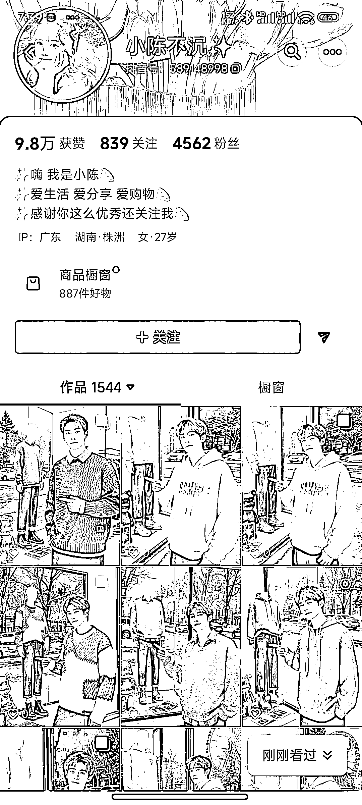
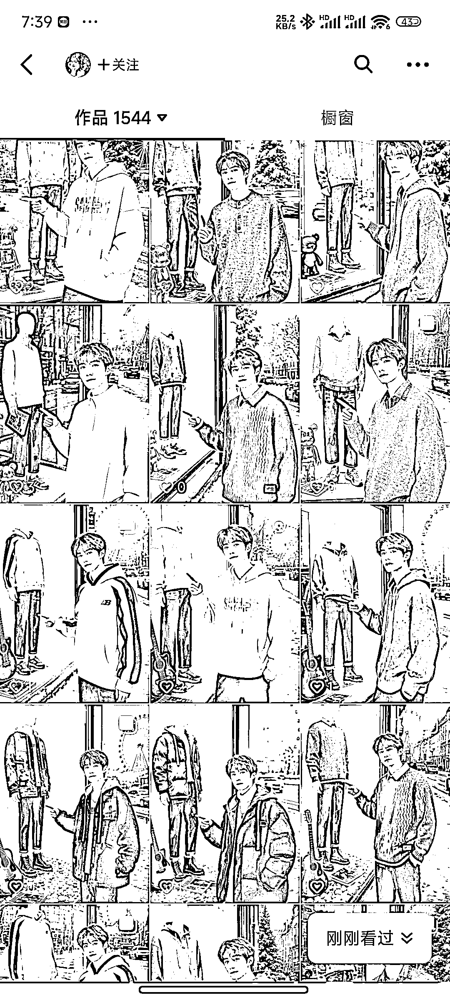
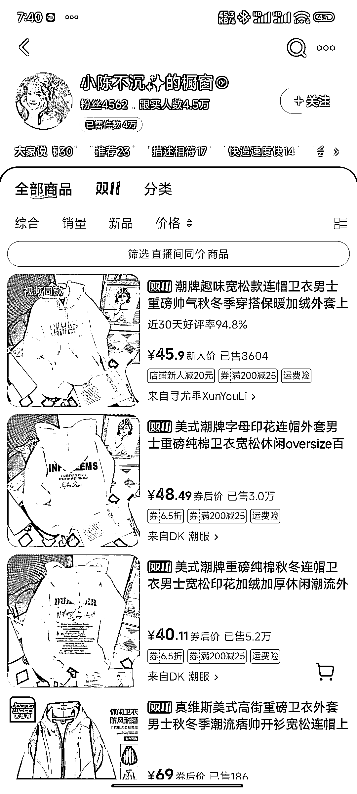

# (27 赞)刷到一个靠 AI 服装图文起号的玩法，多平台矩阵做带货和付费，收益很可观

> 原文：[`www.yuque.com/for_lazy/zhoubao/cgg9rxsv4b0cr9l4`](https://www.yuque.com/for_lazy/zhoubao/cgg9rxsv4b0cr9l4)

## (27 赞)刷到一个靠 AI 服装图文起号的玩法，多平台矩阵做带货和付费，收益很可观

作者： 浮生若梦

日期：2025-11-09

今天在抖音上偶然看到一个用 AI 做服装图文的账号。思路很直接，就是用 AI 把模特穿搭和对应的服饰商品结合起来生成配图，一个作品里会放出好几个不同的视角。素材靠 AI 工作流批量化产出，然后分发到抖音、快手等多个平台。

更关键的是可以做矩阵，多个号一起跑，每天保持 5 条左右的稳定更新。挂上橱窗做带货，转化和利润都相当可观。甚至还能把这个方法本身包装成卖点，做知识付费变现。感兴趣的朋友可以自己深入了解一下。

* * *

评论区：

龙哥 : 感谢分享，已中标