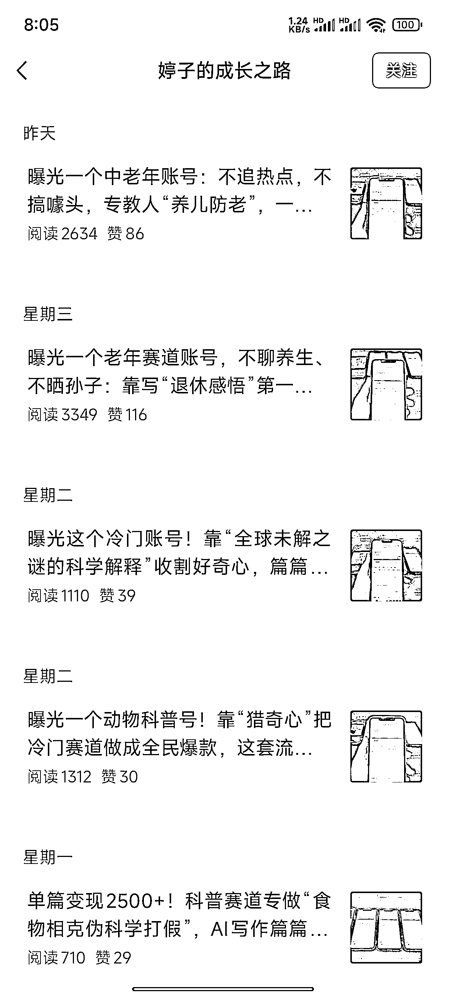
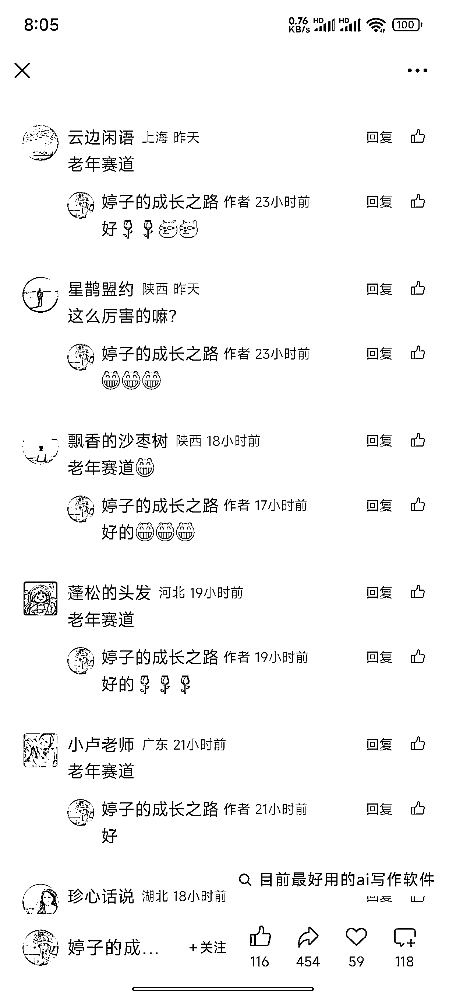
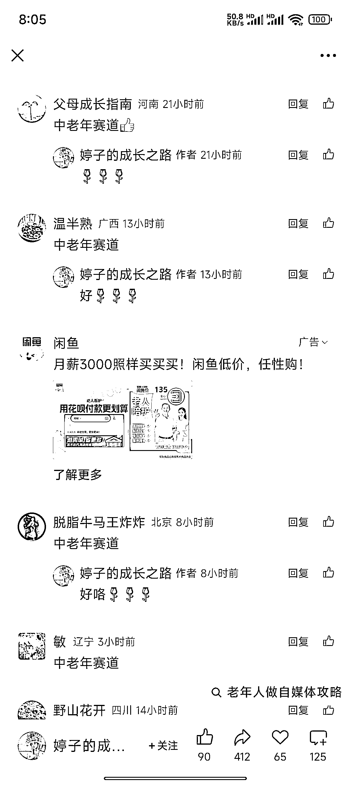

# ('(28 赞)公众号垂直小号：分享赛道选择，多种变现方式来了', (2, 31))

最近在刷赚钱周报时，挖到一个很有意思的公众号玩法，忍不住想拿出来聊聊。

这是一个垂直领域的小号，专门分享“公众号赛道怎么选”这类内容。别看单篇阅读量只有小几千，但评论区异常热闹，转发和互动数据都很亮眼。从评论区的留言情况来看，大家主动加过来的意愿不低，引流效果相当可观。

更值得关注的是它的变现路径，并不是单一靠流量主。作者围绕这个垂直定位，延伸出了公众号陪跑、私教、课程等服务。甚至随手发一份网盘资料包，都能顺便赚一笔网盘拉新的佣金，属于典型的“一鱼多吃”。

在评论区里，还有几个很有价值的补充观点：

有人提出，既然很多新手卡在赛道选择这一步，尤其是不在赚钱圈里的人，做公众号时往往更迷茫，那是不是可以整理出100个不同赛道的对标账号，打包卖个9.9或19.9？这个思路听起来门槛不高，应该能跑得动。

也有人说，自己前两天刚刷到这个账号，发现他们的课程定价并不低，直接到了1980元，可见这个需求的付费意愿是被验证过的。

不过也有实操者现身说法：自己也做过100个对标账号的小报童，目前才卖出200份左右。原因在于很多新手根本意识不到对标账号的重要性，所以光做产品还不够，还得加大科普力度，不断强化用户对这个价值的认知。

这个细节其实挺有启发：方向是对的，但市场教育不能省。

感谢分享，已中标。

