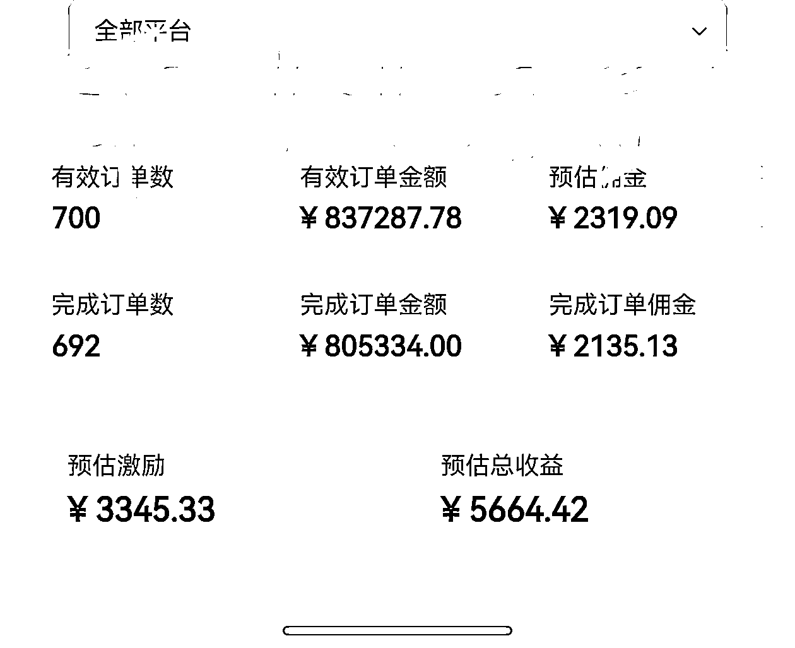

# 从开机都费劲的47岁裁缝店老板，到一个月抖音自然流 CPS 撬动83万 GMV，这位“人生新手”的第一次清单

作者：平凡之路

2025-12-09

我开了23年实体服装店，打了一辈子鱼，和电脑的唯一关系就是能顺利开机。今天我想把一个有点不可思议的30天，摊开来讲给圈里兄弟姐妹听。

47岁，我的人生关键词本来是“稳定”。直到最近，我把钓鱼竿收进柜子，整个人all in进了一个我完全陌生的世界。

时间线很短，但每一步对我来说都是第一次：

10月16号，我走进生财。
10月21号，我第一次上航海。
10月31号，我的第一笔佣金到账，0.01元。
11月14号，我的抖音 CPS 自然流，GMV 冲破83万。

很多人问我0.01元有什么好激动的。对我来说，那不是收入，是信号。那个信号告诉我：一个我从未设想过的门，正一点点为我打开。

从一个面对13寸屏幕就会手足无措的电脑小白，到现在能靠自然流跑出真实GMV，中间没有捷径，只有不断的“第一次”。第一次建号，第一次剪视频，第一次挂链接，第一次被拒，第一次成交。

我想把这段从0到1的实操心路和踩坑感悟整理出来分享出来。不是为了炫耀数字，而是想告诉还在观望的你：跨出那一步的那一刻，人生就开始重新计算可能性了。

愿我们都能走通自己的0-1，也愿你的世界里，出现属于你的那道0.01元的光。

详细复盘和操作笔记，我放在了飞书：[`ai.feishu.cn/wiki/LslewFdRiijVt9kXduicJgxonNg?from=from_copylink`](https://ai.feishu.cn/wiki/LslewFdRiijVt9kXduicJgxonNg?from=from_copylink)

* * *

读者互动精选：

怡然 : 文笔太燃了！“面对不到13寸的屏幕，比面对200平米的仓库更没底气”这句话把我泪点了，大哥的魄力和执行力真的顶！

平凡之路 : 动力全来自怡然教练那句话：不懂没关系，按教练说的做就行了。做了，总比原地不动强。

亦仁 : 传说中的钓鱼大叔不钓了？是上瘾了啊[呲牙]

三点 : 太有共鸣了。最近有点emo，看到大哥的经历瞬间被点燃，“做了就比不做强”今天第二次被触动，很有力量！

渝小高 : 太炸了！为大哥重新出发的勇气点赞👍🏻👍🏻👍🏻

平凡之路 : 现在确实没空钓鱼了，搞钱这事比钓鱼上头多了。

纪钟 : 体验营那会儿聊到半夜我还担心底子太差学不会，大哥的话证明了时间真的会改变一切，一个月质变，真的太神了[强]

L!N/林林/小林 : 感谢大哥分享！期待听听你前半生的故事，真实的经历比成功学更有用！[抱拳][抱拳][抱拳]