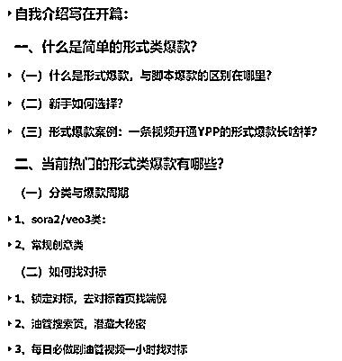
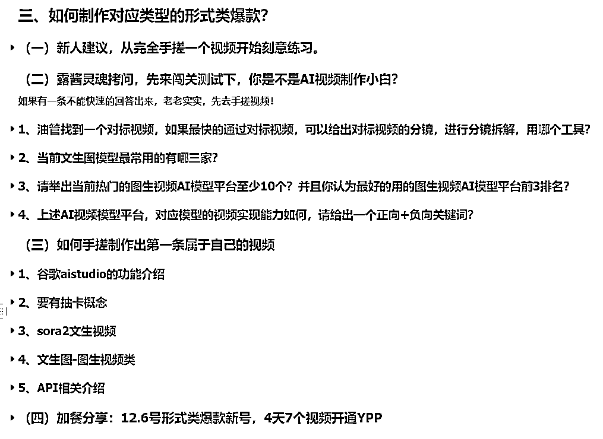
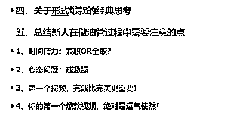

# 新手入门指南：从零掌握油管“形式类爆款”，一步步做出高播放视频

**作者：露酱**  
**日期：2025-12-10**  
**精华帖｜244赞**

如果你想做 YouTube，却还停留在“想开始但不知道从哪里下手”的阶段，这篇内容非常适合你。

大家好，我是龙哥，目前主要在深耕 YouTube 项目，同时负责油管深海圈的带货板块，也担任本次油管航海活动的答疑教练与直播教练。

回想去年这个时候，我也和现在许多新朋友一样，第一次参加赚钱的油管航海。那时同样充满疑问，对平台、内容和操作流程都没有清晰概念。一路走到现在，才逐渐摸索出一套相对完整的方法。

所以，这次整理的“形式类爆款”教程，主要就是为刚入门的朋友准备的。

无论你是：

- 还没有正式开始做 YouTube；
- 已经注册账号，但迟迟没有发布内容；
- 刚开始尝试，面对选题、制作和发布流程一头雾水；

都可以把这篇内容当作一份入门手册来参考。

文章会从形式类内容的基本逻辑讲起，再延伸到视频制作、发布以及运营过程中的具体执行方法，并配有详细的视频操作演示，尽量把每个步骤拆开讲清楚，让新手也能跟着完成。

希望这份分享，能帮助曾经和我一样迷茫、满脑子问号的新人，少走一些弯路，尽快从“了解项目”进入到“真正动手”。

另外，本次还特别补充了最新案例：

**12月6日启动的形式类爆款新账号，仅用4天、发布7条视频，就成功开通 YPP。**

这部分内容还包含一套速通教程，想了解具体操作路径的朋友，也可以重点关注。

详细内容请查看飞书文档：  

---

## 圈友反馈

**蟹老板：**  
这篇内容对新手特别有帮助，既梳理了形式类爆款的整体生态，也把视频制作流程一步步拆解出来。现在做 YouTube，前期入门确实比以前顺畅多了，感谢露酱教练的分享。

**晓风：**  
收获很大，感谢露酱教练。

**孤月大叔：**  
对刚开始做的人来说，真的非常友好。

**Gary 曹淦丨 AI 内*：**  
能看出来露酱为了让大家真正理解，虽然一边说着累，却还是不断补充操作视频。文章写完后，圈友提出新问题，她又继续研究新方向、录制新教程。单独把这篇内容拿出来做成一套课程，完全不夸张，这就是认真负责的露酱老师。

**露酱：**  
[捂脸][捂脸]

**壹欧壹：**  
太需要这样的教程了，刚好可以补上内容产出不足的问题。

**韬：**  
感谢露露老师。

**北方：**  
非常感谢露酱教练。这几天一直在看回放、整理笔记，接下来还准备再复习一遍，确实是温故而知新。