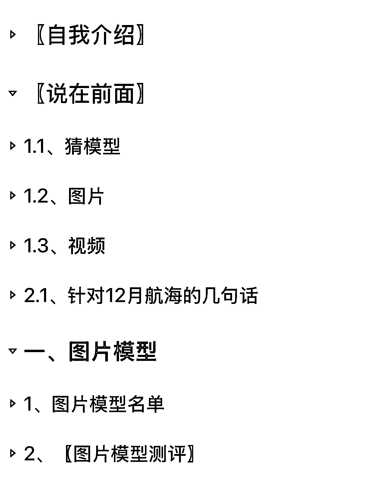
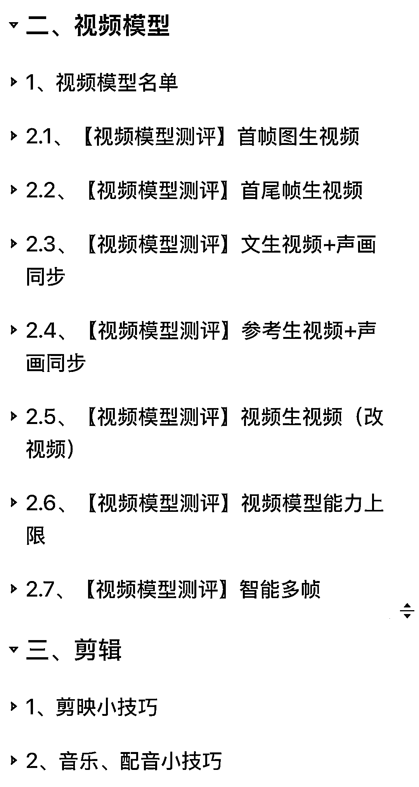

# (精华帖)(145 赞)《12 月 AI 图片&视频模型应用场景测评：AI 内容创作从入门到精通》20251212 更新
作者：龙哥

《12月AI图片&视频模型实测：从入门到进阶，一篇讲透》20251212更新

大家好，我是龙哥。年初加入赚钱，三月份投身油管航海，五月进入深海圈，如今担任答疑教练。早年辗转于外企设计院、广告公司、互联网大厂，也做过抖音电商创业，现在全职做油管。

目前手里运营着六个高级ypp账号，特别擅长10-20秒短脚本的微创新。无论是微创新还是原创简单脚本的单视频，都有过shorts破亿播放的经历。

从今年七八月开始，我就在持续更新这篇模型测评帖。到2025年12月这版，已经做了三次比较大的迭代。这几个月反复测试下来，确实观察到不少模型细节上的变化，也看到了一些值得关注的发展趋势，今天整理出来分享给大家。

这是我头一回在赚钱发帖，短短几个月里已经迭代了三轮。原因很简单——AI模型的迭代速度快得惊人，而每次大版本更新，往往都意味着某些赛道要重新洗牌。

我特别希望这篇内容能帮到正在做AI视频的朋友，尤其是刚入门的新人。与其自己一个人反复试错、耗费大量时间和金钱，不如借着这份测评快速建立起有效的认知框架。看懂模型的脾气，研判未来的演化方向，脚下的路自然会好走很多。

详细内容放在飞书文档里：

对应直播在25年12月YouTube航海高手领航中，链接如下：

评论区里不少朋友说：现在AI大模型五花八门，API接口也铺天盖地，有了这份帖子，能少走很多弯路，也能少烧很多算力卡。这正是我写这篇测评的初衷。