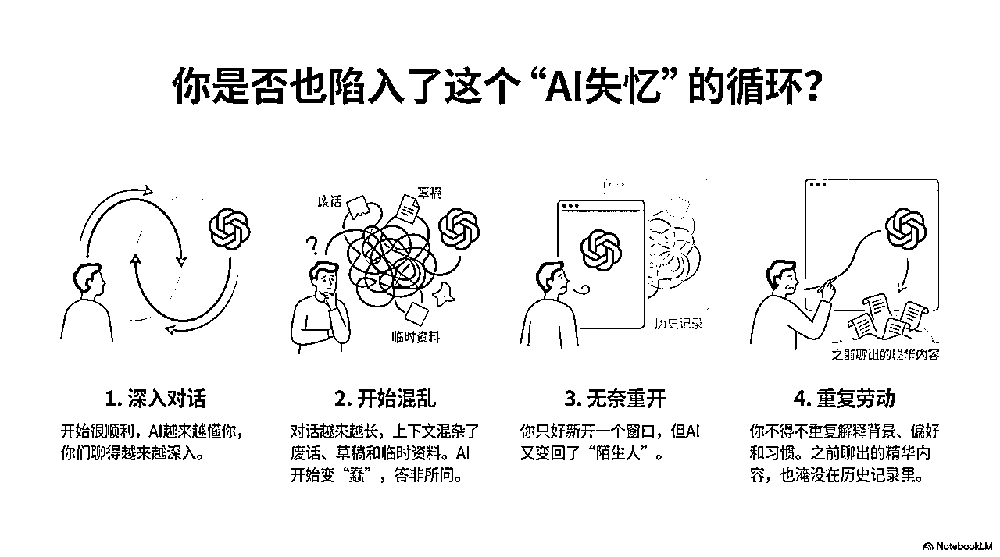
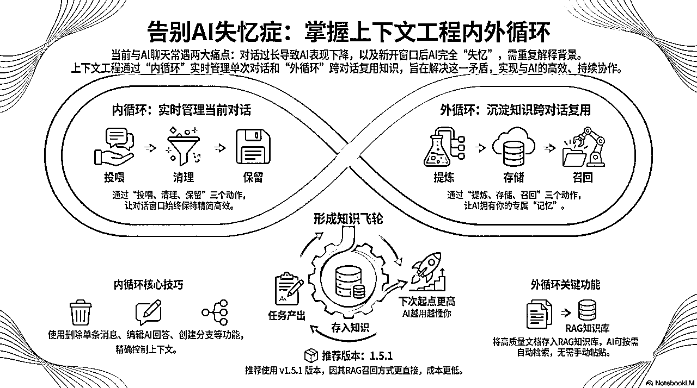

# 普通人也能掌握的上下文工程：让你的每一次 AI 对话都产生复利效应
作者：龙哥

## 普通人也能掌握的上下文工程：让你的每一次 AI 对话都产生复利效应

作者：夙愿学长
发布日期：2025-12-12

大家好，我是龙哥，一名资深传术师。02年大学毕业后至今，我在一家专注企业AI转型的咨询机构负责AI产品研发与智能体落地工作。

Vibe Coding 的热潮刚过，圈子里又刮起了一股新的风——Context Engineering，上下文工程。它到底有多受重视？以 Shopify 为例，他们在发布招聘需求之前，第一步不是撰写 JD，而是先判断这个岗位能否通过 AI 加上上下文工程来替代。若能替代，便直接取消招聘。

为何这个概念会突然爆火？

核心原因很简单：当前大语言模型的能力天花板愈发明显，单纯寄望于“下一个更强的模型”来解决问题已不现实。行业的竞争重心，正从“打造更强的模型”转向“把现有的模型用好”。然而在我们个体的使用层面，现状却相当不理想。

当一个对话的上下文变得过长时，大多数人的第一反应是：关掉重开一个新窗口。可问题在于，新窗口里的 AI 仿佛又变成了第一次见面的陌生人。你之前在旧窗口里耗费大量精力才让它吃透的业务背景、个人偏好、使用习惯，全都清零了。

这正是普通人使用 AI 时最核心的痛点。

所以这篇文章诞生了，它的使命就是帮你彻底打破这个瓶颈。

先说个实话，这篇内容不算短，全文约16500字，阅读下来大概需要三十分钟。但如果你每天都在与 AI 打交道，这三十分钟的投入回报率会非常高。

因为它解决的是一个高频发生的日常难题：如何让 AI 记得你、懂你、越用越顺手。

我把过去几个月自己实战摸索出的完整工作方法论全部摊开了写。从基础概念的拆解，到可落地的操作技巧，再到具体的工具配置方案，最后延伸到个人知识库的搭建。只要你跟着一步步实践，我相信你与 AI 的协作模式会产生质变。

如果你觉得这篇内容对你有价值，欢迎点个赞让我知道。

* * *

读者互动：

四夕 : 内容太扎实了，外循环的思路很有数据沉淀的味道，会不断积累高质量素材

及时雨℃ : 我每次用完 GPT 都习惯让它把整段对话存进记忆里，说以后所有对话都保留。我一直这样操作，它好像都记得

夙愿学长 : GPT 的记忆能力终究是有限度的

shu.p. : 感觉 GPT 在这类任务上确实要聪明一些

刘璐 : 文章还没细看，但问题确实存在。GPT 多轮聊下来就会开始卡顿，记不住之前的上下文，导致后续对话出现偏差。

啊喂王默 : 干货满满

好运. : 哈哈为什么偏偏要用无序列表，太有共鸣了